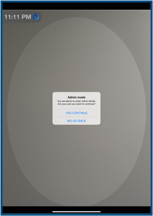
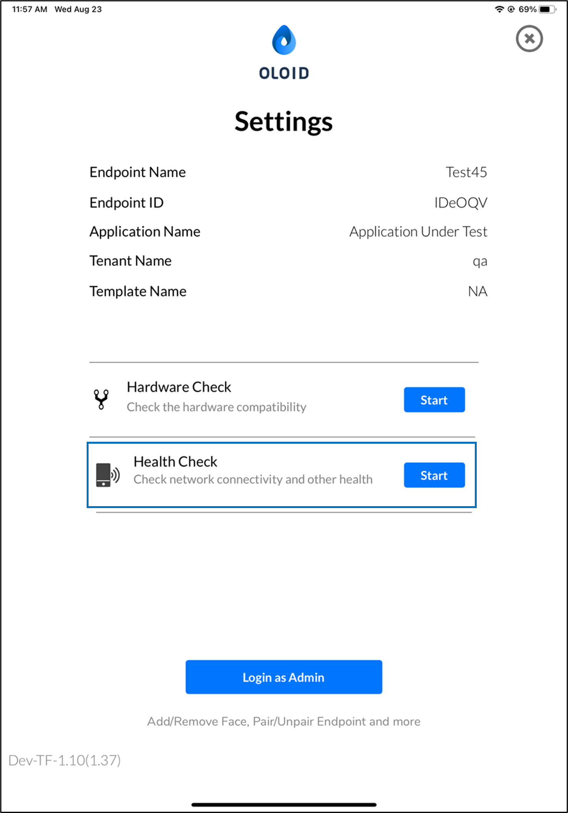
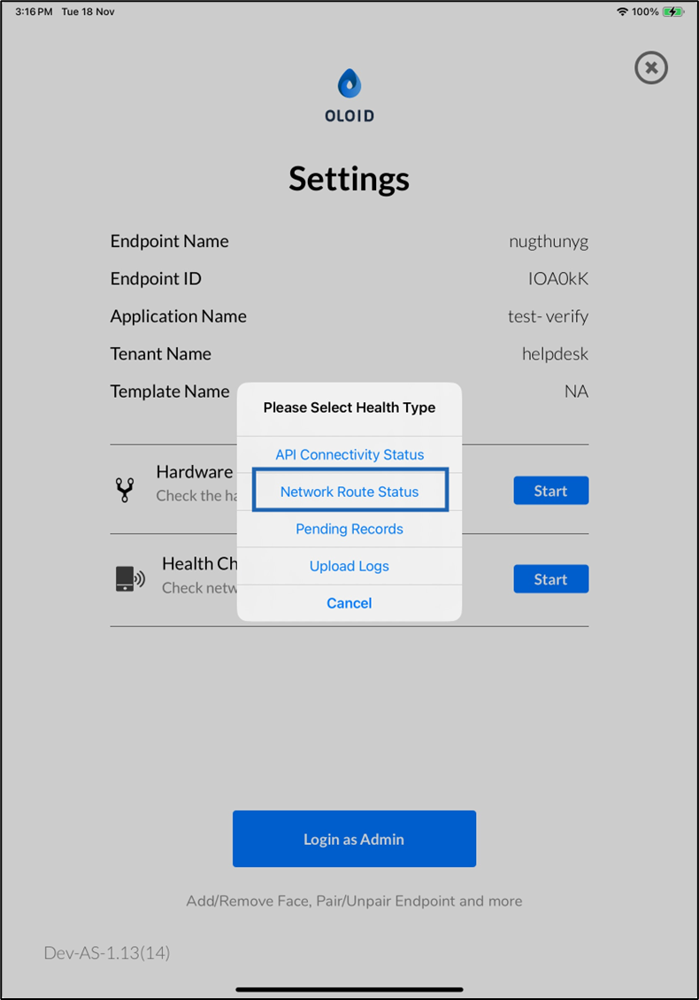
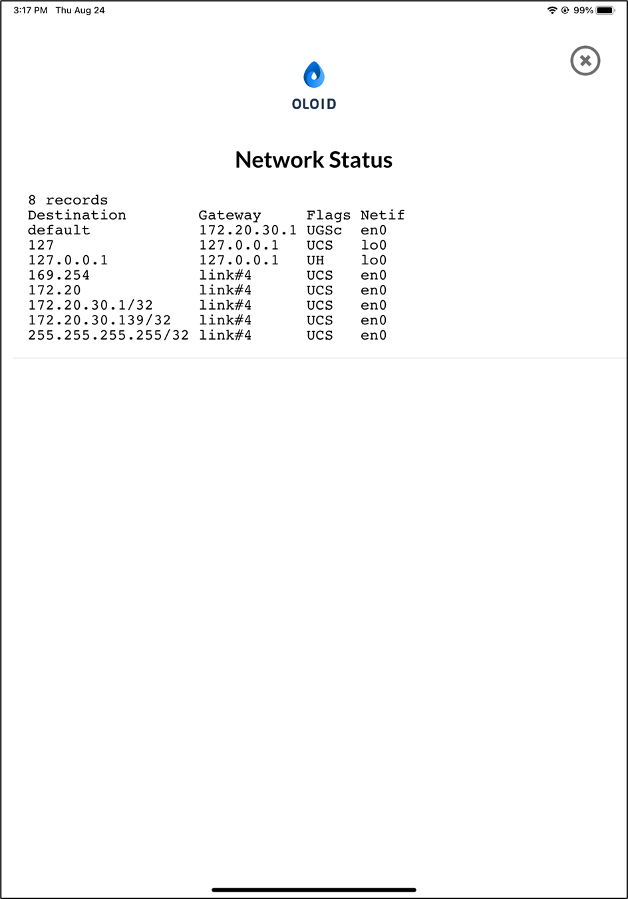

{/* Source: Intercom article 8612537 - https://oloid.help/en/articles/8612537-oloid-verify-how-to-test-network-connectivity-status-on-the-endpoint */}
{/* Generated by intercom_to_mintlify.py - re-running overwrites this file. */}

## Introduction

The Network Connectivity test feature in the Oloid Verify App allows Admin and Supervisor to quickly check endpoint network status. This helps diagnose connectivity issues and ensures that the device can communicate with the configured application.

## Prerequisites

- You must have a Tenant Admin account.
- You must complete the Admin Setup. To setup refer [Oloid Verify: Admin Setup.](/platforms/ios/time-clock/oloid-verify/oloid-verify-how-to-complete-admin-setup)

## Step to test network connectivity status on the endpoint

1. Launch Oloid **Verify** App.

   

   The Preview screen is displayed.
2. **Double-tap** on the Preview screen with two fingers.

   <Note>
     **Note:** You can see Preview screen after the Oloid Verify App is paired with the endpoint.
   </Note>

3. Tap **YES-CONTINUE** to log into **Admin Mode**.

   

   The **Settings** screen is displayed.
4. On the **Settings** page, tap **Start** in **Health Check** section.

   

   The **Please Select Health Type** pop-up box is displayed.

On the pop-up box, tap **Network Route Status**.

The **Network Status** page is displayed.

---

##### SEO Keywords

|Oloid Verify network connectivity test | Check network status in Oloid Verify | Oloid Verify endpoint network test|
