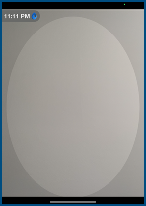
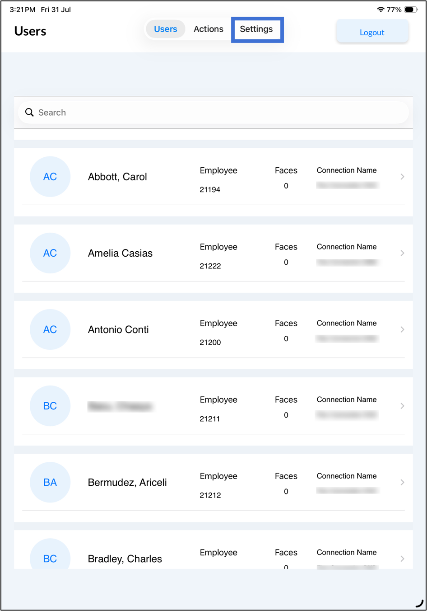
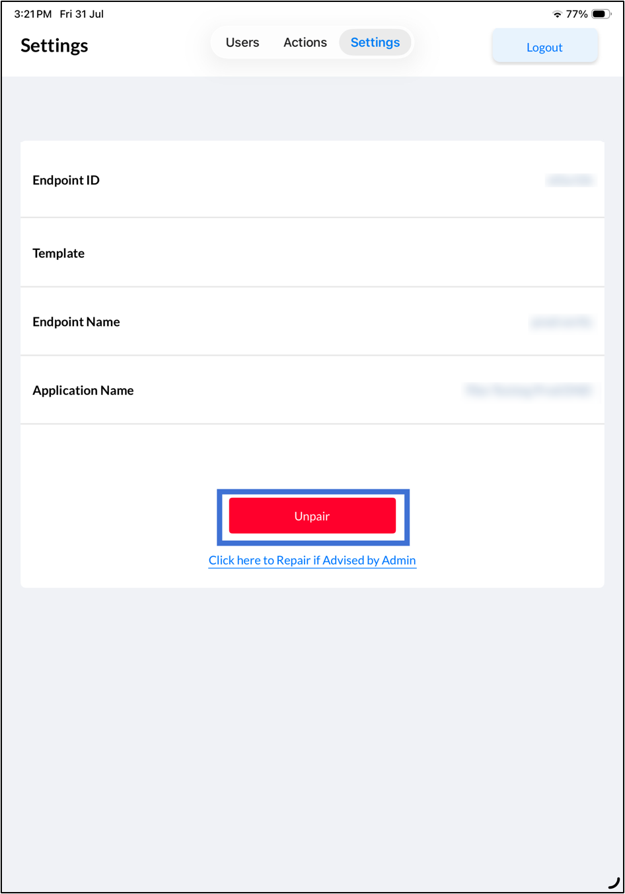
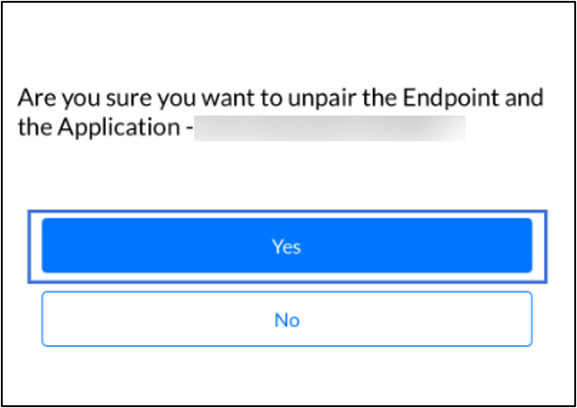
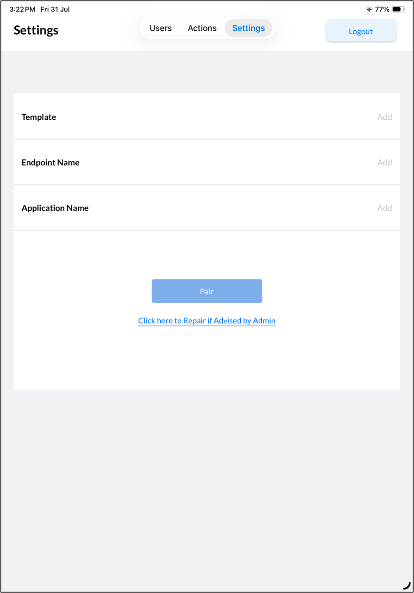

{/* Source: Intercom article 16159090 - https://oloid.help/en/articles/16159090-oloid-verify-how-to-unpair-endpoint */}
{/* Generated by intercom_to_mintlify.py - re-running overwrites this file. */}

## Introduction

This document explains how to unpair an endpoint using the **Oloid Verify** application.

## Prerequisites

- The Oloid Verify endpoint must be paired. For more, refer to [Oloid Verify - How to Pair an Endpoint](/platforms/ios/time-clock/oloid-verify/oloid-verify-how-to-pair-an-endpoint)
- You must have Tenant Admin or Supervisor access.

## Steps to Unpair Endpoint

1. Launch the **Oloid Verify App**.

   <Note>
     **Note:** Since the endpoint is already paired, the App will launch in the preview screen of the App. For more, refer to [Oloid Verify - How to Pair an Endpoint](/platforms/ios/time-clock/oloid-verify/oloid-verify-how-to-pair-an-endpoint)
   </Note>

   

2. Log in to Admin mode. For more refer to [Oloid Verify - How to Log In to Admin Mode as an Admin or Supervisor](/platforms/ios/time-clock/oloid-verify/oloid-verify-how-to-log-in-to-admin-mode-as-admin-or-supervisor)
   The **Users** page is displayed.
3. Tap **Settings**.

   

   The **Settings** page is displayed.
4. Tap **Unpair**.

   

   The confirmation pop-up box is displayed.

Tap **Yes.**

The Oloid Verify Endpoint is unpaired successfully.

