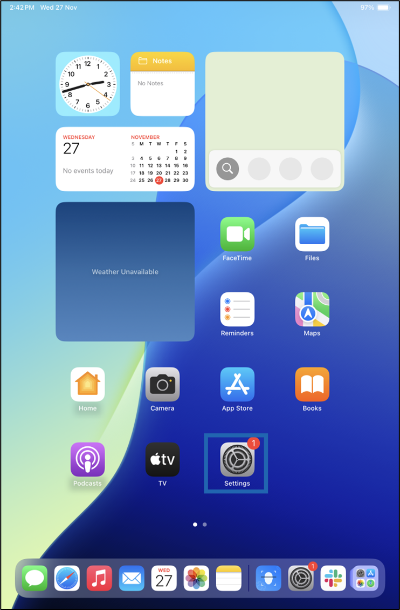
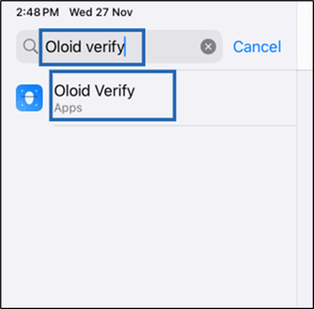
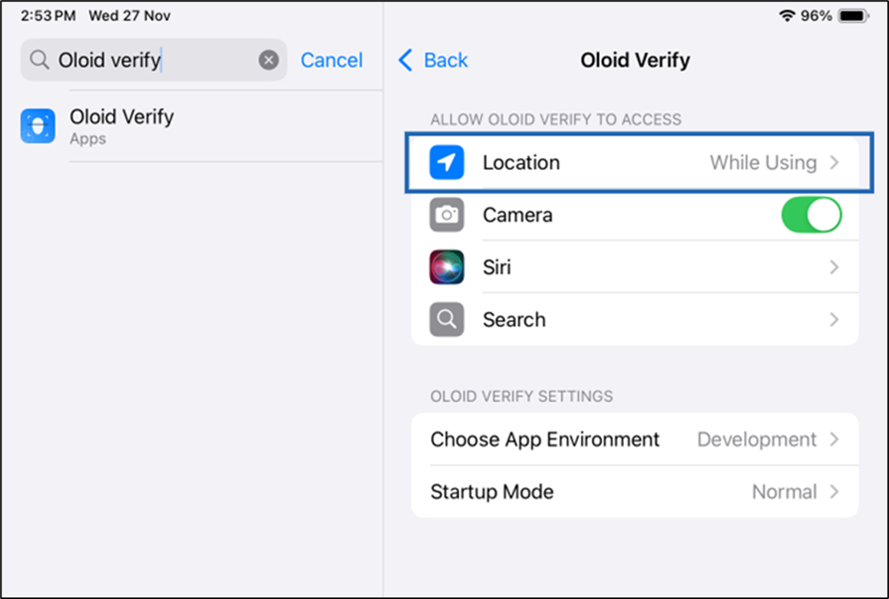
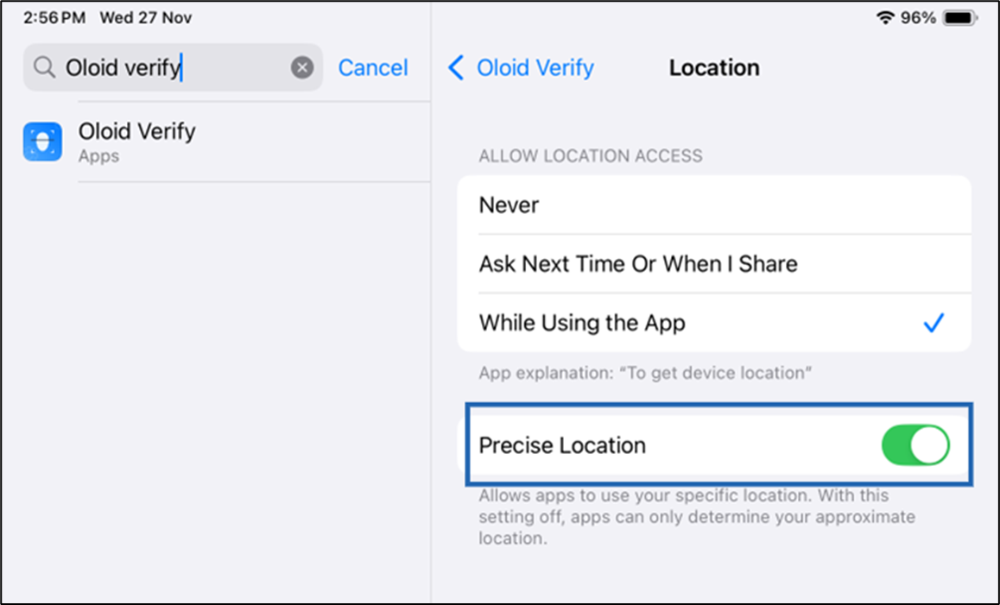

{/* Source: Intercom article 10204617 - https://oloid.help/en/articles/10204617-oloid-verify-how-to-update-location-permission-on-ipad */}
{/* Generated by intercom_to_mintlify.py - re-running overwrites this file. */}

## Introduction

This document explains how to update the location permission for the Oloid Verify app on iPad.

## Prerequisite

You must have the Oloid Verify app installed on the iPad. For more, refer to [How to Download and Install the Oloid Verify App](/platforms/ios/time-clock/oloid-verify/oloid-verify-how-to-download-and-install-the-app)

## Steps to update location permission

1. Go to **Settings** in **iPad**.

   

   The Settings menu is displayed.
2. Search **Oloid Verify App** and open.

   

   The Oloid Verify app menu is displayed.
3. Tap **Location**.

   

   The **Location access** menu is displayed.

   

4. Select **an option.**
   - **Never:** The app cannot use your location, even when you’re using the app.
   - **Ask Next Time Or When I Share**: Every time you open the app, it’ll ask to use your location.
   - **While Using the App:** The app can use your location only when you're using that app.
5. Enable **Precise Location** to allow the app to detect your specific location.

   <Note>
     **Note:** Precise Location option appears when you allow location access.
   </Note>

   The location is updated successfully.
