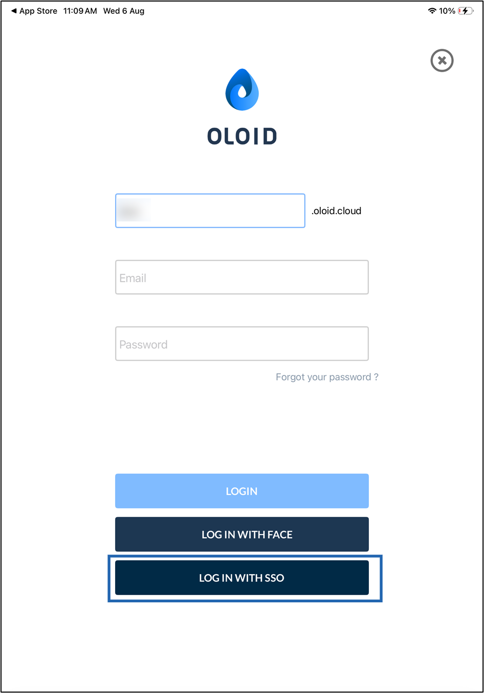
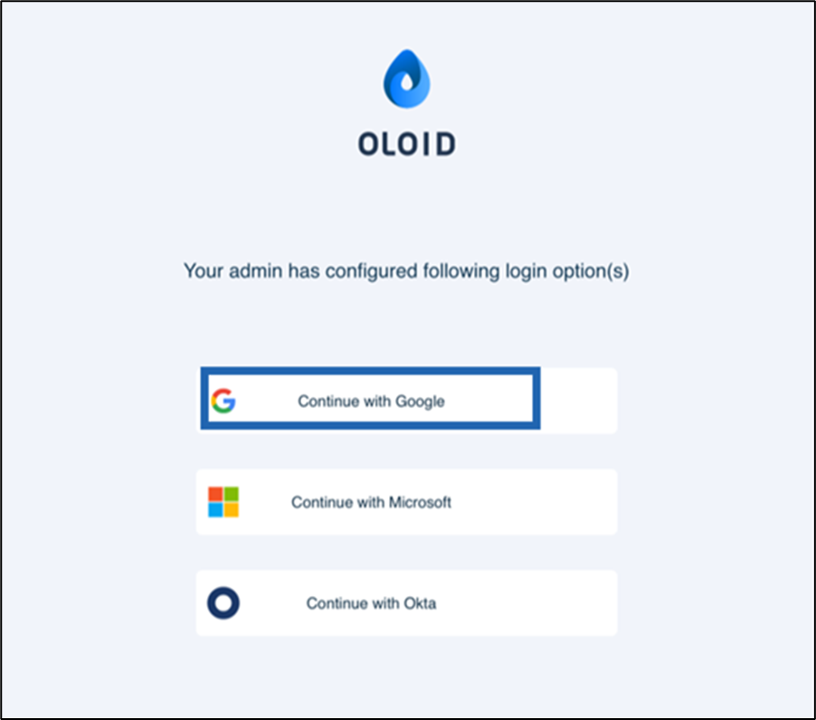
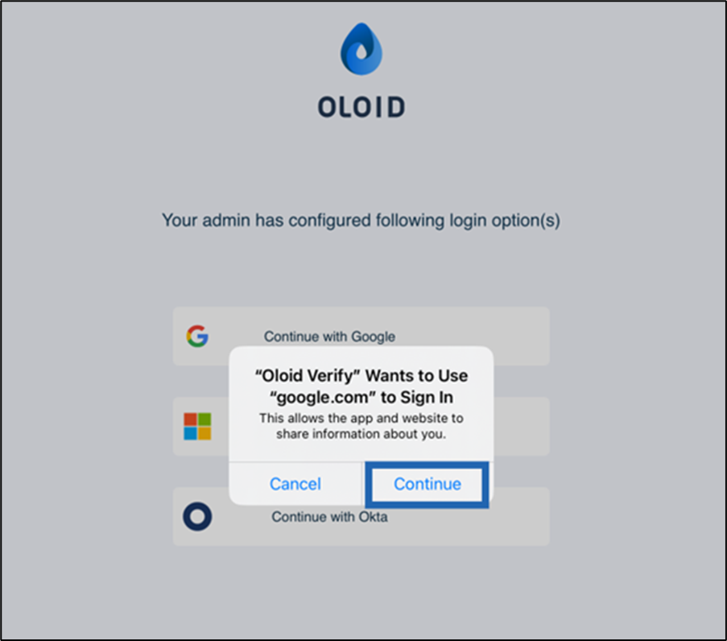
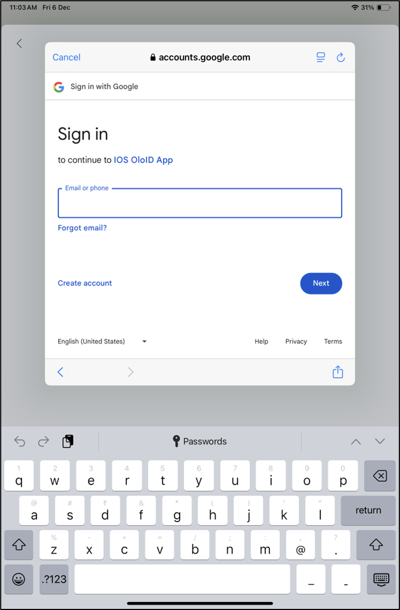
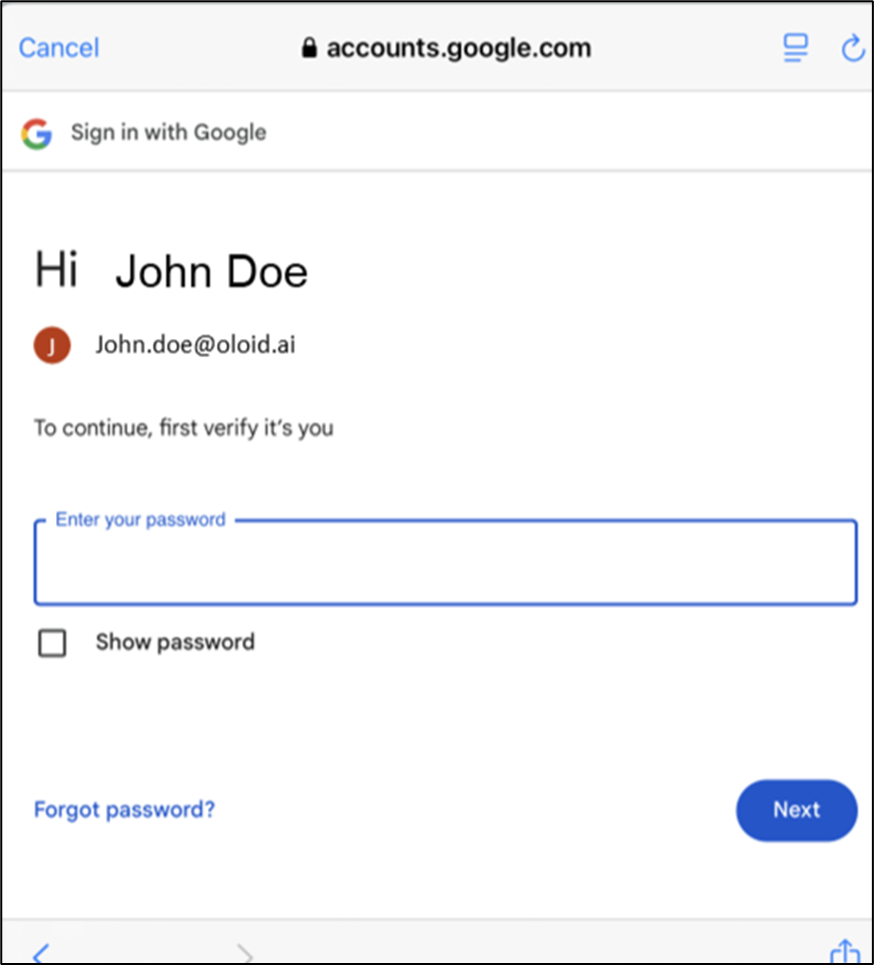

{/* Source: Intercom article 10247971 - https://oloid.help/en/articles/10247971-oloid-verify-login-using-google-sso */}
{/* Generated by intercom_to_mintlify.py - re-running overwrites this file. */}

## Introduction

The Google SSO Login feature in the Oloid Verify App allows Tenant Admin and Supervisor to securely access Admin Mode using Google SSO credentials.

## Prerequisites

You must have a Tenant Admin account.

## Steps to login with Google SSO

1. Launch the **Oloid Verify** App.
   The Login screen is displayed.
2. On the login screen, tap **Login with SSO**.

   

   The screen with **SSO options** are displayed.
3. Tap **Continue with Google**.

   

   The confirmation pop-up box is displayed.
4. Tap **Continue**.

   

   The **Sign in** page is displayed.
5. Enter **Email ID** > tap **Next**.

   

6. Enter **Password** > tap **Next**.

   

   You are logged in to Admin Mode in Oloid Verify using Google SSO successfully.

---

##### SEO Keywords

Oloid Verify Google SSO | Google SSO login Oloid Verify | Login with Google in Oloid Verify
