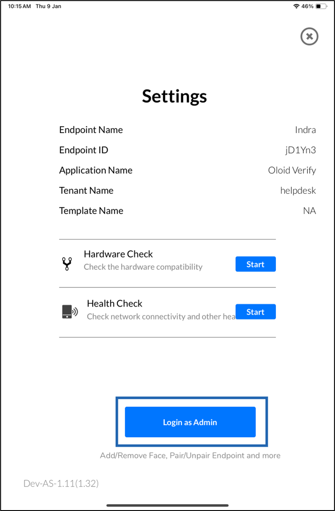
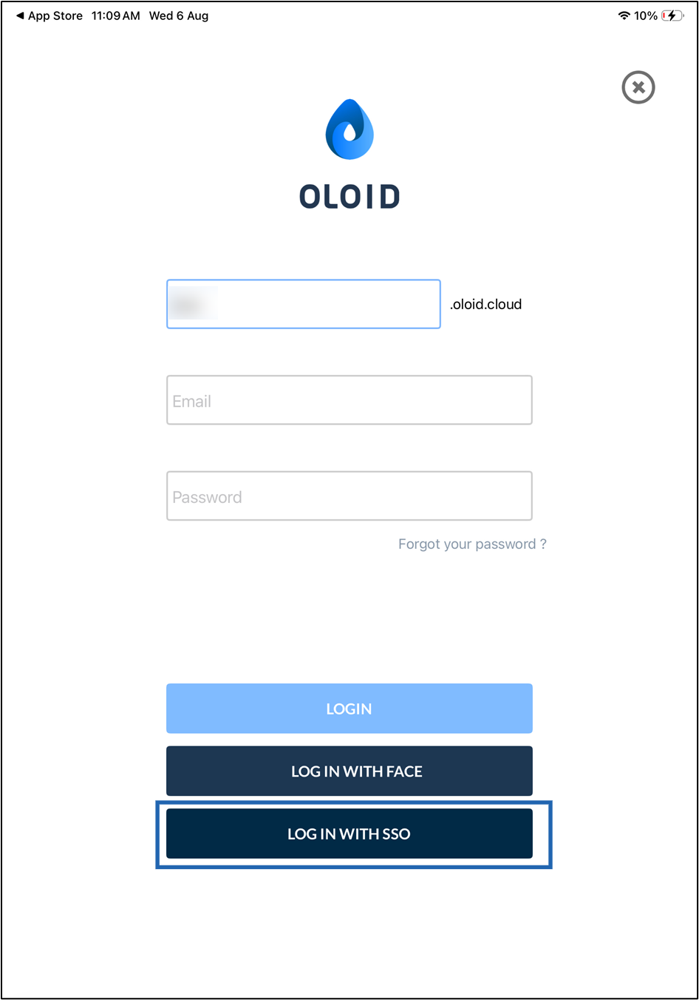
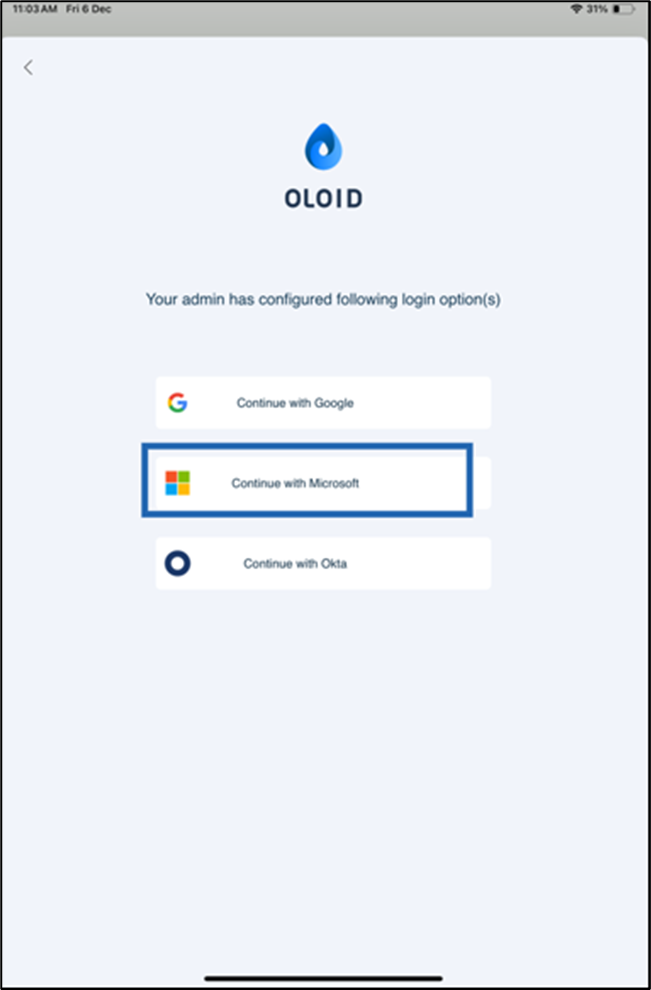
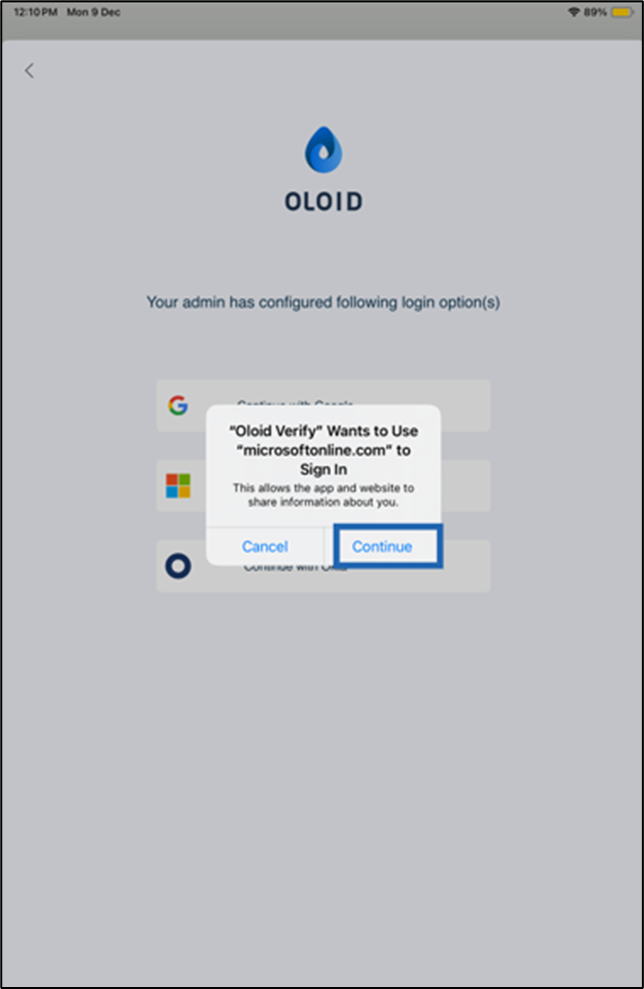
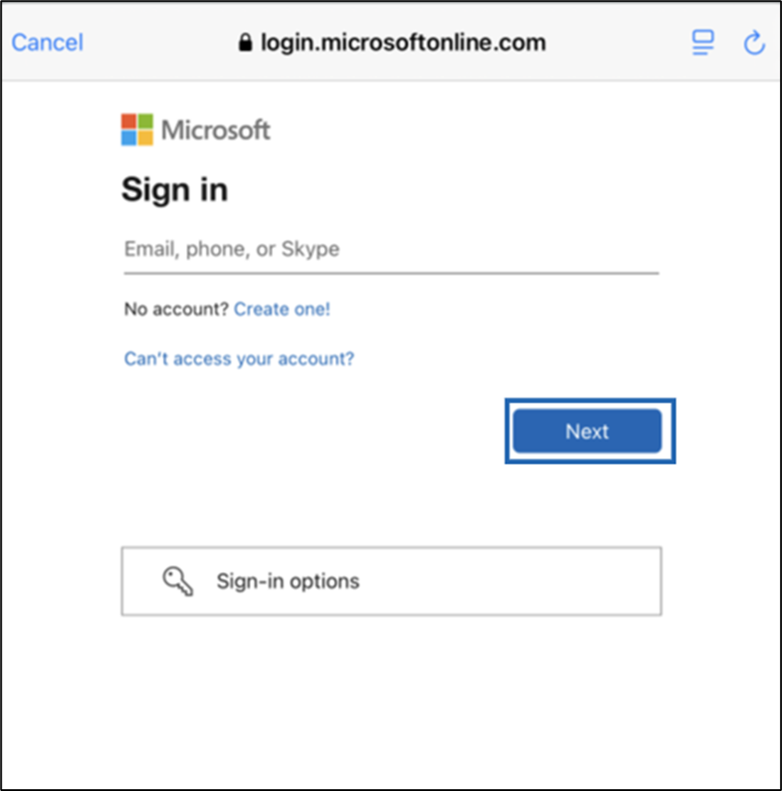
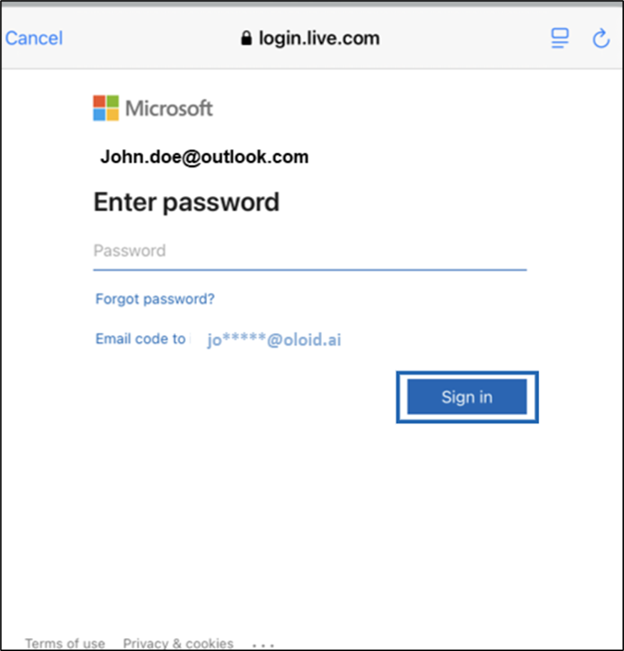

{/* Source: Intercom article 10255679 - https://oloid.help/en/articles/10255679-oloid-verify-login-using-microsoft-sso */}
{/* Generated by intercom_to_mintlify.py - re-running overwrites this file. */}

## Introduction

The Microsoft SSO Login feature in the Oloid Verify App allows Tenant Admin and Supervisor to access Admin Mode using Microsoft credentials.

## Prerequisite

You must have a Tenant Admin account.

## Steps to log in with Microsoft SSO

1. Launch the **Oloid Verify** App.
   The **Settings** screen is displayed.
2. Tap **Login as Admin**.

   

   The Login screen is displayed.
3. On the login screen, tap **Login with SSO**.

   

   The screen with **SSO options** are displayed.
4. Tap **Continue with Microsoft**.

   

   The confirmation pop-up box is displayed.
5. Tap **Continue**.

   

   The **Microsoft Sign in** page is displayed.
6. Enter **Email ID** > tap **Next**.

   

Enter **Password** > tap **Sign in**.

You are logged in to Admin Mode in Oloid Verify using Microsoft SSO successfully.

---

##### SEO Keywords

7. |Oloid Verify Microsoft SSO | Oloid Verify SSO login | Microsoft SSO Admin Mode|
