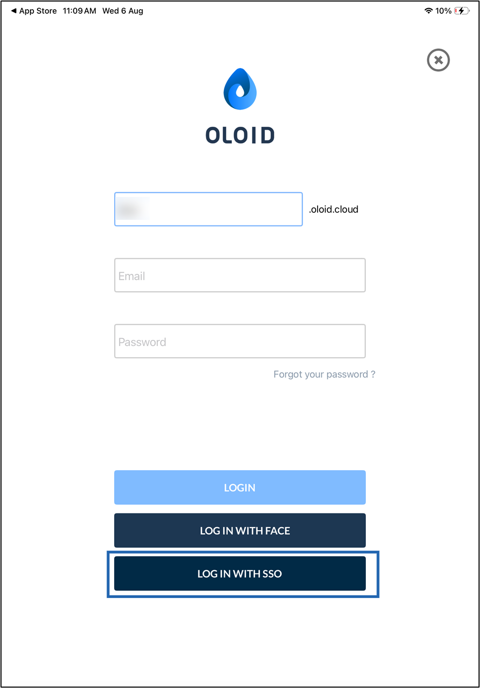
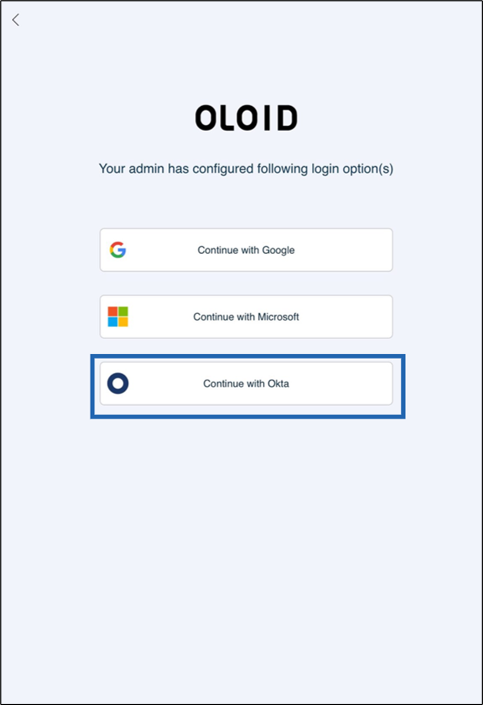
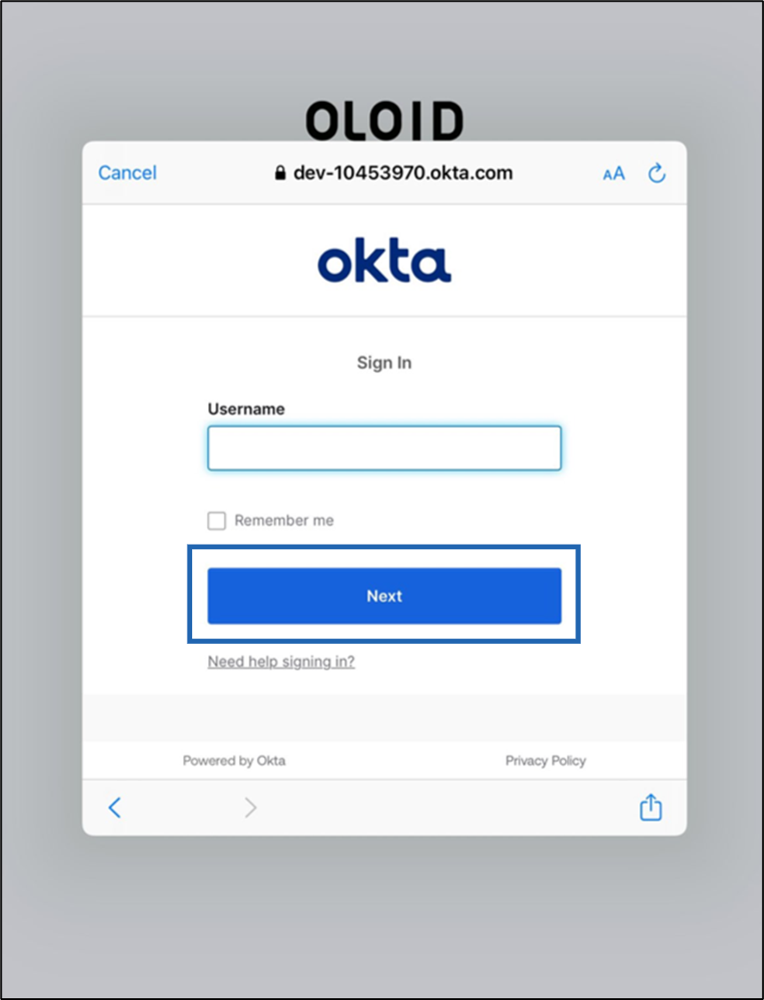
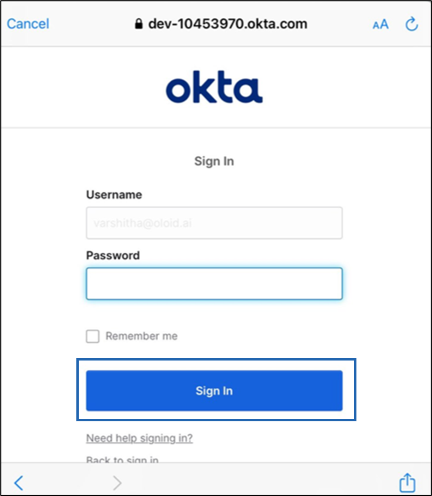

{/* Source: Intercom article 10367862 - https://oloid.help/en/articles/10367862-oloid-verify-login-using-okta-sso */}
{/* Generated by intercom_to_mintlify.py - re-running overwrites this file. */}

## Introduction

The Okta SSO Login feature in the Oloid Verify App allows Admin and Supervisor to securely access Admin Mode using Okta credentials.

## Prerequisite

- You must have a Tenant Admin account.

## Steps to log in with Okta SSO

1. Launch the **Oloid Verify** App.
   The Login screen is displayed.
2. On the login screen, tap **Login with SSO**.

   

   The screen with **SSO options** are displayed.
3. Tap **Continue with Okta**.

   

   The confirmation pop-up box is displayed.
4. Tap on **Continue**.

   

   The **Okta Sign In** screen is displayed.
5. Enter **Username** > tap **Next**.

   

Enter **Password** in the Password field > tap **Sign In**.

You are logged in to Admin Mode in Oloid Verify using Okta SSO successfully.

---

##### SEO Keywords

6. Oloid Verify Okta SSO login | Okta SSO in Oloid Verify | Oloid Verify SSO authentication | Oloid Verify Admin Mode Okta login
