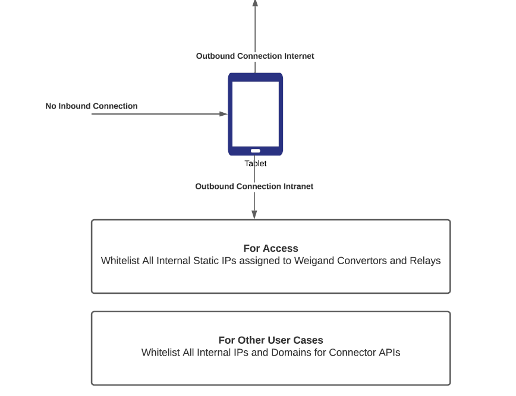

{/* Source: Intercom article 8644249 - https://oloid.help/en/articles/8644249-oloid-verify-network-architecture */}
{/* Generated by intercom_to_mintlify.py - re-running overwrites this file. */}

<Note>
  **Note:** Ensure that the iPad’s network connection (Wi-Fi or Ethernet) can communicate with the servers listed below. All network requests are outbound.
</Note>

| Sn. | Domain name | Port | Description |
| --- | --- | --- | --- |
| 1 | oloid.cloud | 80, 443 | Production Oloid Face Vault Platform Root Domain |
| 2 | *.oloid.cloud | 80, 443 | Production Flex Tenant Sub Domains |
| 3 | oloiddev.com | 80, 443 | Development Oloid Face Vault Platform Root Domain |
| 4 | *.oloiddev.com | 80, 443 | Development Flex Tenant Sub Domains |
| 5 | *.crashlytics.co | 80, 443 | Capturing Crash Logs |
| 6 | *.amazonaws.com | 80, 443 | Accessing AWS Resources directly ( e.g S3 ) |
| 7 | cv.proxce.co | 80, 443 | Legacy Computer Vision Server |
| 8 | *.googleapis.com | 80, 443 | Firebase Pub Sub Production Interface |
| 9 | visionlabsbv.prod.sentinelcloud.com | 80, 443 | On Device FR License Management Server |

---

## SEO Keywords

Oloid Verify network architecture | Oloid Verify server communication | Oloid Verify outbound connections
