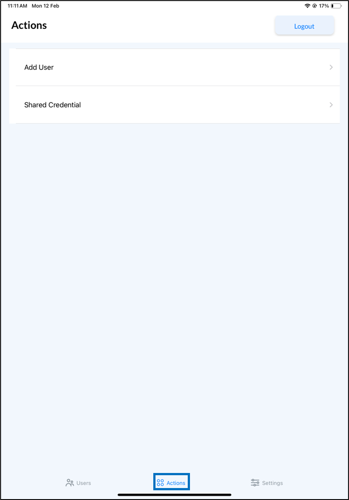
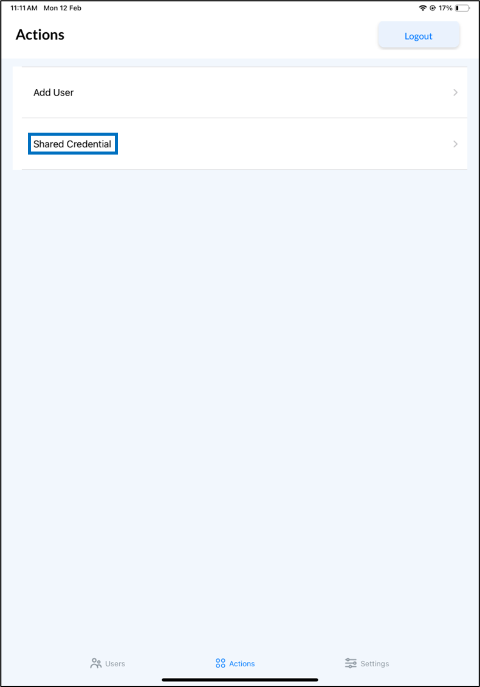
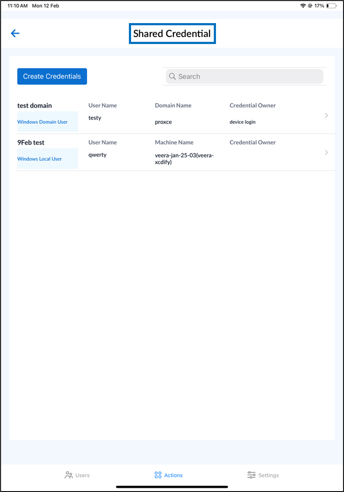
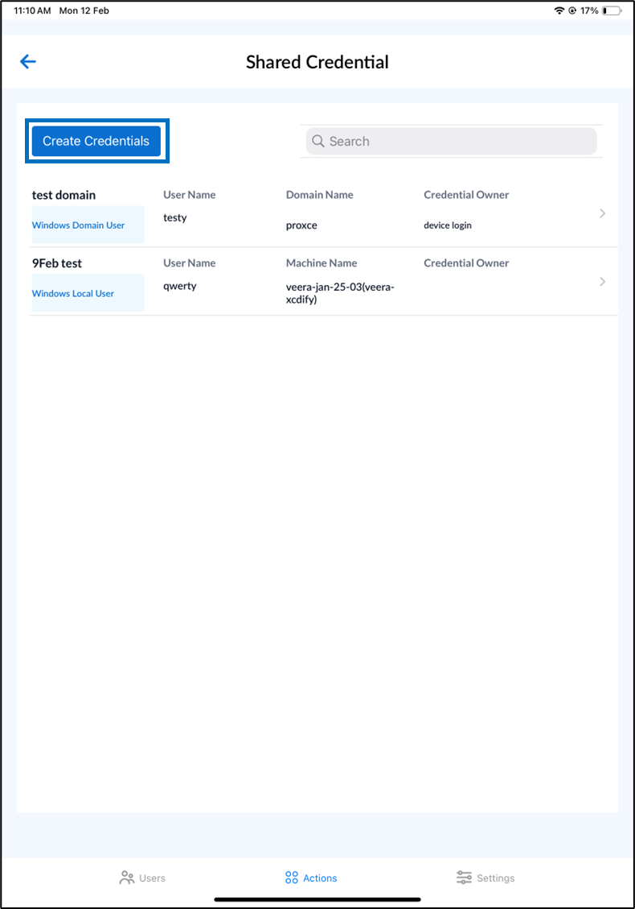
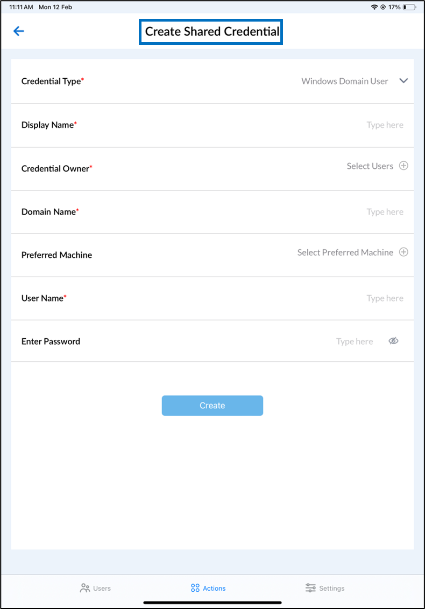

{/* Source: Intercom article 8943090 - https://oloid.help/en/articles/8943090-oloid-verify-shared-credential */}
{/* Generated by intercom_to_mintlify.py - re-running overwrites this file. */}

## Introduction

This feature of Oloid Verify app allows the supervisor in admin mode to create shared credential for users using the app.

This document comprises of the following:

- [Create shared credential for domain](#create-shared-credential-for-domain)
- [Create shared credential for local windows machine](#create-shared-credential-for-local)

To create shared credential:

1. Tap **Actions** on the menu at the bottom of the screen.

   

2. Select **Shared Credential**.

   

   The **Shared Credential** page is displayed.

   

3. Tap **Create Credentials**.

   

   The **Create Shared Credential** page is displayed.

   

Do the following:

### Create shared credential for domain

1. Select **Credential Type** as Windows Domain User.
2. Enter **Display Name**.
3. Select user(s) for **Credential Owner**.
   The user list is displayed on the pop-up box.
4. Select **Add**.
5. Enter **Domain Name**.
6. Select **Preferred Machine**.
   The preferred machine list is displayed on the pop-up box.
7. Select **Add**.
8. Enter **User Name**.
9. Enter **Password**(Optional).
10. Click **Create**.

The shared credential of type Windows Domain User is created and listed on the **Shared Credential** page.

### Create shared credential for local

1. Select **Credential Type** as Windows Local User.
2. Enter **Display Name**.
3. Select user(s) for **Credential Owner**.
   The user list is displayed on the pop-up box.
4. Select **Add**.
5. Select **Machine** .
   The preferred machine list is displayed on the pop-up box.
6. Select **Add**.
7. Enter **User Name**.
8. Enter **Password**(Optional).
9. Click **Create**.
   The shared credential of type Windows Local User is created and listed on the **Shared Credential** page.
