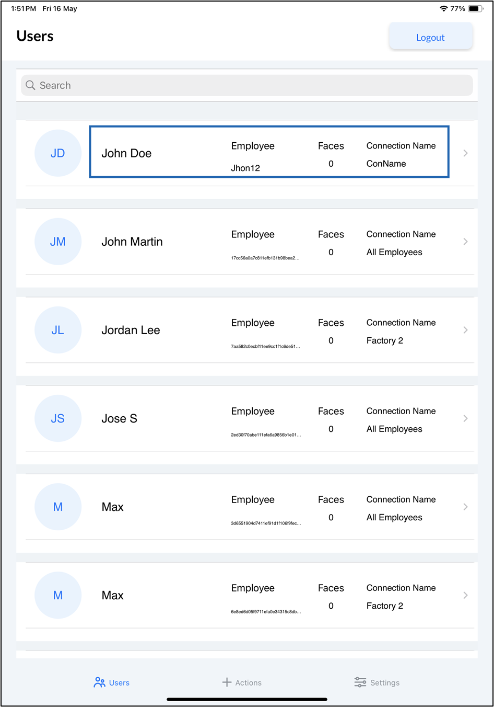
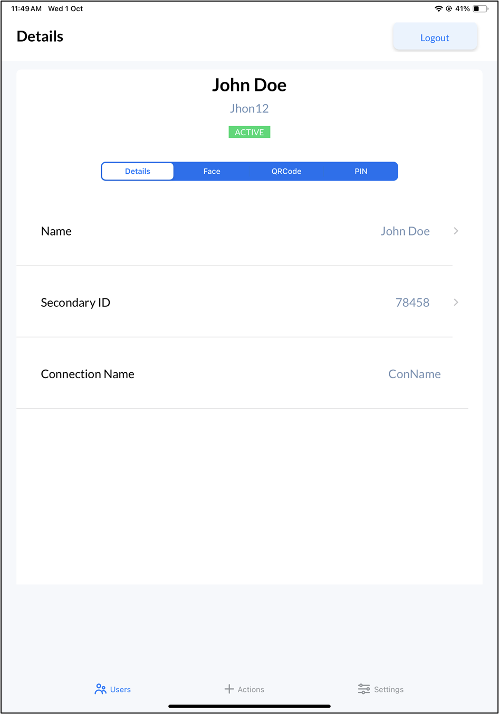

{/* Source: Intercom article 8616846 - https://oloid.help/en/articles/8616846-oloid-verify-view-user-details */}
{/* Generated by intercom_to_mintlify.py - re-running overwrites this file. */}

## Introduction

The View User Details feature in the Oloid Verify app allows Admin and Supervisor to quickly access essential information about a user. From this, you can view key details such as the user’s name, primary ID, and the connection assigned to them.

## Prerequisite

- You must have a Tenant Admin or Supervisor account.
- You must add the user. To add user refer[Oloid Verify: Add User](/platforms/ios/time-clock/oloid-verify/oloid-verify-add-user).
- The Oloid Verify endpoint must be paired. To pair, refer [How to pair an Oloid Verify endpoint](/platforms/ios/time-clock/oloid-verify/oloid-verify-how-to-pair-an-endpoint)

## Steps to view User details

1. Launch the **Oloid Verify** app.

   

2. Log in to Admin mode in Oloid Verify app. To login, refer [How to log in to the admin mode of Oloid Verify App as an Admin or Supervisor.](/platforms/ios/time-clock/oloid-verify/oloid-verify-how-to-log-in-to-admin-mode-as-admin-or-supervisor)
   The **Users** screen with list of users is displayed.

Tap on the preferred **user** to view details.

The User details are displayed on the **Details** screen.

---

##### SEO Keywords

3. |Oloid Verify User Details | View User Details Oloid Verify App | Oloid Verify Users screen|
