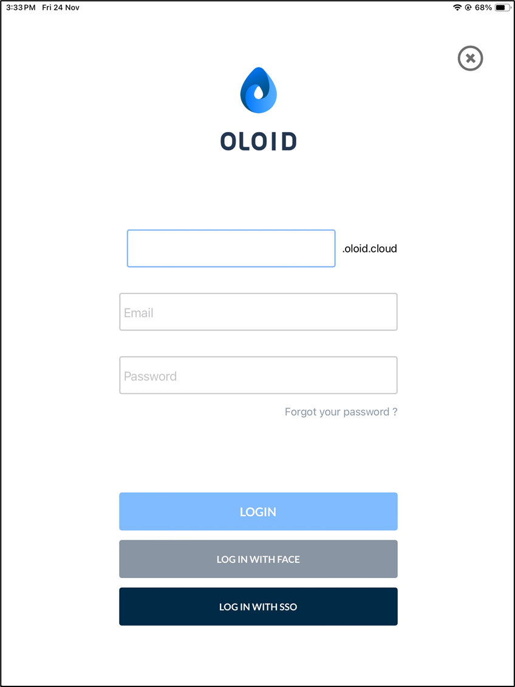
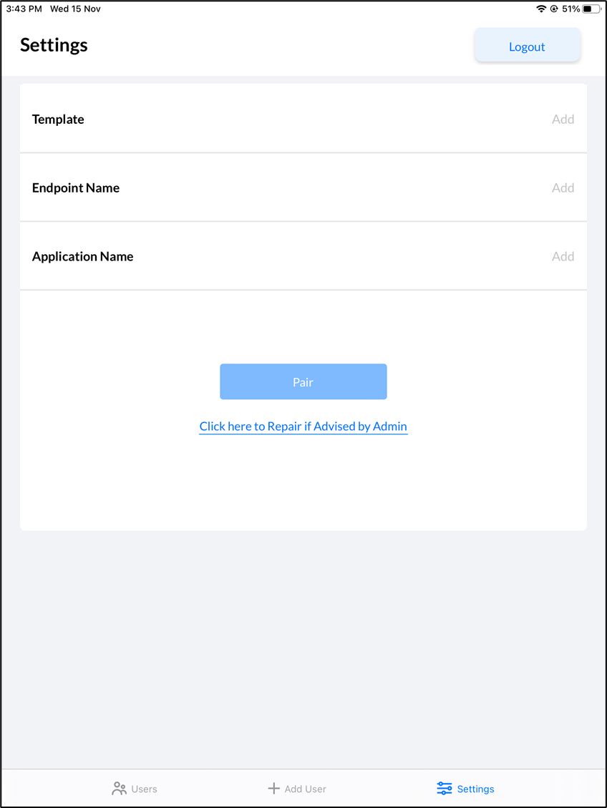
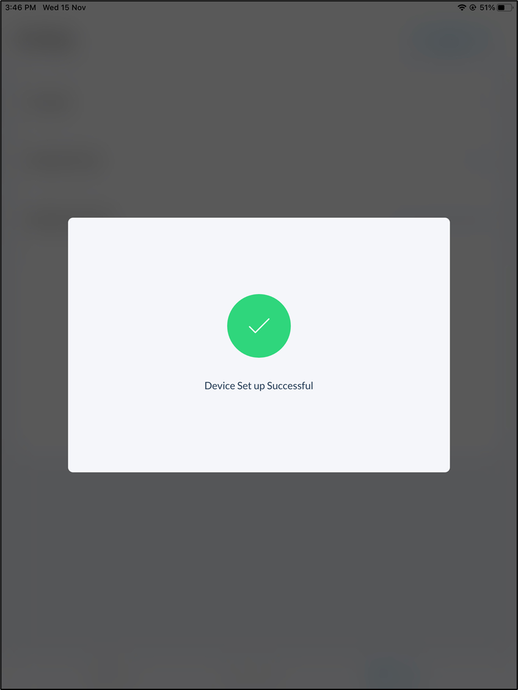
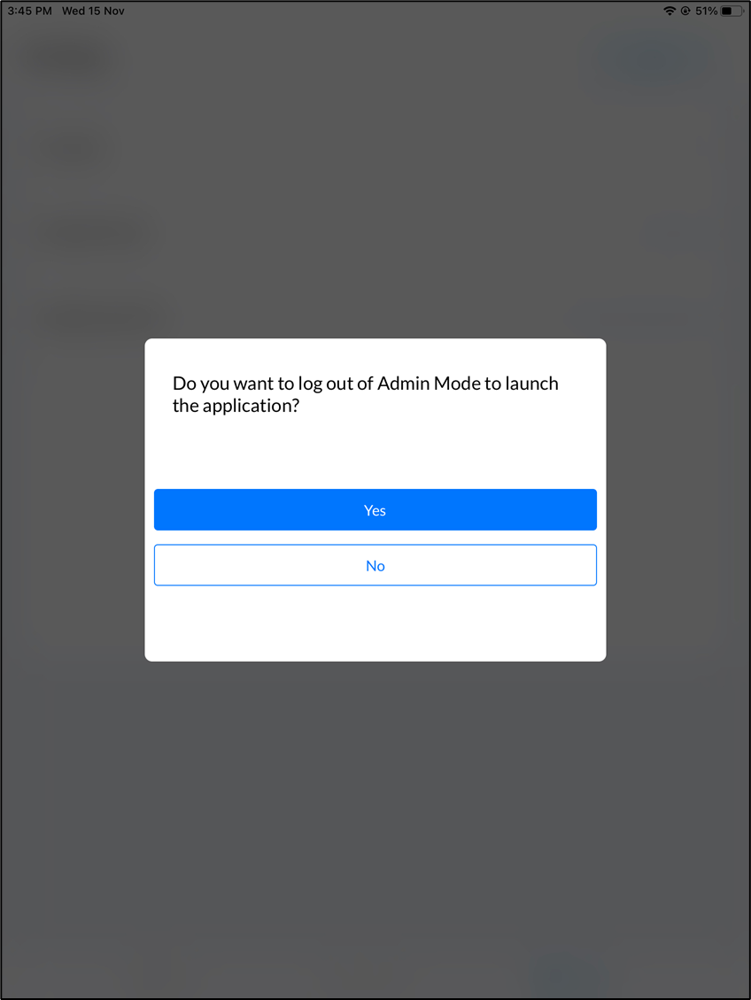

{/* Source: Intercom article 9514800 - https://oloid.help/en/articles/9514800-setting-up-ipad-for-oloid-verify */}
{/* Generated by intercom_to_mintlify.py - re-running overwrites this file. */}

Oloid Verify is a contactless authentication application for time and attendance, clocking, payroll compliance, and workplace access using facial recognition.

## Pre-requisites for getting started with Oloid Verify

### Oloid Verify: Pre-req/System Requirements

- **[Hardware requirement for iPad](/platforms/ios/time-clock/oloid-verify/oloid-verify-hardware-and-software-requirements)**
- **[Electrical and Power Requirement](/drafts/platforms/ios/time-clock/pre-req-system-requirements-archived)**
- **[Others](/drafts/platforms/ios/time-clock/pre-req-system-requirements-archived)**

#### Hardware requirement for iPad

| Model | iPad Pro (11- inch) and newer |
| --- | --- |
| True Depth Camera | Available |
| Mount and Case for the tablet |  |

#### Electrical and Power Requirement

- 120V outlet access for charging device.
- PoE adapter if the customer prefers a wired network connection.

#### Others

- Sufficient illumination around the tablet so that the facial features of the end user are clearly visible.
- Tablet should be mounted in such a way that the camera of device is at 5 feet height from the floor

For Installation of the iPad, the recommended height to mount the iPad is 5 feet. This is to cater to people with different heights. However, for employees for whom recommended height is too high, a separate iPad may be mounted at a lower height.

For more information, see Oloid's [iPAD Installation Guide.](https://www.oloid.ai/training-center/#:~:text=iPAD%20Installation%20Guide)

### Network architecture of Oloid Verify

Refer guide on [Network architecture of Oloid Verify](/platforms/ios/time-clock/oloid-verify/oloid-verify-network-architecture)

### Set up iPad in Kiosk Mode

Refer guide [Set up iPad in Kiosk Mode](/platforms/ios/time-clock/oloid-verify/oloid-verify-set-up-ipad-in-guided-access-mode-or-kiosk-mode)

## Oloid Platform Configuration for Oloid Verify App

Oloid Verify is used based on the configuration in the Oloid Portal. To use Oloid Verify, the application, connection, and template (optional) have to be preconfigured in the Oloid Portal. For details on configuration setup, refer to the following Oloid Platform Documents and Videos. **[Oloid Platform - Enterprise Features](https://oloid.help/en/collections/3797155-oloid-platform-enterprise-features)**

## App Installation and Admin Setup

**Pre-requisite:**

- You should be a Tenant Admin.
- Application, Connections, and template (optional) are configured in Tenant Admin Portal.
1. Go to **App Store** and download **Oloid Verify App**. Refer to [How to download Oloid Verify application](/platforms/ios/time-clock/oloid-verify/oloid-verify-how-to-download-and-install-the-app) guide.
2. Install the application and upon successful installation, launch the app.
   The login page is displayed.

   

3. Enter **Tenant Name**.
4. Enter your email id in the **Email** text field.
5. Enter your password in the **Password** text field.
6. Tap **LOGIN**.
   The **Settings** page is displayed.

   <Note>
     **Note:** If your face is added to the Tenant Portal as a Tenant Admin, you can tap on **LOG IN WITH FACE** to log in using your face.
   </Note>

7. Do the following on the **Settings** page.

   

   1. Add **Template** (optional).
   2. Enter **Endpoint Name**.
   3. Select Application Name from **Application Name** list.
   4. Click **Pair.**
      The settings are saved and the Device Setup success message is displayed.

      

      <Note>
        **Note:** Once the iPad is successfully paired, other settings can be configured in the tenant admin portal.
      </Note>

8. The application prompts you to log out of Admin mode.

   

9. Do one of the following:
   1. Click **Yes** to log out and launch the application (**preview mode**).
      The app displays preview mode and allows you to capture live Images for facial transactions.

      <Note>
        **Note:** To go back to admin mode, **double-click with two fingers** on preview mode and tap **Yes- To Continue**.
      </Note>

   2. Click **No** to stay logged in to the admin mode.
      You can now
      1. **[View User Details](/platforms/ios/time-clock/oloid-verify/oloid-verify-view-user-details)**
      2. **[Add User](/platforms/ios/time-clock/oloid-verify/oloid-verify-add-user)**
      3. **[Add Faces](/platforms/ios/time-clock/oloid-verify/oloid-verify-add-faces)**
