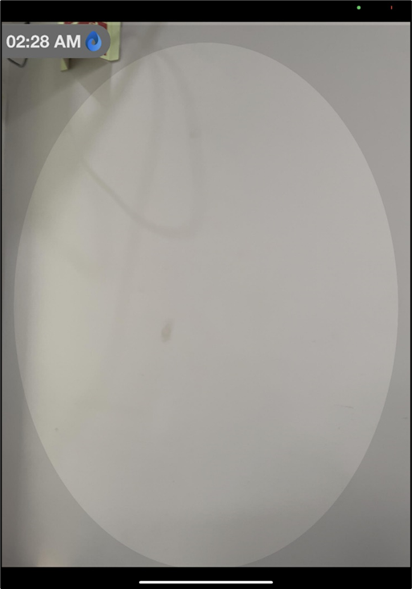
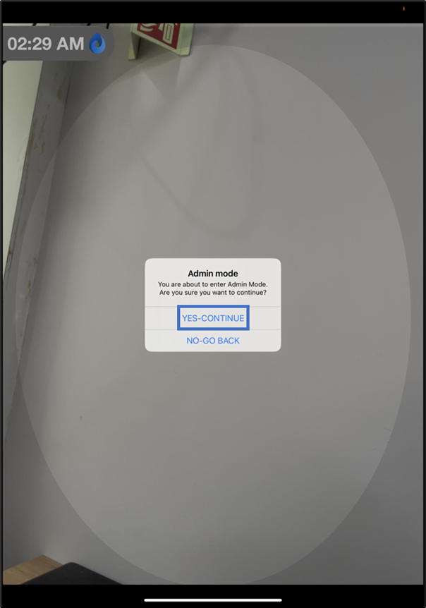
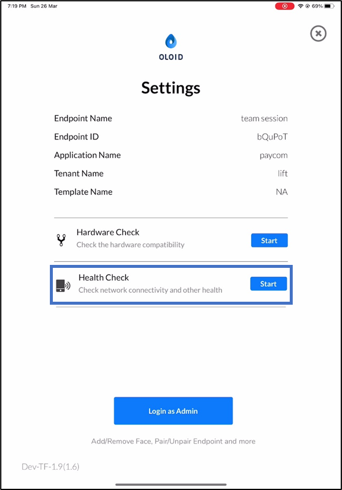
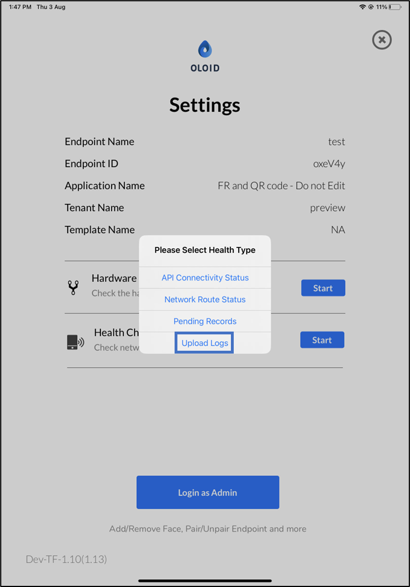
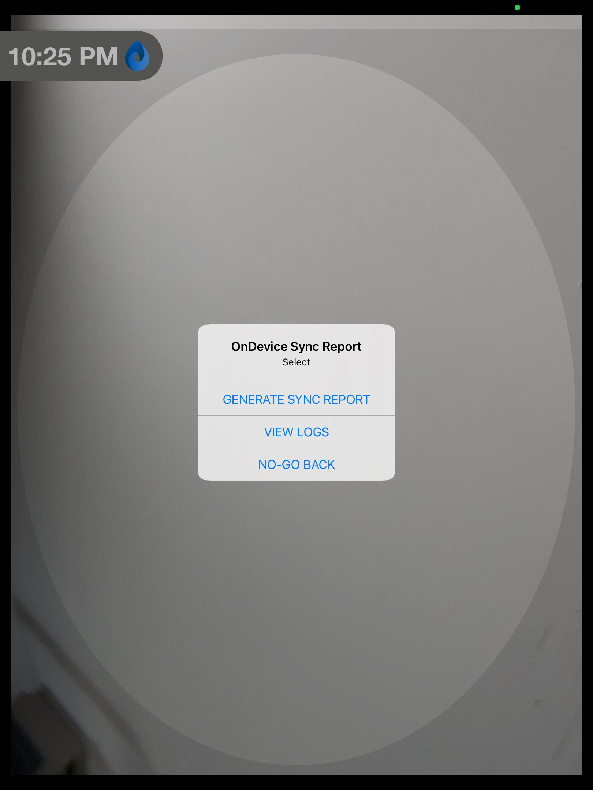
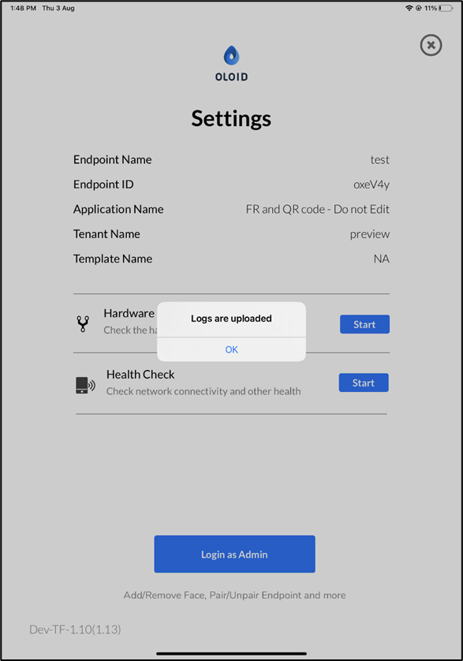
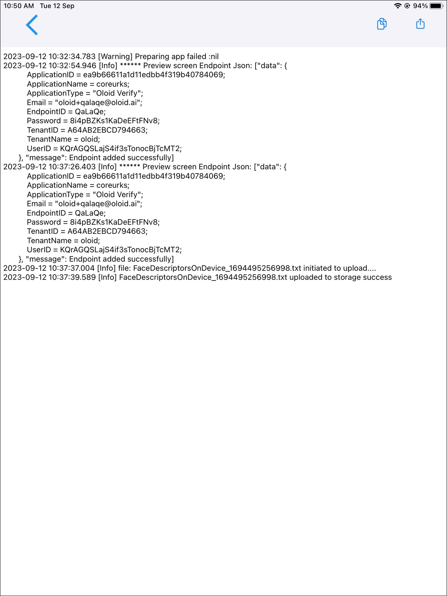

{/* Source: Intercom article 8247618 - https://oloid.help/en/articles/8247618-set-up-sharing-logs-with-the-app-developer */}
{/* Generated by intercom_to_mintlify.py - re-running overwrites this file. */}

On the Oloid Verify/Connect app, you can share logs with the app developer in two ways:

[Upload logs to the app developer](#upload-logs-to-the-app-developer)

[View and share logs with the app developer](#view-and-share-logs-with-the-app-developer)

## Pre-requisite

Endpoint configuration for debugLog should be done in the Oloid portal.

### Upload logs to the app developer

Steps to upload logs:

1. Launch the **Oloid Verify** app in preview mode.
2. Double-tap the screen with two fingers to log into **Admin mode**.

   

3. Tap **YES-CONTINUE**.

   

   **Settings** screen is displayed.
4. Tap on **Start** button in the **Health Check** section.

   

   The **Please Select Health Type** pop-up box is displayed.

Select **Upload Logs**.

The logs are successfully uploaded.

### View and share logs with the app developer

5. Steps to view and share logs:
1. Launch the **Oloid Verify** app in preview mode.
2. Tap the screen four times using a single finger .

   

   The **Ondevice Sync Report** pop-up box is displayed.
3. Tap **VIEW LOGS**.

   

   The log report is displayed on the screen.

   

4. On the top right corner of the report page, you can do one of the following:
   1. Tap copy icon, to copy the log report to your file.
   2. Tap the share button to send the log report to the developer.

      
