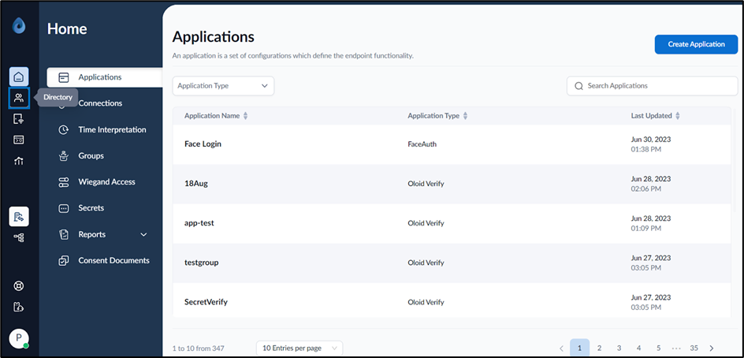
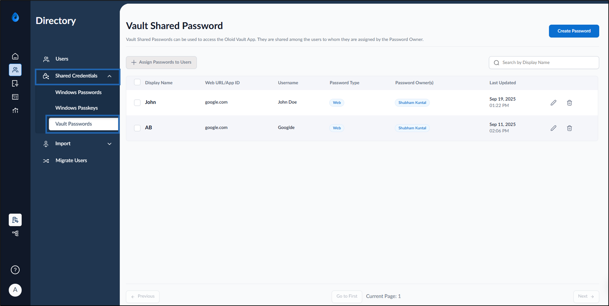
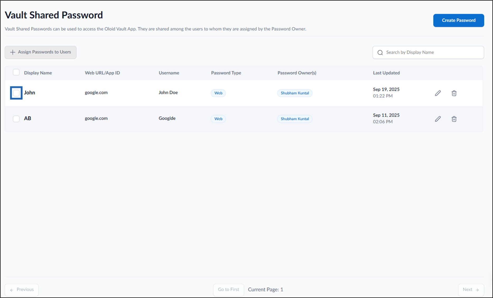
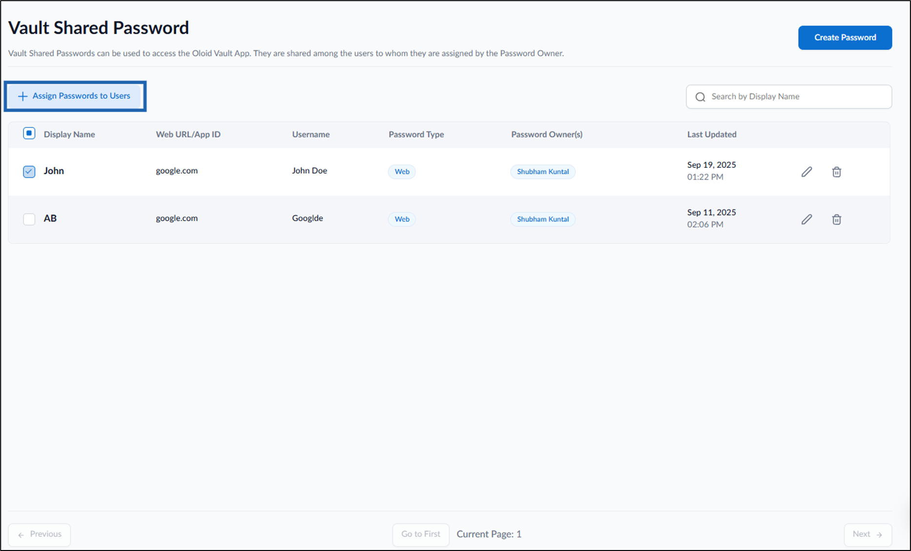
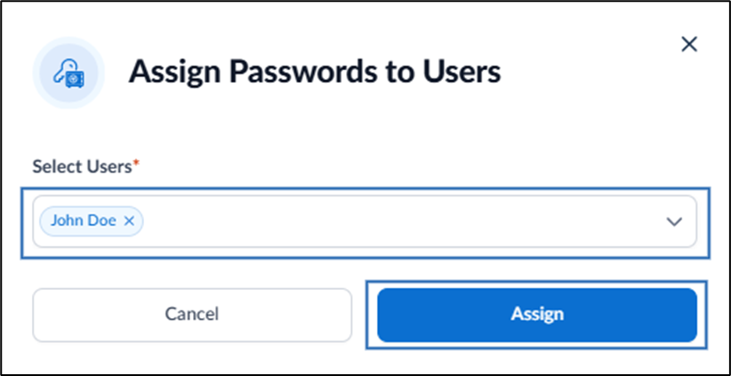
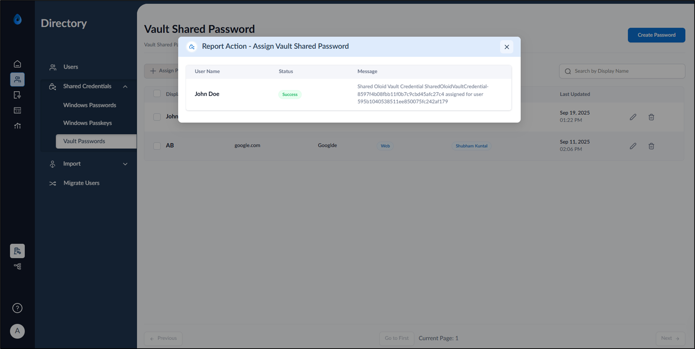
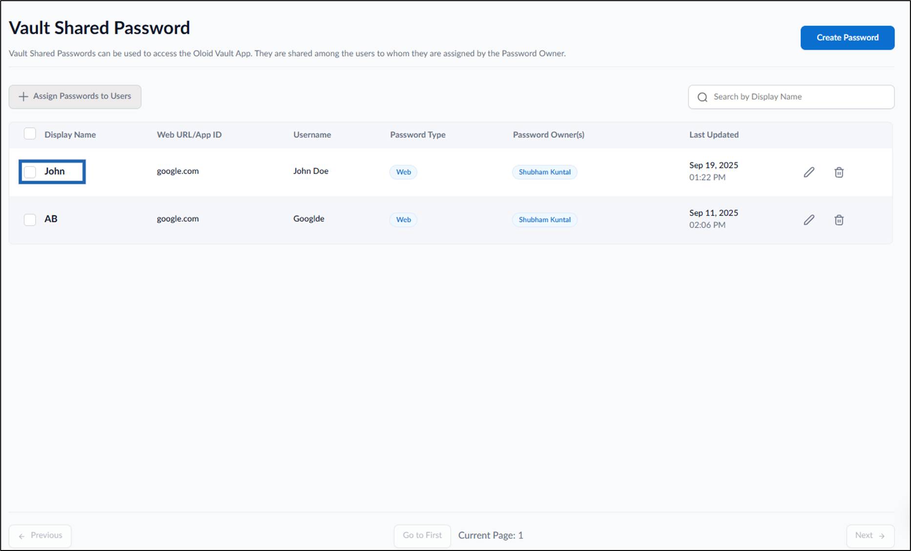
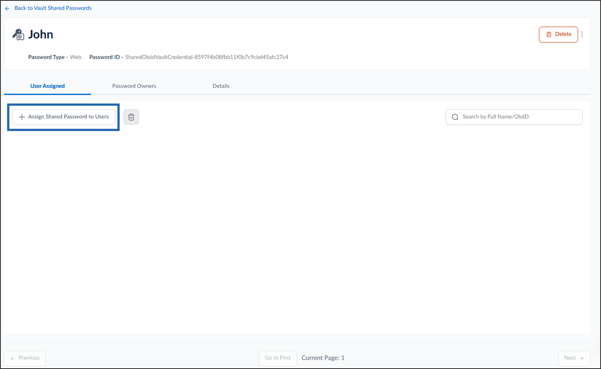

{/* Source: Intercom article 12275961 - https://oloid.help/en/articles/12275961-how-to-assign-chrome-vault-shared-password-to-user-in-the-tenant-admin-portal */}
{/* Generated by intercom_to_mintlify.py - re-running overwrites this file. */}

## Introduction

The Tenant Admin Portal provides Tenant Admins with the ability to manage and assign Oloid Vault Shared Passwords to users.

## Prerequisites

- You must create Vault Shared Password. To create Vault Shared Password refer [How to Create Vault Shared Password in the Tenant Admin Portal](/platforms/web/vault/chrome/oloid-vault-chrome-chromium-how-to-create-shared-password-in-the).
- You must create User. To create User, refer [How to add Users in the Tenant Admin Portal](/platform/tenant-admin-portal/tenant-admin-portal-how-to-create-user).

## Steps to assign vault shared password

1. Log in to the **Tenant Admin Portal**.
2. On the home page of the portal, click **Directory** on the left menu panel.

   

   The **Users** page is displayed.
3. Select **Shared Credentials > Vault Passwords** on the left menu panel.

   

   The **Vault Shared Password** page is displayed.
4. Do one of the following:
   1. Assign Password inVault Shared Passwordpage.
      or
   2. Assign Password in Passworddetails page.

### Assign Password in Vault Shared Password page

1. Select the preferred password name(s).

   

2. Click **Assign Passwords to Users**.

   

   The **Assign Password to Users** pop-up box is displayed.
3. On the pop-up box, do the following:
   1. Enter the **User Name** in the **Select Users** field > select the user from dropdown menu.
   2. Click **Assign**.

      

The Vault Password is assigned successfully.

### Assign Password in **Vault Password** details page

1. Click on the preferred Vault Password

   

   The Password details page is displayed.
2. Select **Assign Shared password to Users**.

   

   The **Assign Password to Users** pop-up box is displayed.
3. On the pop-up box, do the following:
   1. Enter the **User Name** in the **Select Users** field > select the user from dropdown menu.
   2. Click **Assign**.

      

The Vault Password is assigned successfully.

