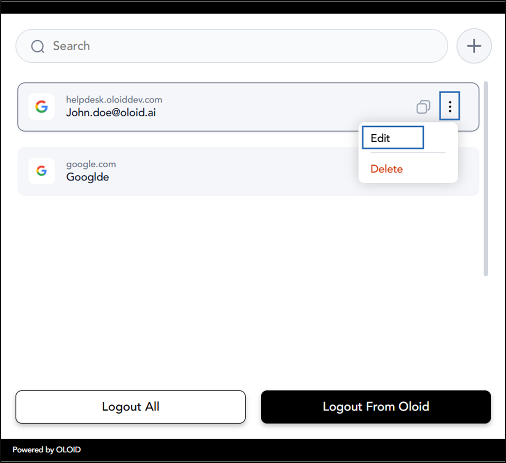
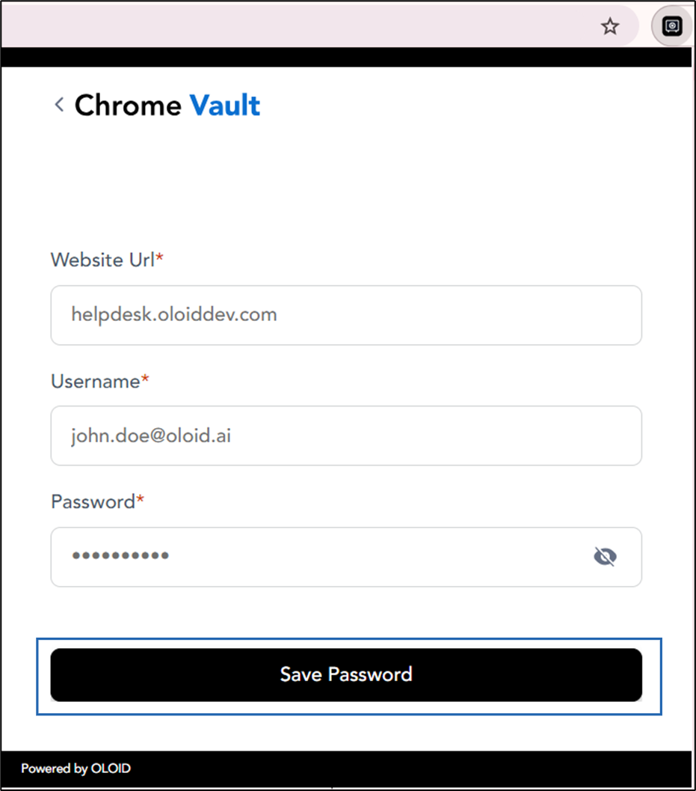
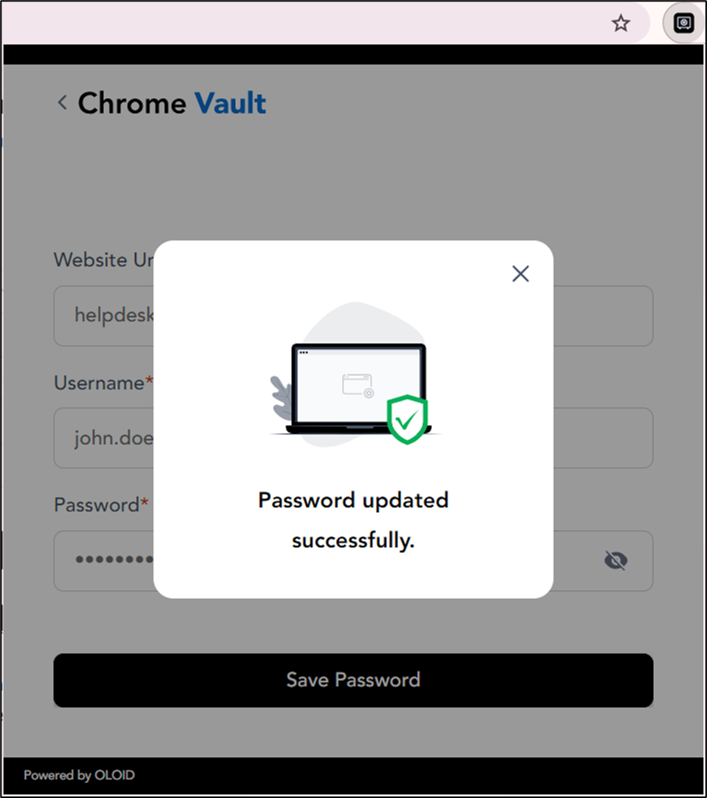

{/* Source: Intercom article 9795116 - https://oloid.help/en/articles/9795116-how-to-edit-password-in-chrome-vault */}
{/* Generated by intercom_to_mintlify.py - re-running overwrites this file. */}

## Introduction

Chrome Vault lets you securely manage saved passwords in your browser. This document shows you how to update a saved password to keep your credentials current and avoid login issues.

## Prerequisite

The password must be saved in Chrome Vault. To save password refer [How to save password in Chrome Vault](/platforms/web/vault/chrome/how-to-save-password-in-chrome-vault).

## Steps to edit password

1. Open **Google Chrome** browser and click **Chrome Vault** icon located on the toolbar.

   

   The **Chrome Vault** pop-up box is displayed.
2. Click **More options menu** () on the preferred saved profile to edit it.

   

   The **Chrome Vault** page in edit mode is displayed.
3. Do the following:
   1. Edit the website **URL** (optional).
   2. Edit **username** (optional).
   3. Edit **password**.
   4. Click **Save Password**.

      

      The password is updated successfully.

      

      <Note>
        **Note:** You can also edit and update your password using the Update Password option. For details, see [How to update password in Chrome Vault](/platforms/web/vault/chrome/how-to-update-password-in-chrome-vault).
      </Note>
