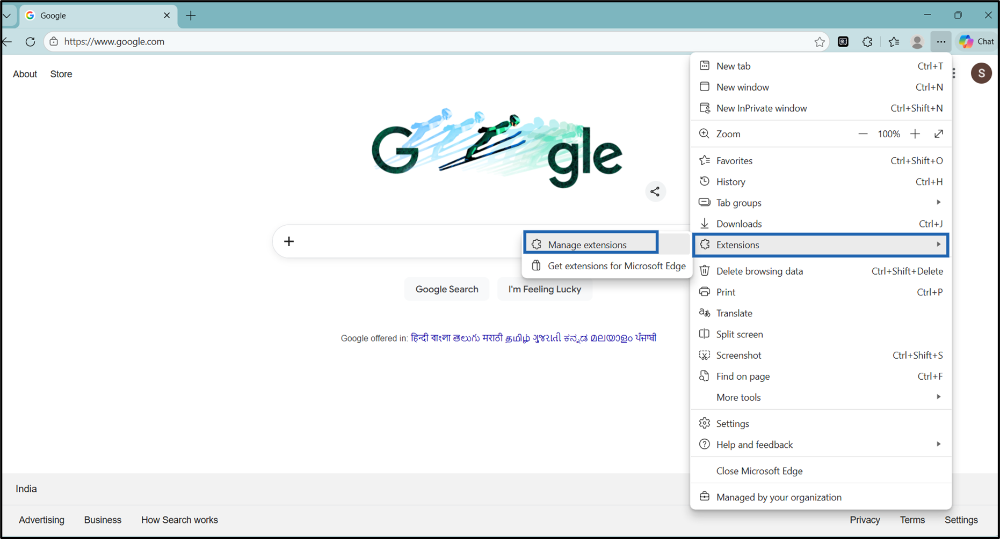
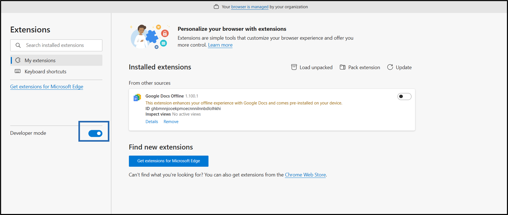
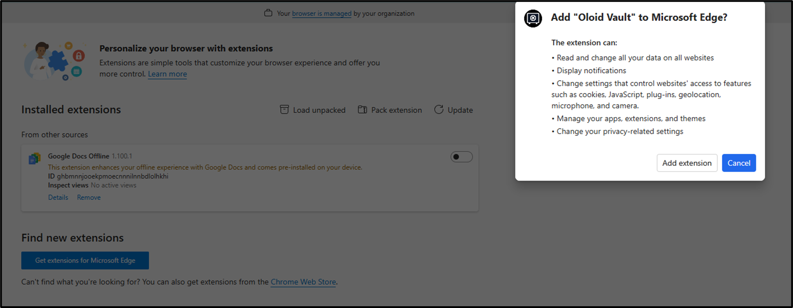
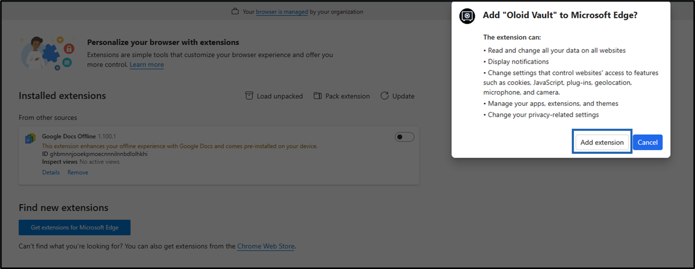
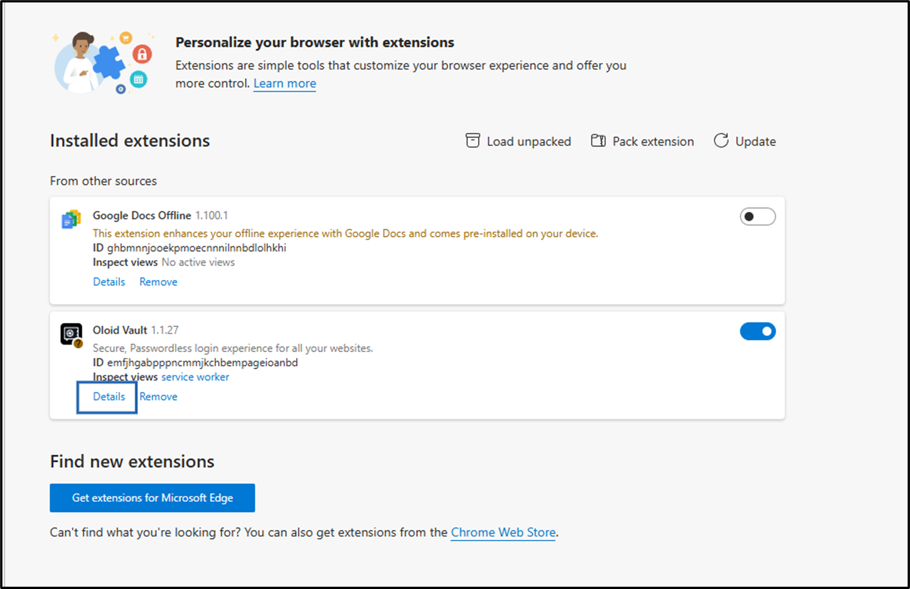
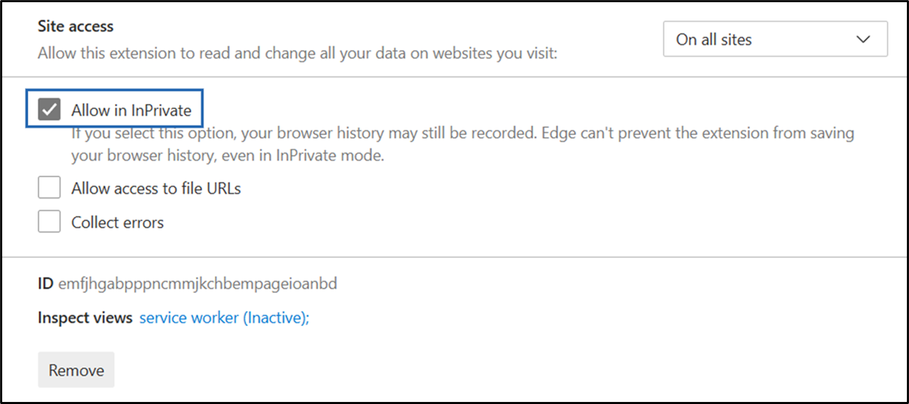
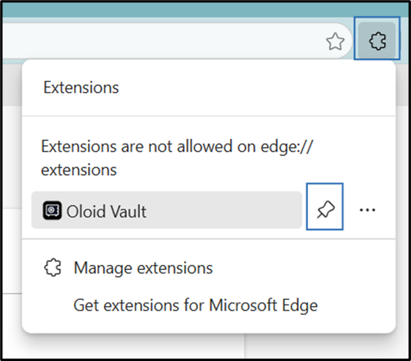
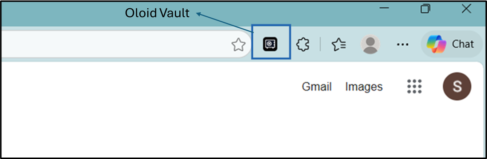

{/* Source: Intercom article 13741498 - https://oloid.help/en/articles/13741498-how-to-install-oloid-vault-in-microsoft-edge-browser */}
{/* Generated by intercom_to_mintlify.py - re-running overwrites this file. */}

## Introduction

This document provides instructions to install **Oloid Vault** as a browser extension. The installation steps in this document apply to **Microsoft Edge** browser. After installation, Oloid Vault enables users to securely manage credentials directly within Microsoft Edge web applications.

## Prerequisites

- The **Oloid Vault installer package** (ZIP file) is available.

  <Note>
    **Note:** Contact [Oloid Support](mailto:Support@oloid.ai) to obtain the Oloid Vault installer package
  </Note>

- The installer package includes:
  - **Oloid_Vault.crx file**
  - **Registry file(s).**

    <Note>
      **Note:** Restart **Microsoft Edge browser** to apply the registry changes
    </Note>

## Steps to Install Oloid Vault Application

1. Download the **Oloid Vault installer ZIP file** on your system.

   <Note>
     **Note:** Ensure theinstaller file must contain **Oloid_Vault.crx** and **Registry** files.
   </Note>

2. Right-click the zip file and select **Extract All**.

   <Note>
     **Note:** The extracted files are saved in the same folder as the original ZIP file.
   </Note>

3. Install **Registry** file.

   <Note>
     **Note:** First-time users must install the required registry file before using the Oloid Vault application.
   </Note>

4. Open **Microsoft** browser.
5. Go to **Extensions** > **Manage Extensions**.

   

   The **Extensions** page is displayed.
6. Enable **Developer Mode** toggle.

   

   The **Developer mode** is enabled successfully
7. Drag and drop the **Oloid_Vault.crx file** onto the **Edge Extensions** page.

   <Note>
     **Note:** Ensure that **Developer mode** is enabled before dragging and dropping the Oloid_Vault.crx file.
   </Note>

   The **Add "Oloid Vault" to Microsoft Edge?** pop-up box is displayed.

   

8. Select **Add extension**.

   

   The **Oloid Vault** is added successfully.
9. Click **Details**.

   

   The **Details** page is displayed.
10. Select **Allow in InPrivate**.

    

    The **Oloid Vault** extension is successfully installed.
11. Click **Extension > Pin to Tool bar** (Optional).

    

    The Oloid vault is added in the Microsoft Edge toolbar.
    You can now view **Oloid Vault** icon on the toolbar.

    
