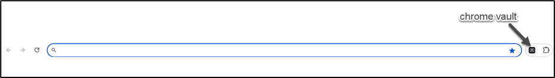
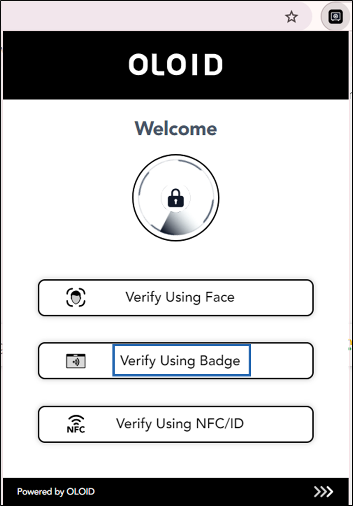
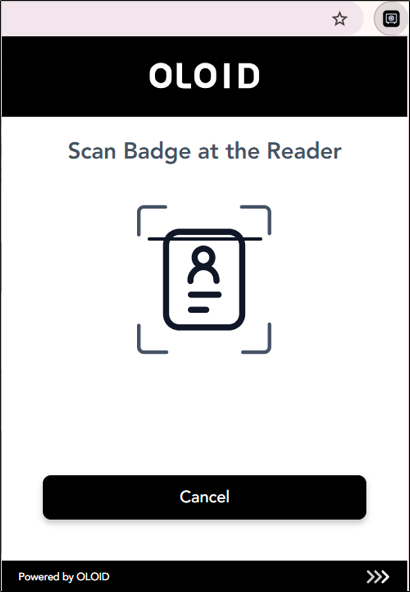
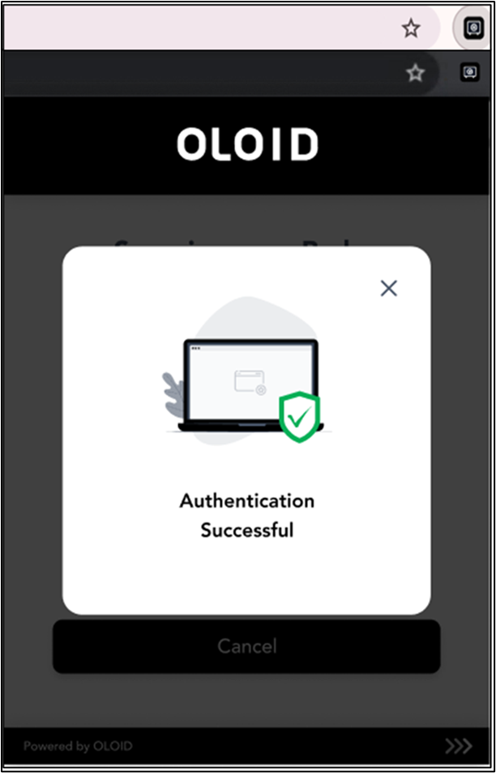

{/* Source: Intercom article 9751929 - https://oloid.help/en/articles/9751929-how-to-log-in-to-chrome-vault-using-badge */}
{/* Generated by intercom_to_mintlify.py - re-running overwrites this file. */}

## Introduction

This document explains how to log in to **Chrome Vault** using a badge.
By scanning a registered badge on a supported card reader, users can quickly and securely authenticate without entering a password.

## Prerequisites

- You have a valid Badge assigned to you.
- Your device supports Badge and has an active Badge reader.

## Steps to log in with Badge

1. Open **Google Chrome** browser and click **Chrome Vault** icon located on the toolbar.

   

   The Welcome screen is displayed.
2. Select **Verify Using Badge**.

   <Note>
     **Note:** You can see only the authentication ways enabled for you in the application. The button name may vary depending on the application configuration. Reach out to [support](mailto:support@oloid.ai)team if you do not see any authentication method.
   </Note>

   

   The **Scan Badge at the Reader** is displayed.

   

3. Scan the **Badge** on the **Card Reader**.
   On Badge authentication, you are successfully logged in to Chrome Vault.

   

## Related Video

**[How to log in to Chrome Vault using Badge-Video Tutorial](/platforms/web/videos/how-to-log-in-to-chrome-vault-using-badge-video-tutorial)**.
