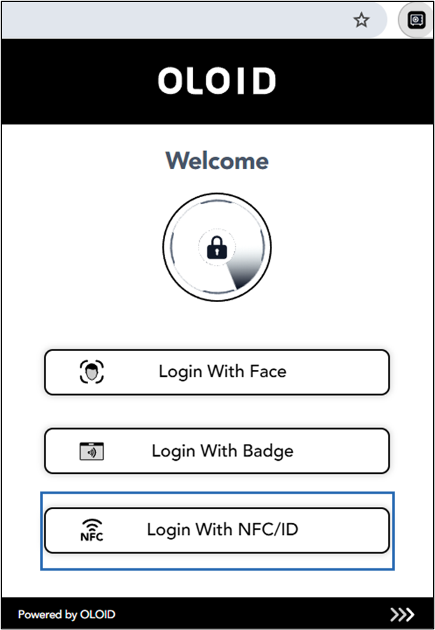
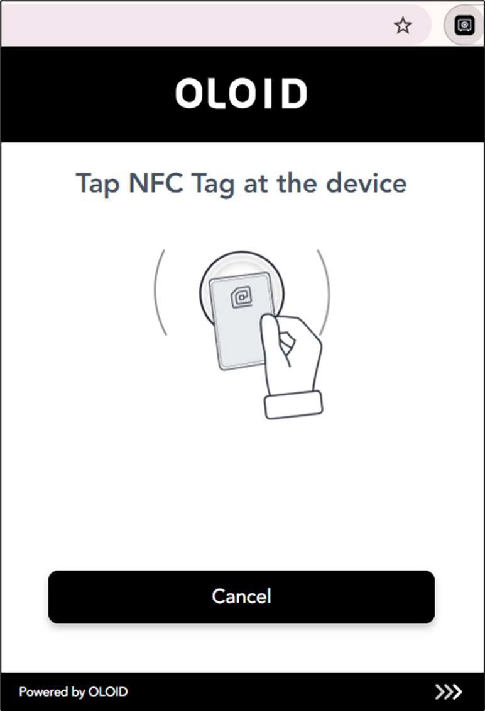
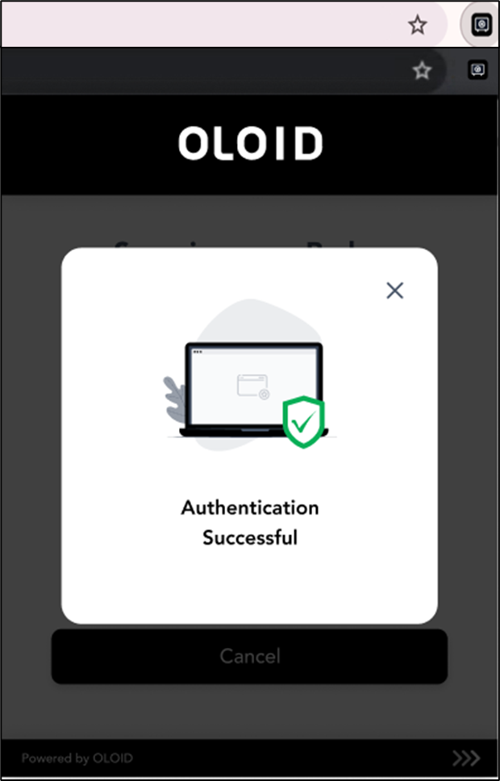

{/* Source: Intercom article 9740334 - https://oloid.help/en/articles/9740334-how-to-log-in-to-chrome-vault-using-nfc */}
{/* Generated by intercom_to_mintlify.py - re-running overwrites this file. */}

## Introduction

This document explains how to log in to Chrome Vault using NFC (Near Field Communication). NFC allows you to authenticate quickly by tapping your NFC tag on a compatible reader. This secure method streamlines access to Chrome Vault without the need to manually enter credentials.

## Prerequisites

- You have a valid NFC/ID tag assigned to you.
- Your device supports NFC and has an active NFC reader.

## Steps to Log in to Chrome Vault using NFC

1. Open **Google Chrome** browser and click **Chrome Vault** icon located on the toolbar.

   

   The Welcome screen is displayed.
2. Select **Login With NFC/ID**.

   <Note>
     **Note:** You will only see the authentication methods (Face, Badge and NFC/ID) enabled for you. Button names may vary based on configuration. Contact [Support](Mailto:Support@oloid.ai) if no authentication method appears.
   </Note>

   

   The **Tap NFC Tag at the device** screen is displayed.

Tap the **NFC/ID** tag on the **Reader** to scan it.

After successful NFC authentication, you are logged in to Chrome Vault.

## Related Video

3. **[How to log in to Chrome Vault using NFC- Video Tutorial](/platforms/web/videos/how-to-log-in-to-chrome-vault-using-nfc-video-tutorial)**
