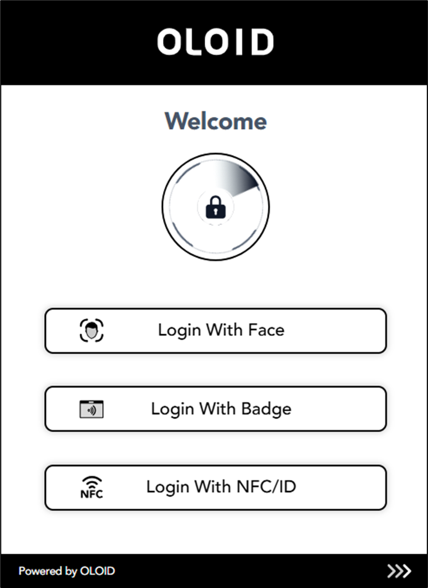

{/* Source: Intercom article 12289985 - https://oloid.help/en/articles/12289985-how-to-log-in-to-chrome-vault */}
{/* Generated by intercom_to_mintlify.py - re-running overwrites this file. */}

## Introduction

The Chrome Vault application provides a secure and passwordless way for users to access their accounts using Face, Badge, or NFC/ID authentication. This ensures a faster login experience while maintaining high security standards.

## Prerequisites

Authentication method (Face, Badge, or NFC/ID) must be enabled. To enable refer [How to create and configure Chrome Vault application](/platforms/web/vault/chrome/oloid-vault-chrome-chromium-how-to-create-and-configure-oloid-vault).

## Steps to login

1. Open **Google Chrome** browser and click **Chrome Vault** icon located on the toolbar.

   

   The Welcome screen is displayed.
2. Do one of the following:
   1. Select **Login with Face**
      To login with Face refer[How to log in to Chrome Vault using Face](/platforms/web/vault/chrome/how-to-log-in-to-chrome-vault-using-face).
   2. Select **Login with Badge**
      To login with Badge refer [How to log in to Chrome Vault using Badge](/platforms/web/vault/chrome/how-to-log-in-to-chrome-vault-using-badge).
   3. Select **Login with NFC/ID**
      To login with NFC/ID refer [How to log in to Chrome Vault using NFC](/platforms/web/vault/chrome/how-to-log-in-to-chrome-vault-using-nfc).

      
