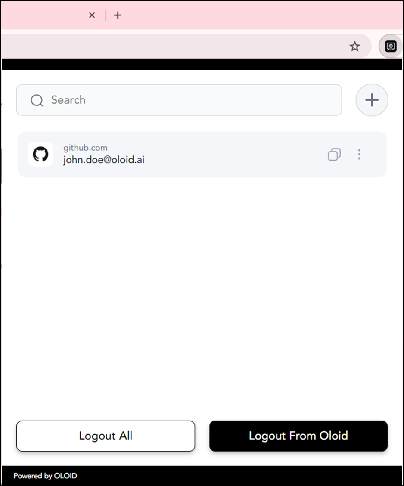
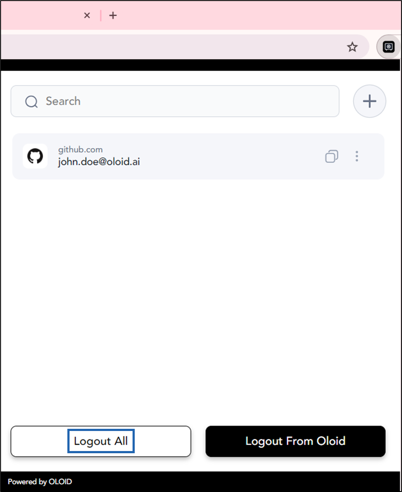
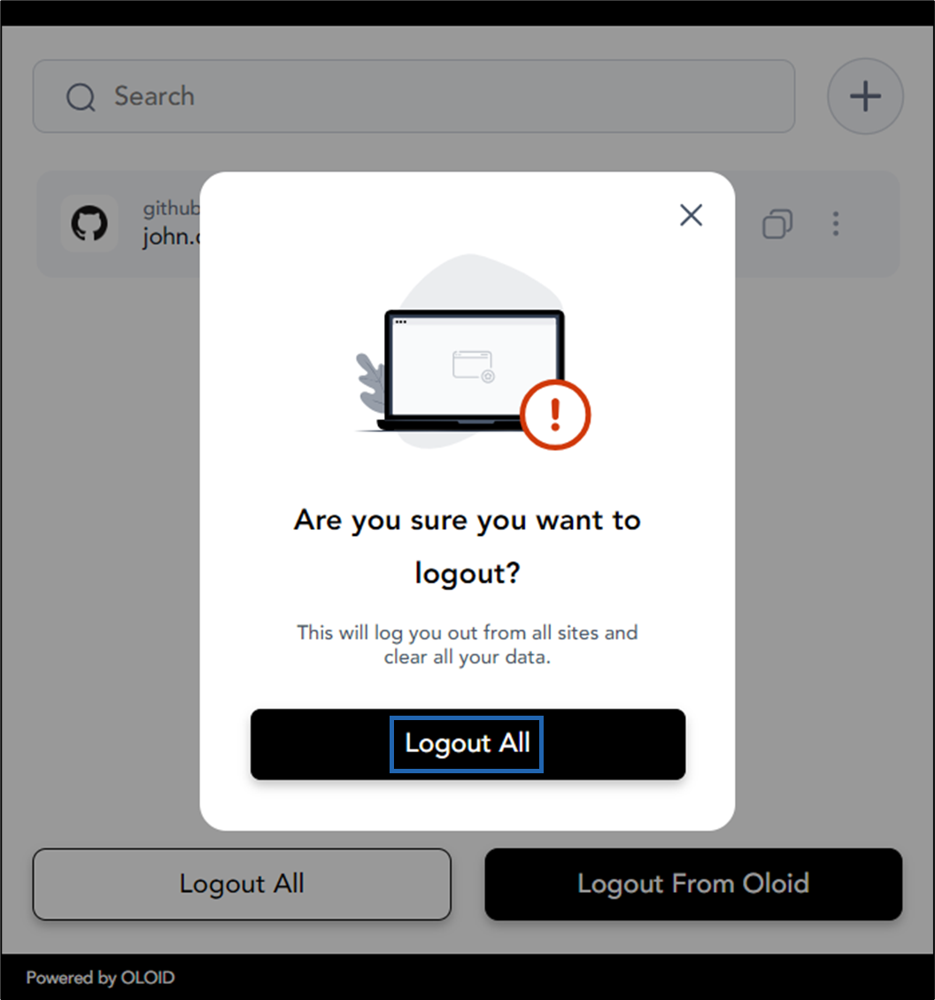
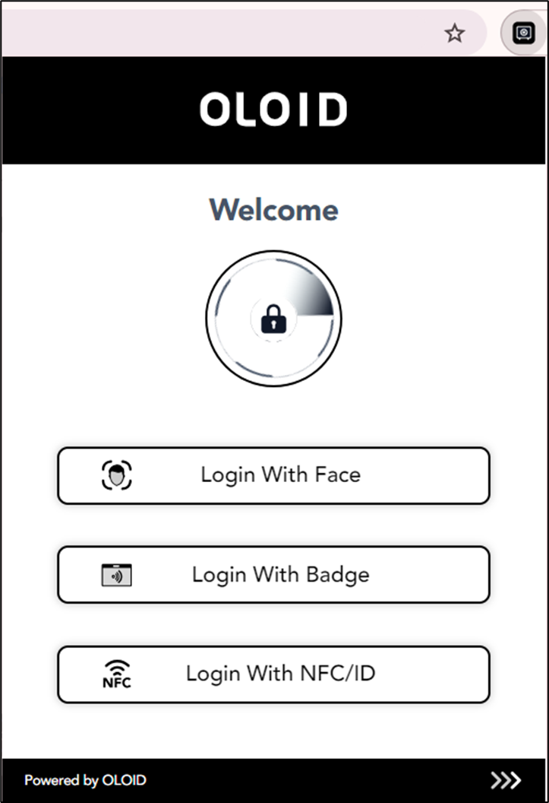
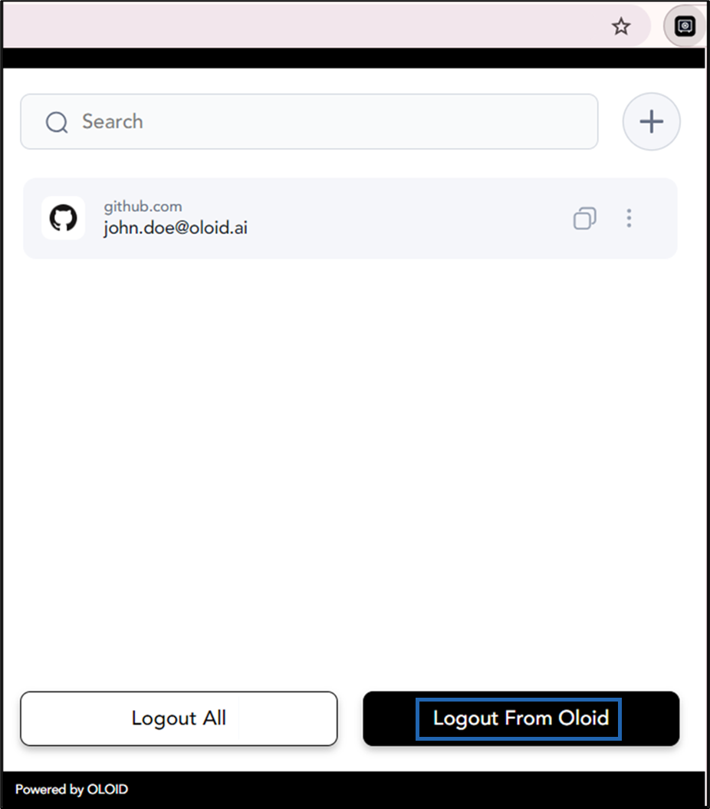

{/* Source: Intercom article 9766302 - https://oloid.help/en/articles/9766302-how-to-log-out-of-chrome-vault */}
{/* Generated by intercom_to_mintlify.py - re-running overwrites this file. */}

## Introduction

Chrome Vault allows users to securely manage credentials. To maintain privacy and prevent unauthorized access, users can log out either from all active websites or directly from the Chrome Vault application.

## Prerequisite

You must login to the Chrome Vault. To log in refer [How to log in to Chrome Vault](/platforms/web/vault/chrome/how-to-log-in-to-chrome-vault).

## Steps to log out

1. Open **Chrome Vault** application.

   

   You will see the list of websites with saved credentials.
2. Do one of the following:
   1. [Logout All](#logout-all)
   2. [Logout From Oloid](#logout-from-oloid)

### Logout All

1. Select **Logout All** to log out of all websites.

   

   The Confirm pop-up box is displayed.
2. Select **Logout All** to confirm your logout.

   

   <Note>
     **Note:** This option will log you out of all websites you are currently signed into in your browser, and you will be redirected to the login screen.
   </Note>

   

### Logout from Oloid

1. Select **Logout From Oloid**.

   

   <Note>
     **Note:** This option logs you out of the Chrome Vault app and the login screen is displayed.
   </Note>

   
