{/* Source: Intercom article 9618391 - https://oloid.help/en/articles/9618391-how-to-save-password-in-chrome-vault */}
{/* Generated by intercom_to_mintlify.py - re-running overwrites this file. */}

## Introduction

The Chrome Vault application securely stores and manages your website passwords in the browser. It lets you quickly access saved credentials without remembering multiple usernames and passwords. You can save passwords either while logging in through the browser or by using the add option in the Chrome Vault extension.

## Prerequisites

The Chrome Vault application must be installed. To install refer [How to install Chrome Vault application](/drafts/platforms/web/vault/chrome/how-to-install-chrome-vault-application).

## Steps to save password

1. Open **Google Chrome** browser and click **Chrome Vault** icon located on the toolbar.

   

   The welcome screen is displayed.
2. Log in to **Chrome Vault** application by selecting an authentication method. For more details refer [How to log in to Chrome Vault](/platforms/web/vault/chrome/how-to-log-in-to-chrome-vault).

   <Note>
     **Note:** You can see only the authentication ways enabled for you in the application. The button name may vary depending on the application configuration. Reach out to your [Support](Mailto:Support@oloid.ai) team if you do not see any authentication method.
   </Note>

   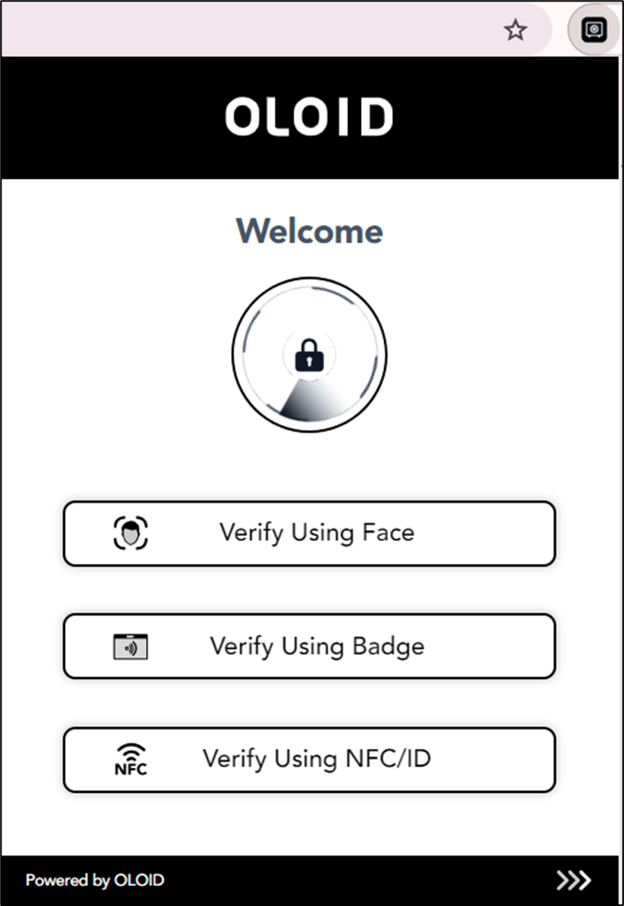

   You are logged in to Chrome Vault.

   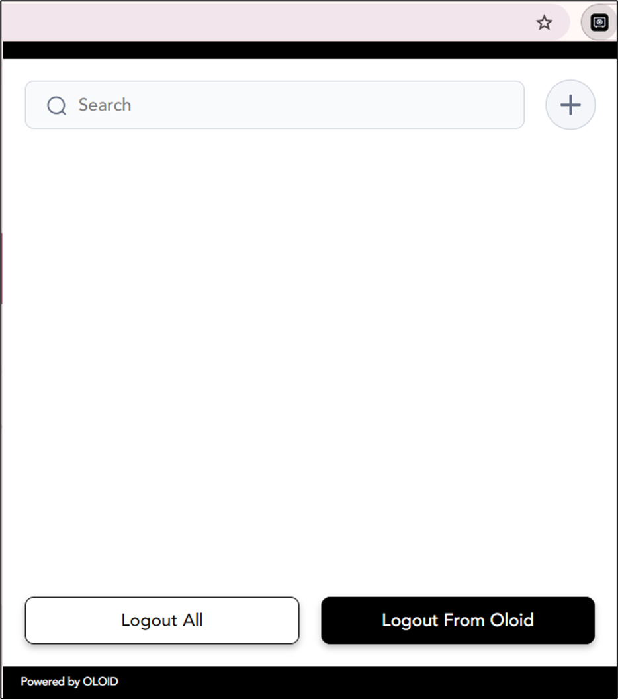

3. You can add website password using the following ways:
   1. [Using browser](#using-browser)
   2. [Using the add functionality of Chrome Vault](#using-the-add-functionality-of-chrome-vault)

      <Note>
        **Note:** You can save and use the same password for a domain and its related domains if multi-domain configuration is enabled for your Chrome Vault application.
      </Note>

### Using Browser

1. Go to a website that you need to log in.

   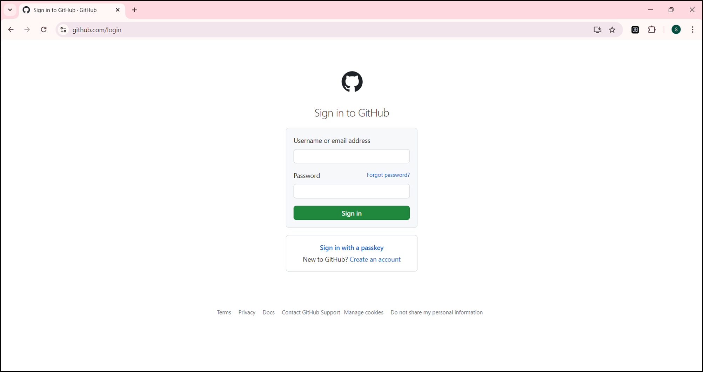

2. Click on any credential field .
   The **Chrome Vault** icon is displayed.
3. Click Chrome Vault icon () > **Save in Chrome Vault**.

   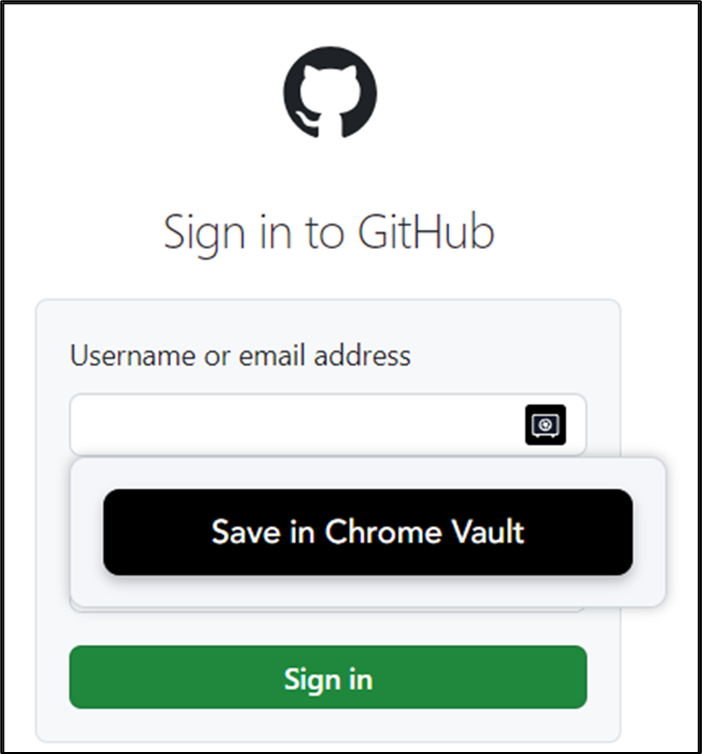

   The Chrome Vault pop-up box is displayed.
4. Do the following:
   1. **Website URL:** The application auto-fills the URL field.
   2. **Username**: Enter **Username**.
   3. **Password**: Enter **Password**.
   4. Click **Save Password**.

      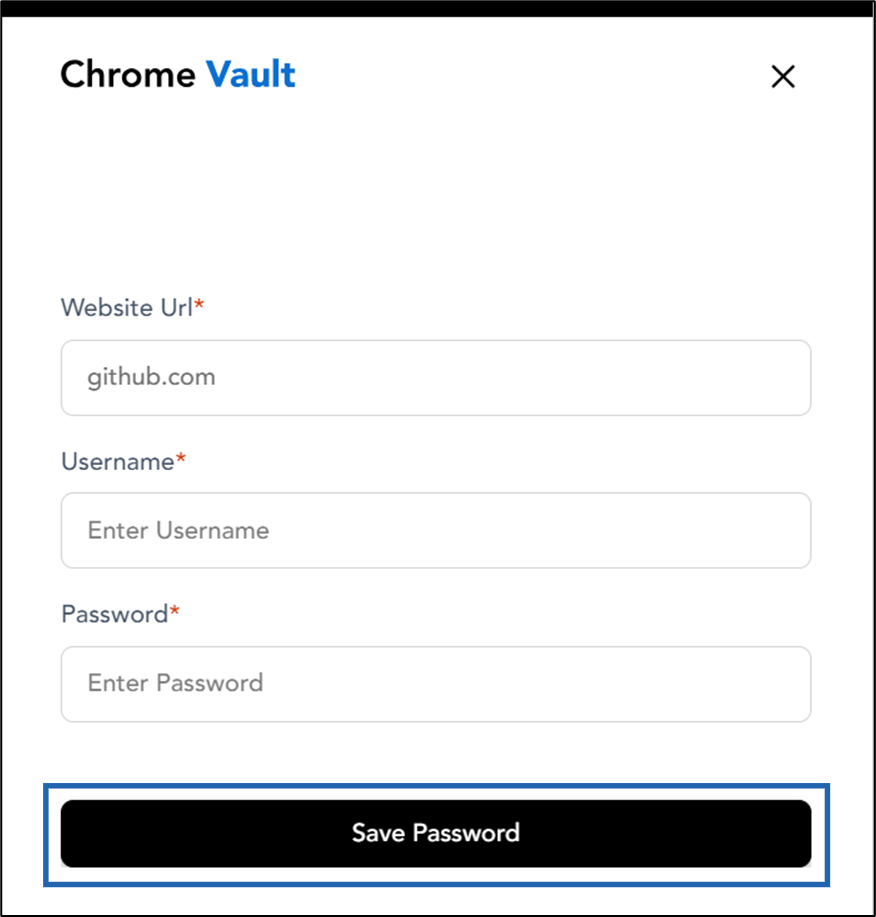

      The password is saved successfully

      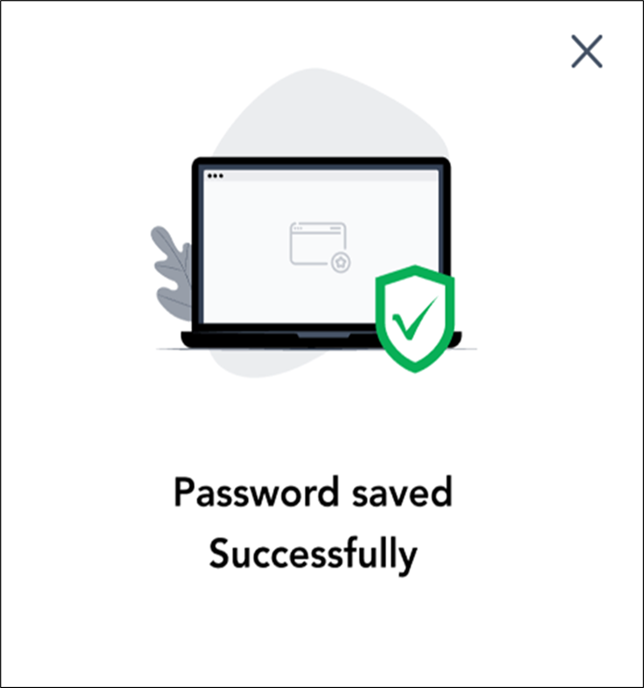

      The saved password displayed in the Chrome Vault.

      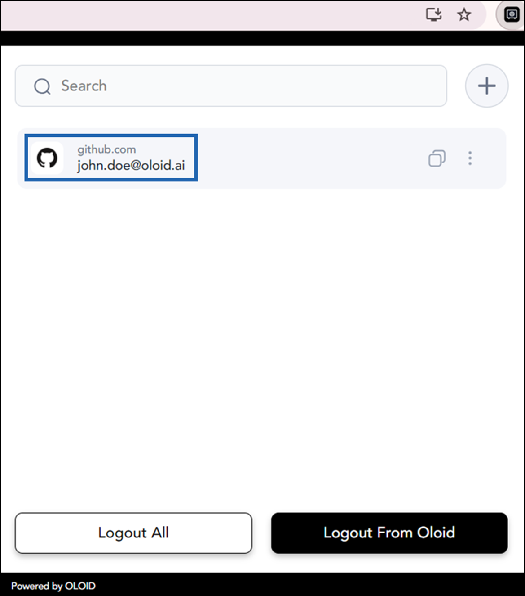

### Using the add functionality of Chrome Vault

- Go to a website that you need to log in.

  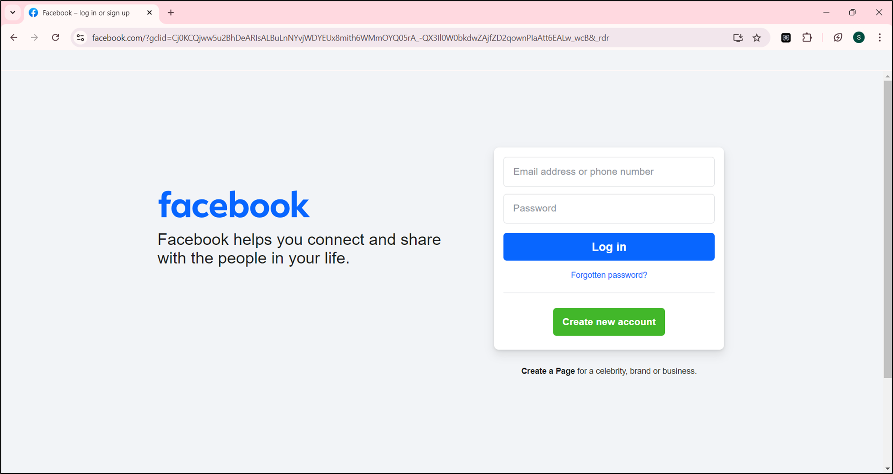

- On the top right, select Chrome Vault icon from the extension space.

  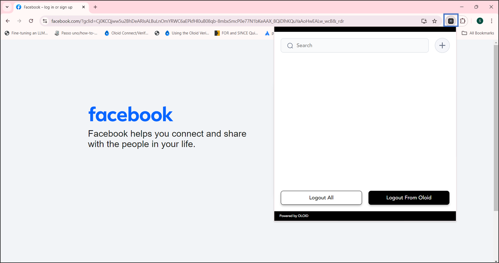

- Select add  icon to enter your credential.

  

  The Chrome Vault screen is displayed.
- Do the following:
  1. **Website URL:** The application auto-fills the URL field.
  2. **Username**: Enter **Username**.
  3. **Password**: Enter **Password**.
  4. Click **Save Password.**

     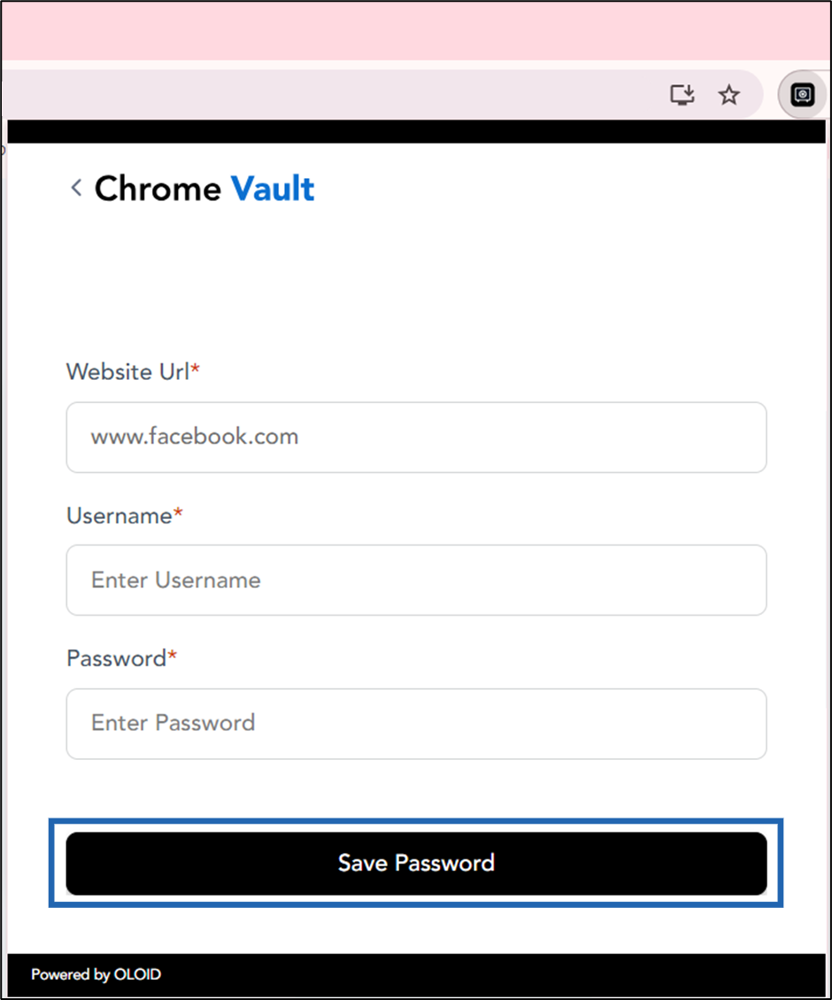

     The password is saved successfully

     

     The saved password displayed in the Chrome Vault.

     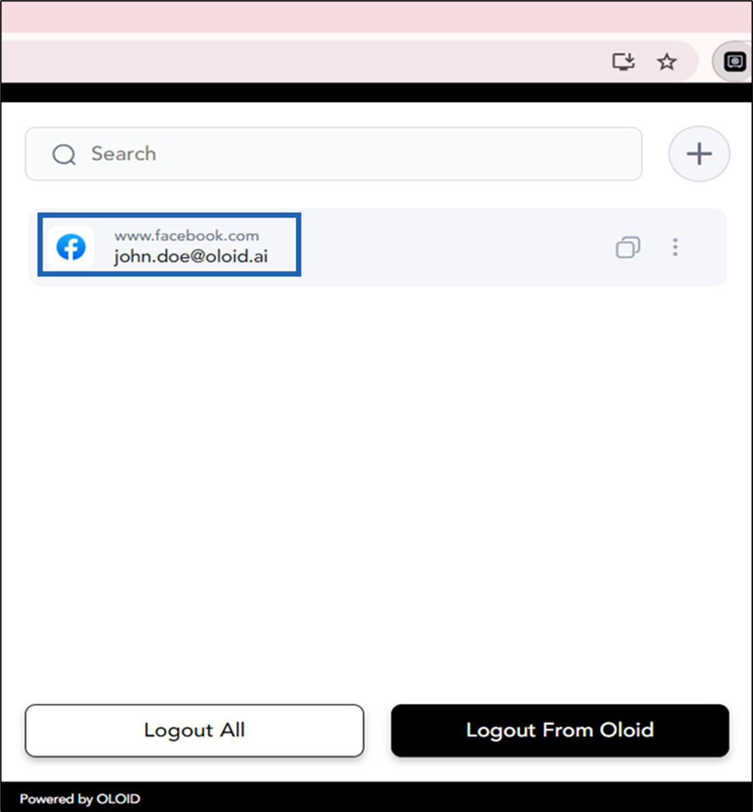

## Related Video

**[How to save password in Chrome Vault- Video Tutorial](/platforms/web/videos/how-to-save-password-in-chrome-vault-video-tutorial)**
