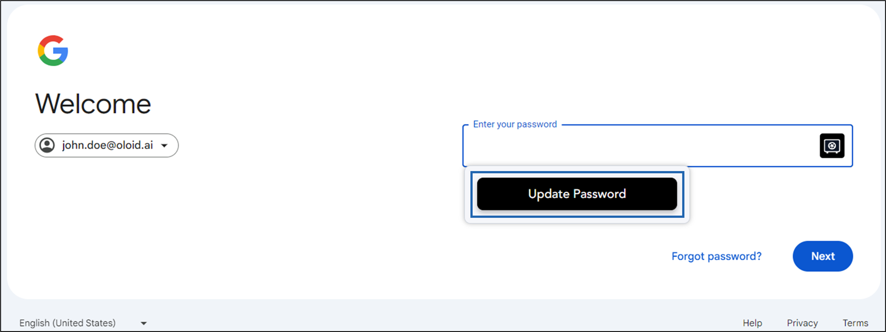
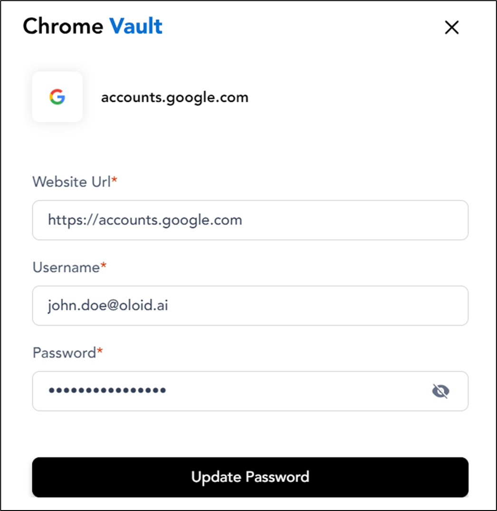
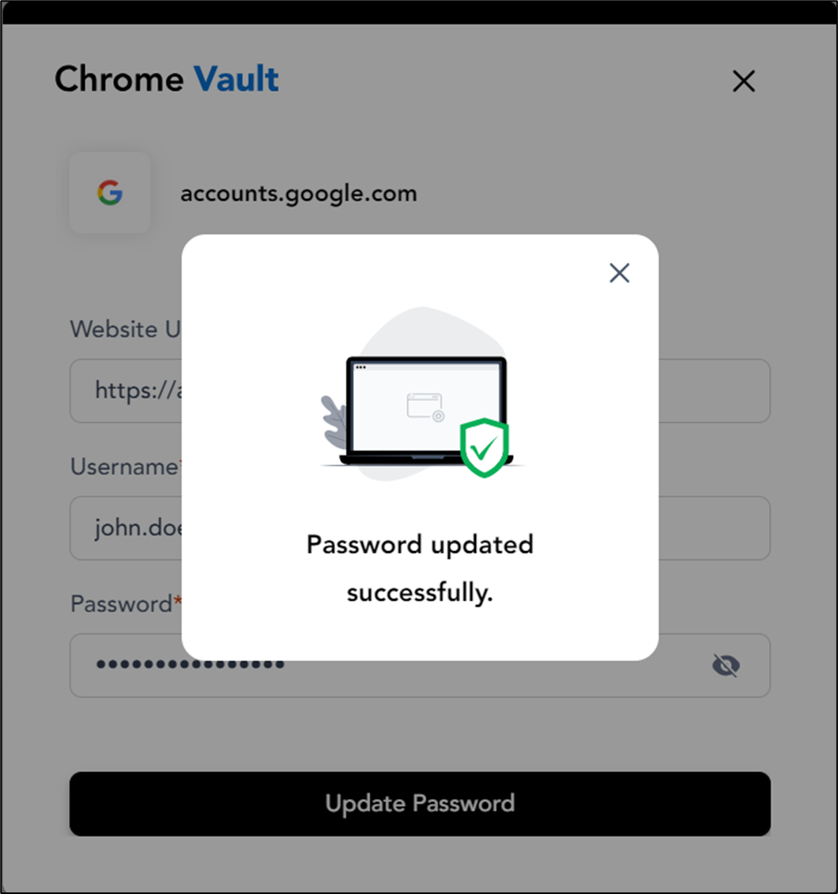

{/* Source: Intercom article 9819006 - https://oloid.help/en/articles/9819006-how-to-update-password-in-chrome-vault */}
{/* Generated by intercom_to_mintlify.py - re-running overwrites this file. */}

**Pre-requisite**

You have saved credentials in the Chrome Vault application. For more information, see [How to save password in Chrome Vault](/platforms/web/vault/chrome/how-to-save-password-in-chrome-vault)

To update password:

1. Go to a website that you need to log in.
2. Click on the password field.
   The Chrome Vault icon is displayed.
3. Edit the password field > **Update Password**.

   

   The Chrome Vault pop-up is displayed.

   

4. Click **Update Password**.
   The password is updated successfully and you can log in to the website.

   
