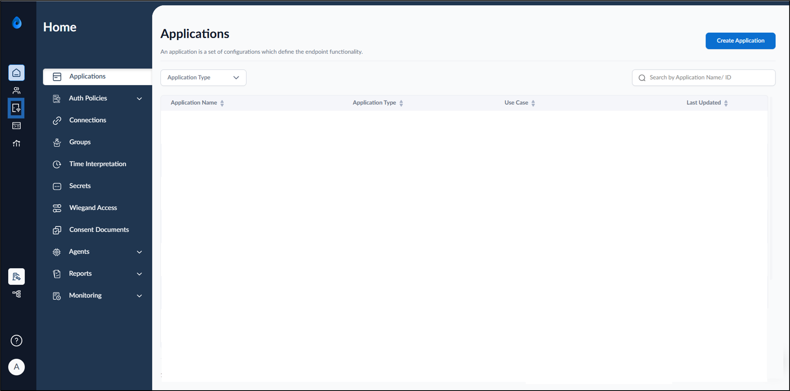
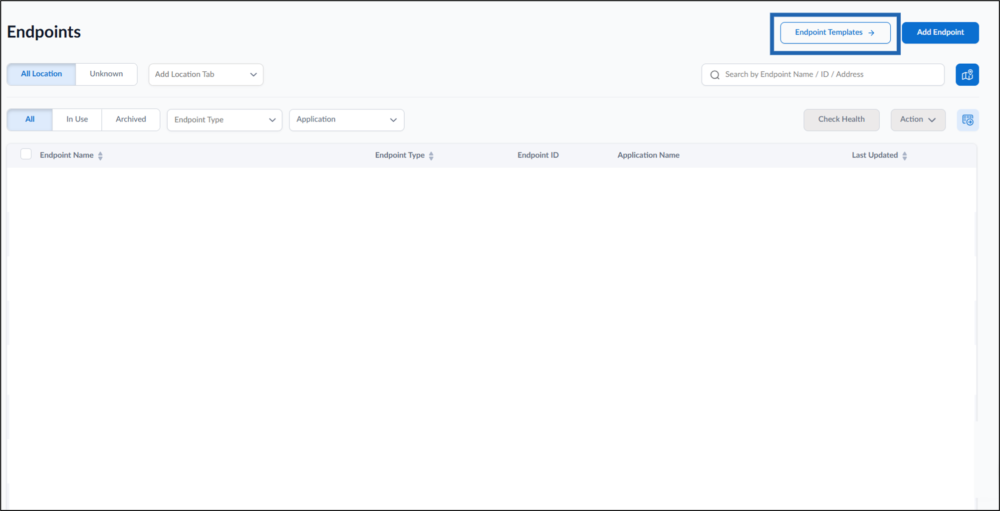
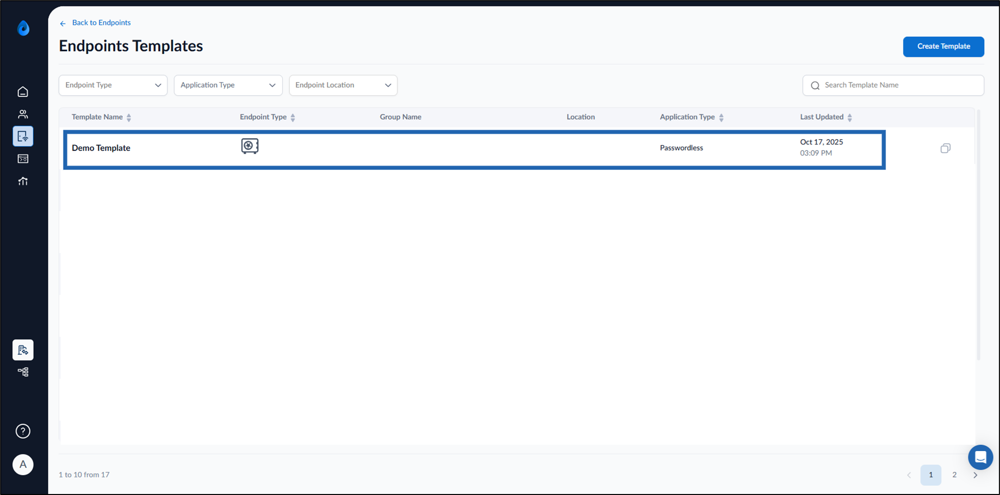
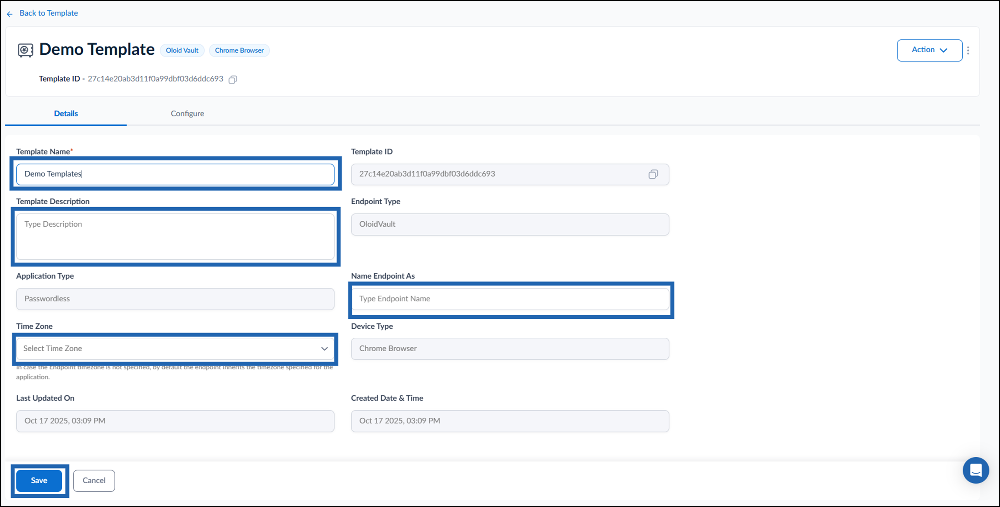
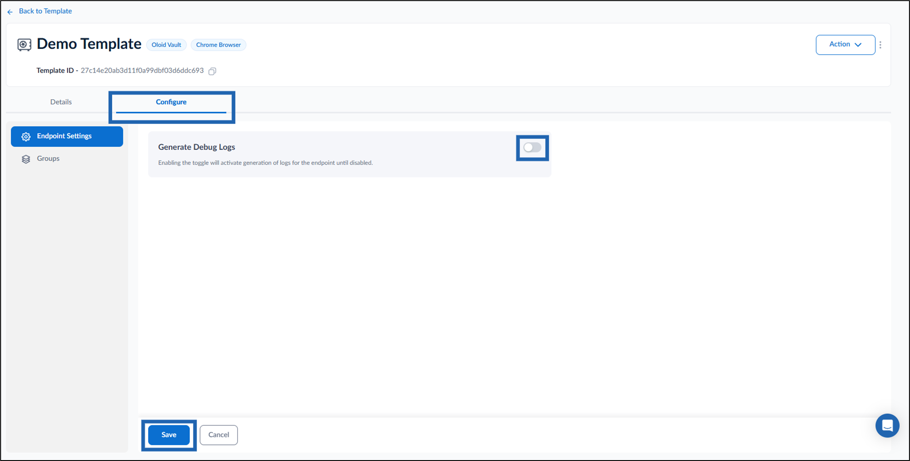
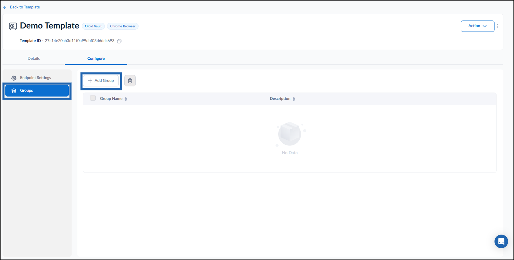
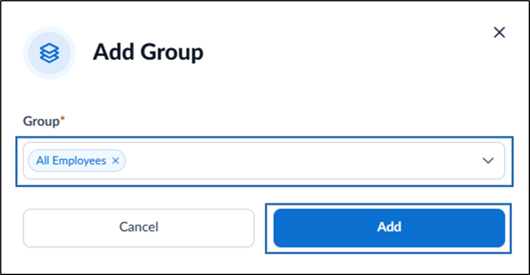
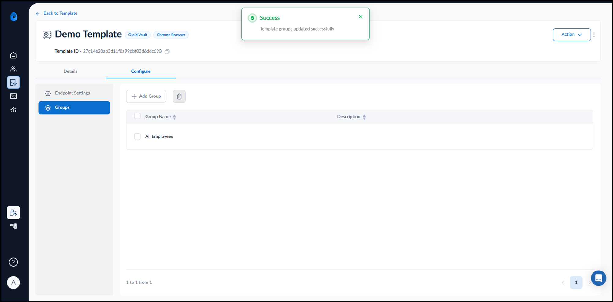

{/* Source: Intercom article 12636504 - https://oloid.help/en/articles/12636504-oloid-vault-chrome-chromium-how-configure-endpoint-templates-in-the-tenant-admin-portal */}
{/* Generated by intercom_to_mintlify.py - re-running overwrites this file. */}

## Introduction

The Endpoint Template in the Tenant Admin Portal allows Tenant Admin to configure and manage settings for endpoints used in the Oloid Vault (Chrome / Chromium) application.

## Prerequisites

You must create Endpoint Template. To create refer, [How to create Endpoint Template for Chrome Vault application in the Tenant Admin Portal](/platforms/web/vault/chrome/oloid-vault-chrome-chromium-how-to-create-and-configure-endpoint).

## Steps to configure Endpoint Templates

1. Log in to the **Tenant Admin Portal**.
2. On the homepage, select **Endpoint** from the left menu panel.

   

   The **Endpoints** page is displayed.
3. Click **Endpoint Template** from the top right.

   

   The **Endpoint Template** page is displayed.
4. Select the preferred Endpoint Template to edit.

   

   The Endpoint Template details page is displayed.
5. Do the following:
   1. Edit **Template Name**.
   2. Add **Template Description**.
   3. Select the **Time Zone** from the dropdown list.
   4. Add **Endpoint Name**.
   5. Click **Save**.

      

6. Go to Configure tab and do the following:
   1. Turn on **Generate Debug Logs** toggle to activate generation of logs for the endpoint until disabled.
   2. Click **Save**.

      

      The Endpoint Settings is configured successfully.
   3. Select **Groups** from the left menu panel > select **Add Groups**.

      

      The **Add Group** pop-up box is displayed.
   4. Do the following on the pop-up box:
      1. Select Groups from the **Groups** dropdown list.
      2. Click **Add**.

The Endpoint Template for DeviceLock Application is configured successfully.

