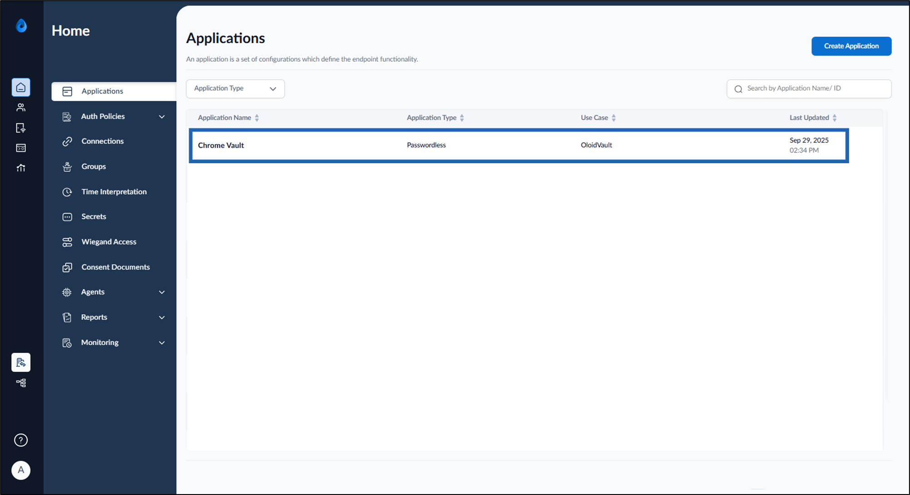
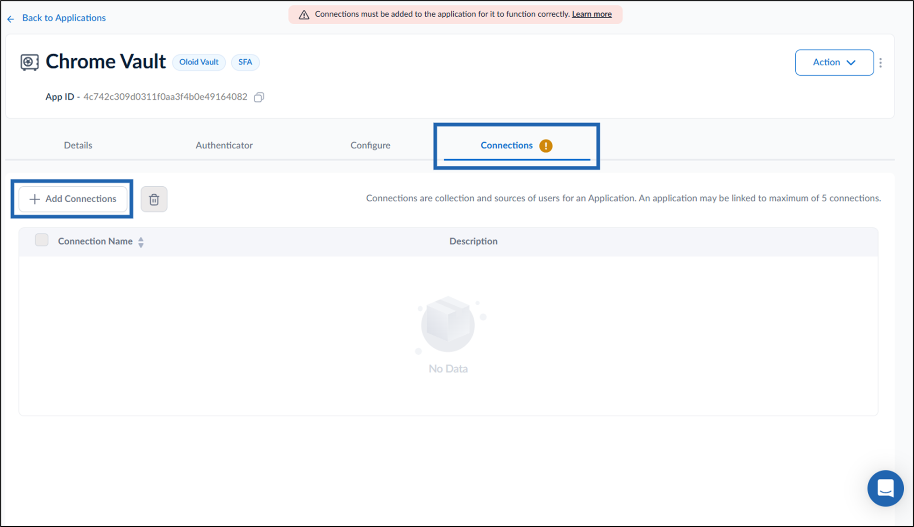
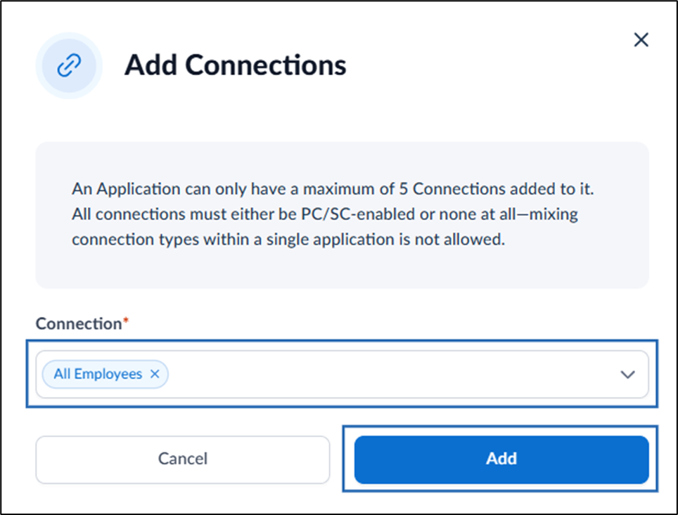
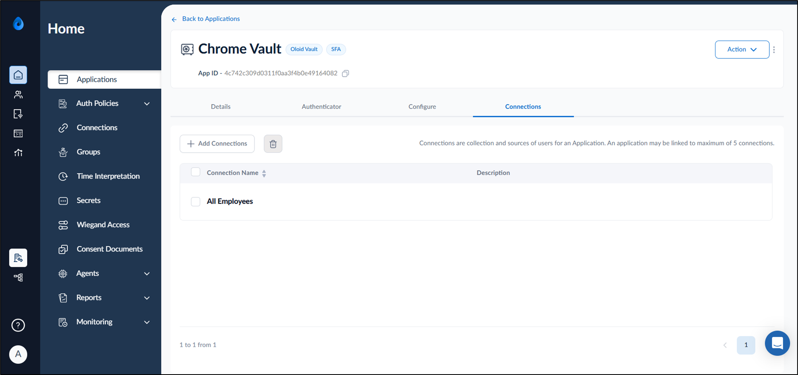

{/* Source: Intercom article 12442012 - https://oloid.help/en/articles/12442012-oloid-vault-chrome-chromium-how-to-add-connections-in-the-tenant-admin-portal */}
{/* Generated by intercom_to_mintlify.py - re-running overwrites this file. */}

## Introduction

The **Connections** tab in the Oloid Vault (Chrome / Chromium) application allows admin to link predefined connections to the application. By adding connections, you enable the application to communicate with supported endpoints for secure authentication and access.

## Prerequisites

- You must have access to the Tenant Admin Portal.
- You must create a Oloid Vault (Chrome / Chromium) application in the Tenant Admin Portal. To create refer [How to Create and Configure Oloid Vault (Chrome / Chromium) Application in the Tenant Admin Portal](/platforms/web/vault/chrome/oloid-vault-chrome-chromium-how-to-create-and-configure-oloid-vault).
- You must create Connections. To create Connections. To more information, refer [How to create Connections in the Tenant Admin Portal](/platform/tenant-admin-portal/tenant-admin-portal-how-to-create-connection).

## Steps to add Connections

1. Log in to the **Tenant Admin Portal**.
2. On the Home page of the portal, click on the preferred Oloid Vault application.

   

   The application detail page is displayed.
3. Go to **Connections** tab > select **Add Connections**.

   

   The Add Connection pop-up box is displayed.
4. Do the following:
   1. Select **Connection**(s) from Connection drop down list.
   2. Click **Add**.

      <Note>
        **Note:** An application can have up to 5 connections, and all must be either PC/SC-enabled or non-PC/SC. Combining different connection types is not allowed.
      </Note>

      

The Connection is successfully added to the application and listed in the connections list.

