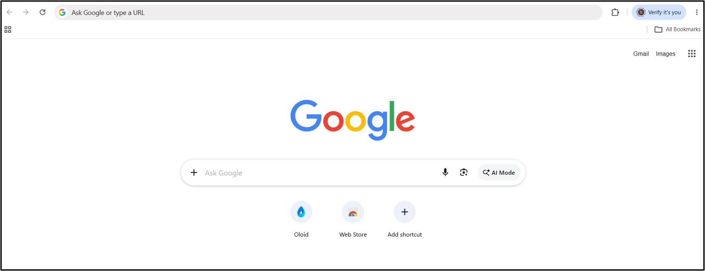
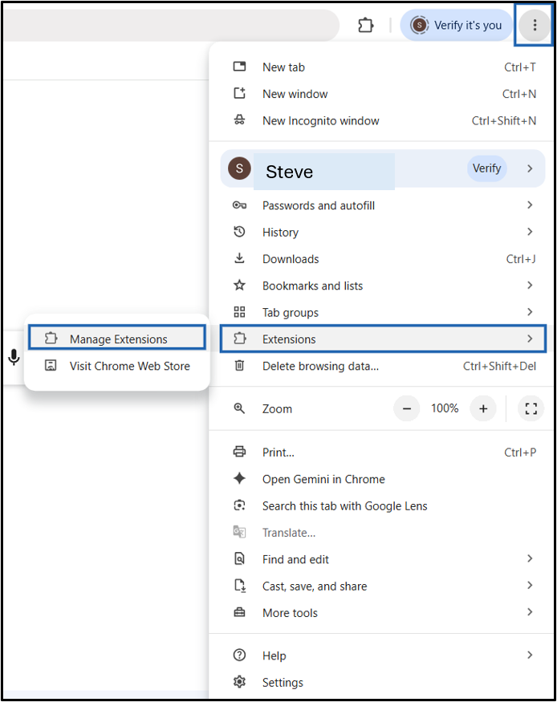
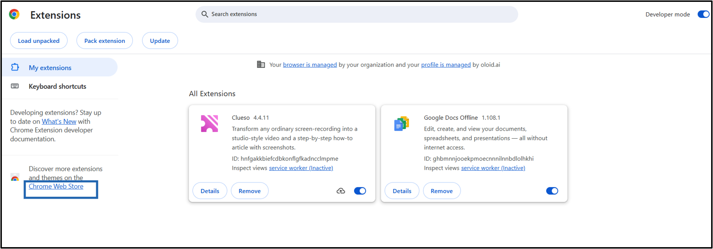
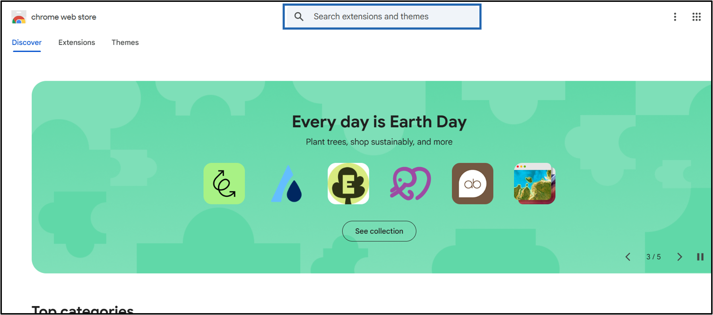
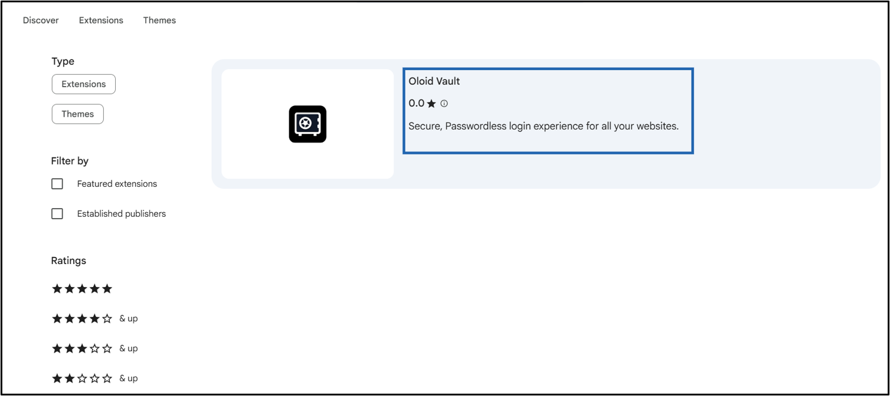
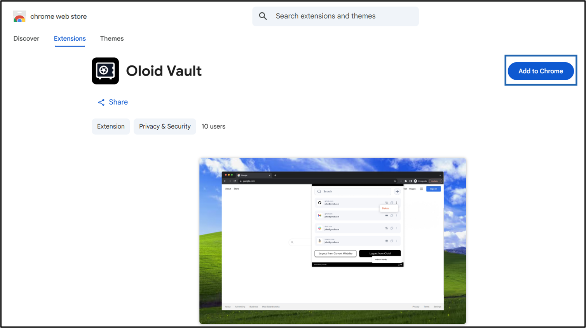
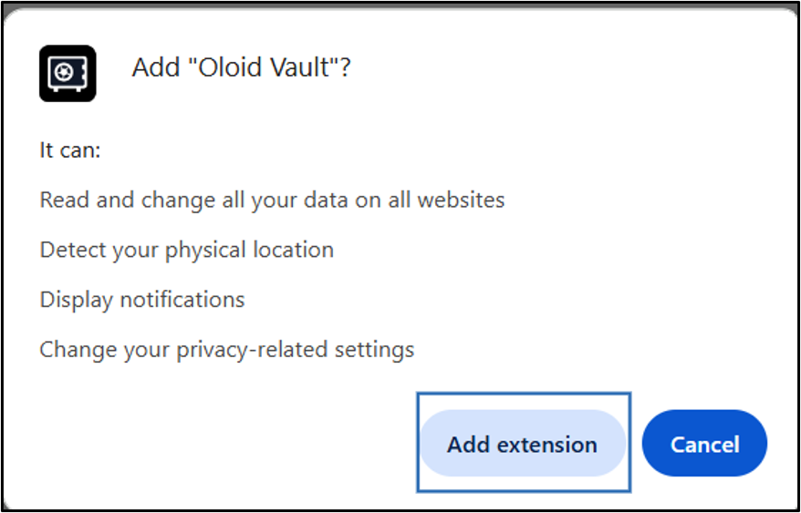
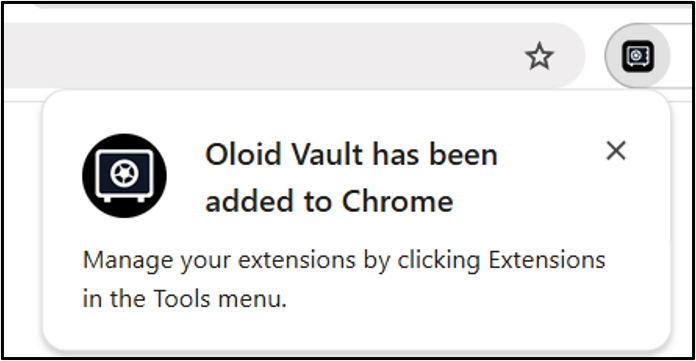

{/* Source: Intercom article 16105372 - https://oloid.help/en/articles/16105372-oloid-vault-chrome-chromium-how-to-add-the-oloid-vault-extension-from-the-chrome-web-store */}
{/* Generated by intercom_to_mintlify.py - re-running overwrites this file. */}

## Introduction

This document provides instructions to install the Oloid Vault extension in Google Chrome from the Chrome Web Store.

## Prerequisites

- Google Chrome is installed on the device.
- You have an active internet connection.
- You have permission to install browser extensions.

## Steps to Add Oloid Vault Extension in Google Chrome.

1. Open the Google Chrome browser.
   The Google Chrome browser is displayed.

   

2. Click the **Menu (three dots)** icon > **Extensions > Manage Extensions**.

   <Note>
     **Note:** You can also click **Visit Chrome Web Store** to open the Chrome Web Store and skip **Step 3**.
   </Note>

   

   The Extensions screen is displayed.
3. Click **Chrome Web Store**.

   

   The Chrome Web store screen is displayed.
4. In the search bar, enter **Oloid Vault**.

   

   The **Oloid Vault Extension** screen is displayed.
5. Click **Oloid Vault**.

   

   The Oloid Vault Extension screen is displayed.
6. Click **Add to Chrome**.

   

   The **Add "Oloid Vault"** pop-up box is displayed.
7. Click **Add extension**.

   

   The Oloid Vault extension is successfully added to Google Chrome.

   
