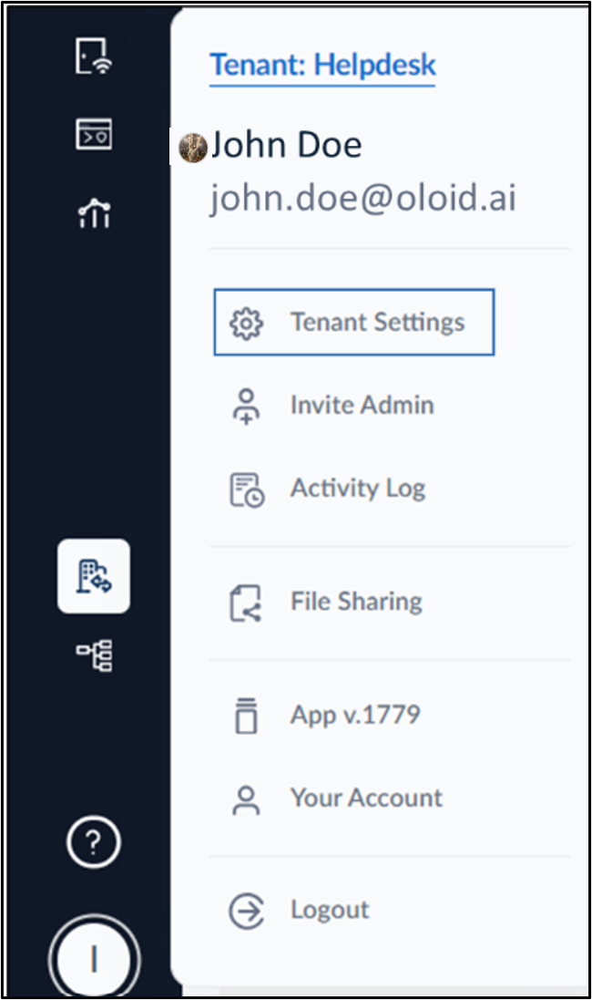
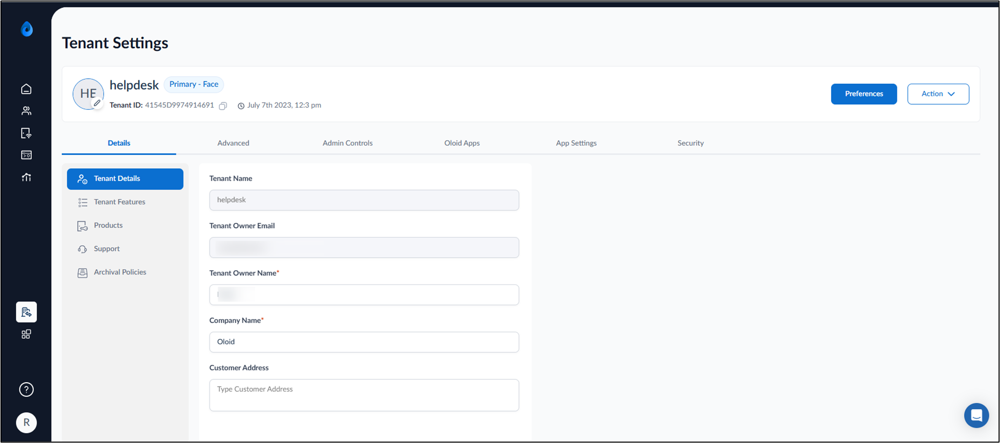
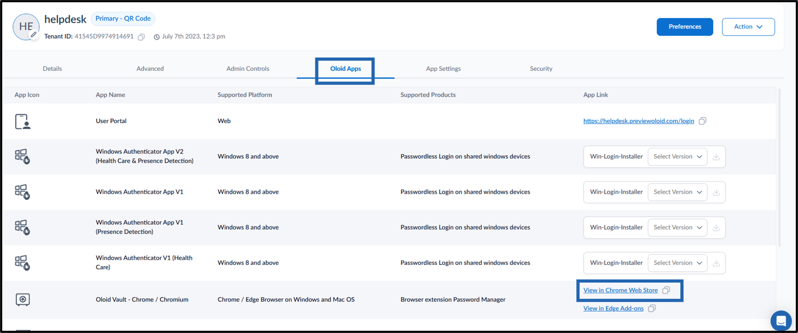
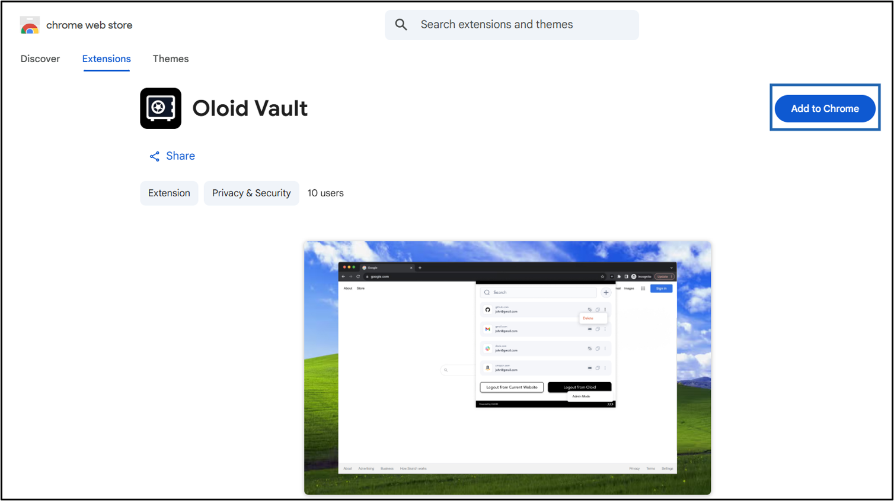
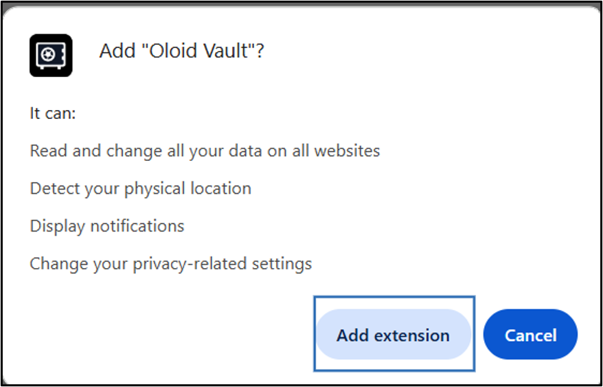
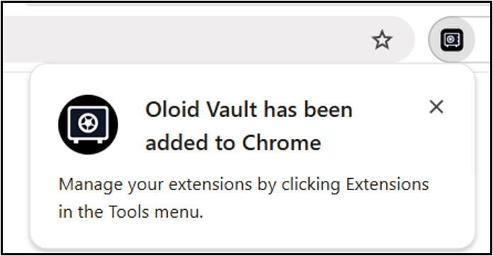
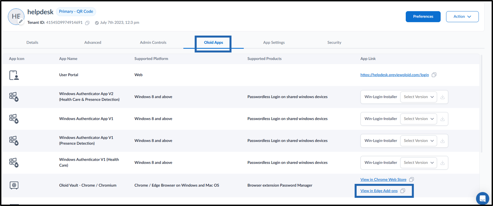
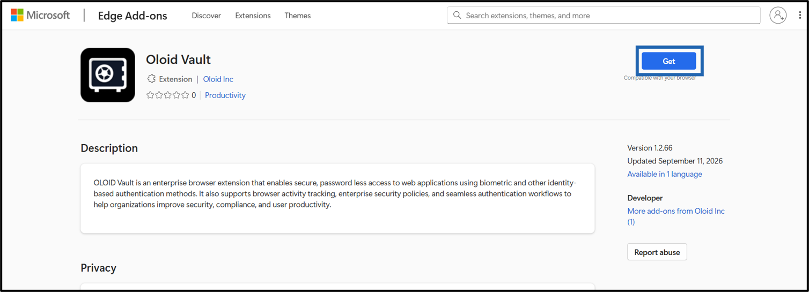
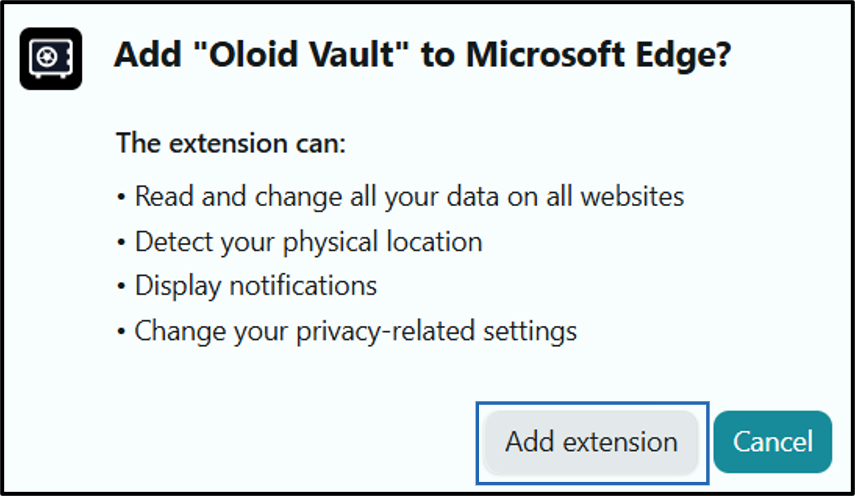
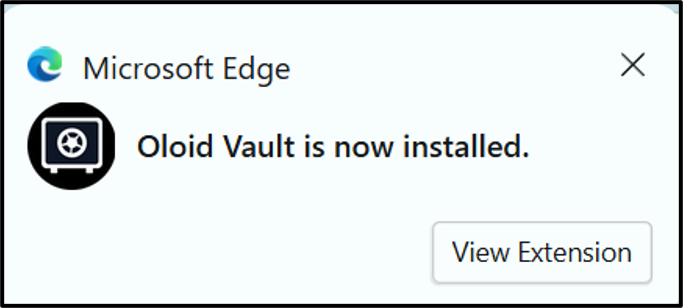

{/* Source: Intercom article 16145298 - https://oloid.help/en/articles/16145298-oloid-vault-chrome-chromium-how-to-add-the-oloid-vault-extension-using-the-tenant-admin-portal */}
{/* Generated by intercom_to_mintlify.py - re-running overwrites this file. */}

## Introduction

This document provides instructions to add the Oloid Vault extension to Google Chrome and Microsoft Edge using the Tenant Admin Portal.

## Prerequisites

- You must have access to the Tenant Admin Portal.
- Google Chrome or Microsoft Edge must be installed on your Windows or macOS device.

## Steps to Add Oloid Vault Extension

1. Log in to **Tenant Admin Portal**.
2. On the homepage of the portal, click **User profile icon** at the bottom-left corner of the menu panel.
   The user profile menu is displayed.
3. Click **Tenant Settings**.

   

   The **Tenant Settings** screen is displayed.

   

4. Go to **Oloid Apps** tab and click one of the following:
   1. View in Chrome Web Store.
   2. View in Edge Add-ons.

#### Add Oloid Vault Extension to Google Chrome

1. On the **Oloid Apps** tab, click **View in Chrome Web Store**.

   

   The Oloid Vault Extension page is displayed.
2. Click **Add to Chrome**.

   

   The **Add Oloid Vault** pop-up box is displayed.
3. Click **Add extension**.

   

   The Oloid Vault extension is successfully added to the Google Chrome.

   

#### Add Oloid Vault Extension to Microsoft Edge

1. On the **Oloid Apps** tab, click **View in Edge Add-ons**.

   

   The Oloid Vault extension page is displayed in Microsoft Edge Add-ons.
2. Click **Get**.

   

   The Add "Oloid Vault" to Microsoft Edge? pop-up box is displayed.
3. Click **Add extension**.

   

   The Oloid Vault extension is successfully added to Microsoft Edge.

   
