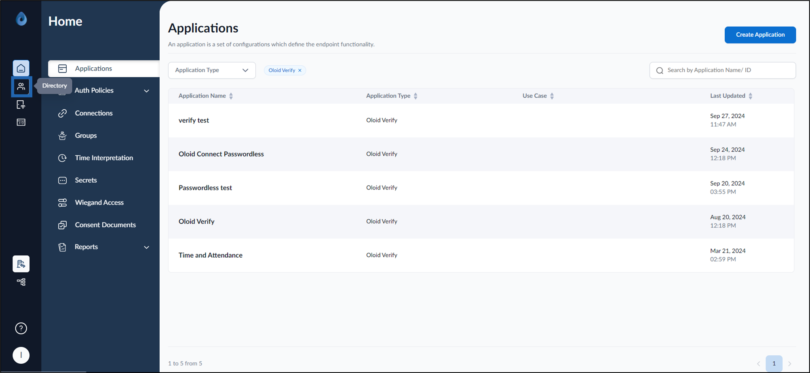
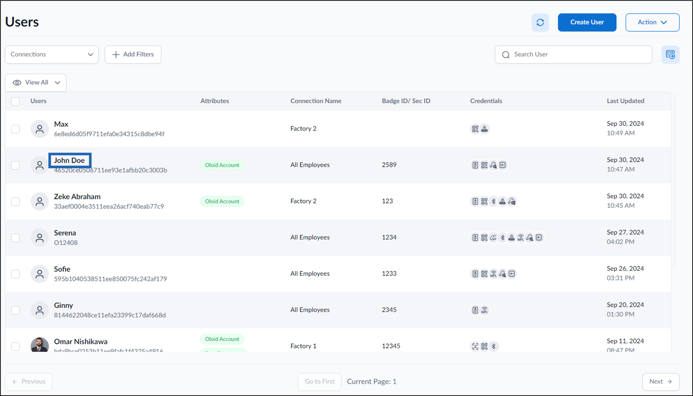
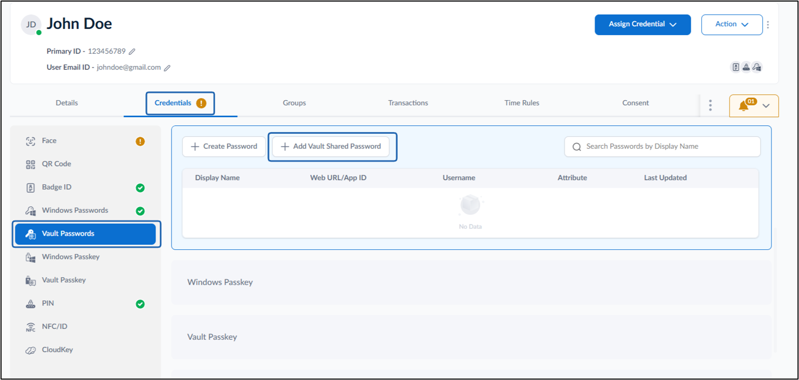
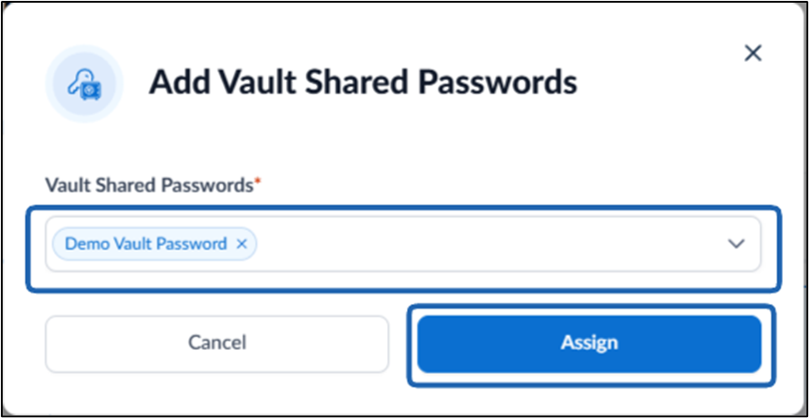
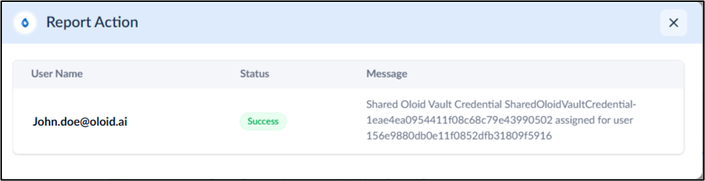

{/* Source: Intercom article 13284463 - https://oloid.help/en/articles/13284463-oloid-vault-chrome-chromium-how-to-add-vault-shared-password-for-a-user-in-the-tenant-admin-portal */}
{/* Generated by intercom_to_mintlify.py - re-running overwrites this file. */}

## Introduction

The Add Vault Shared Password feature allows an admin to securely assign an existing shared password from the Vault to a specific user.

## Prerequisites

- You must have access to the Tenant Admin Portal.
- Vault Shared Password must already be created. For more information, refer [How to create Vault Password for a user](/platform/tenant-admin-portal/tenant-admin-portal-how-to-create-vault-password-for-a-user)

## Steps to Assign Vault Password

1. Log in to the Tenant Admin Portal.
2. On the homepage, click **Directory** from the left menu panel.

   

   The **Users** page is displayed.
3. Select preferred **User** from the list.

   

   The **User details** page is displayed.

   

4. Go to **Credential** tab > **Vault Passwords** > **+ Add Vault Shared Password**.

   

   The Vault Shared password pop-up is displayed.
5. **Select** Vault Shared password to Assign from the dropdown.

   <Note>
     **Note:** More than one Vault shared password can be assigned for a user.
   </Note>

6. Click **Assign.**

   

   Vault shared password is assigned to user.

   
