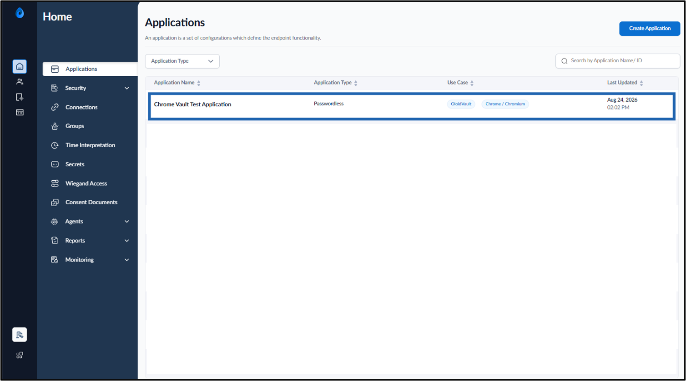
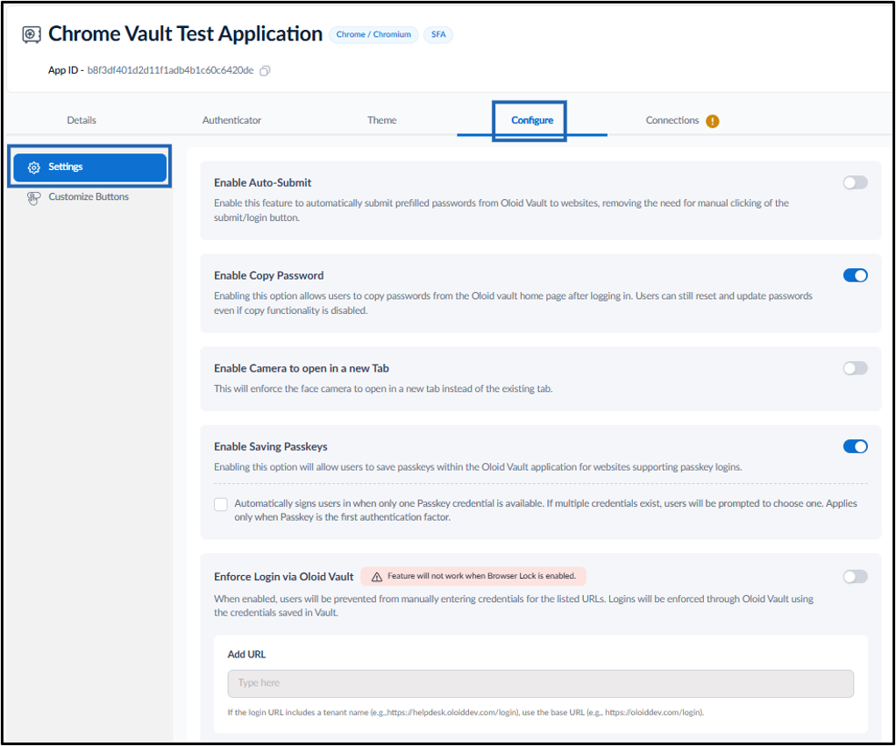
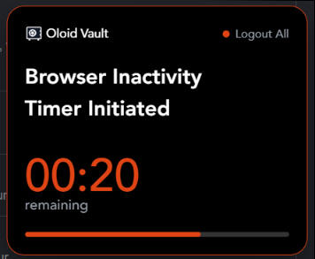
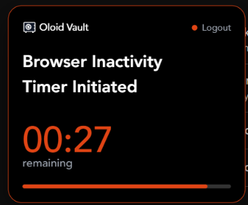
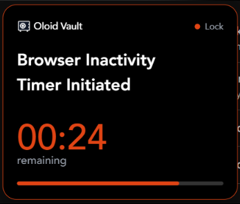
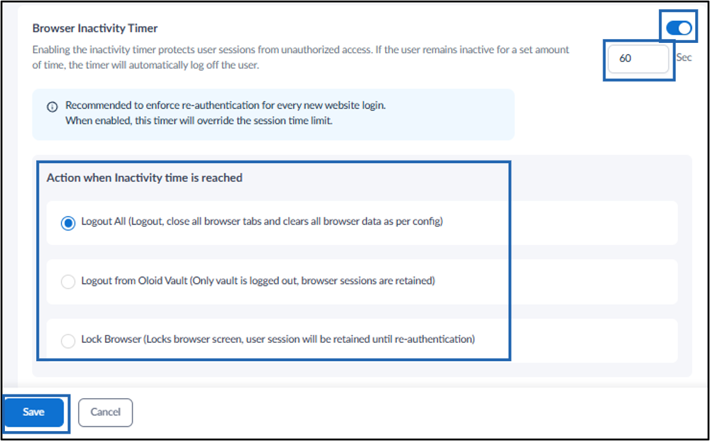

{/* Source: Intercom article 16592724 - https://oloid.help/en/articles/16592724-oloid-vault-chrome-chromium-how-to-configure-browser-inactivity-timer-in-the-tenant-admin-portal */}
{/* Generated by intercom_to_mintlify.py - re-running overwrites this file. */}

## Introduction

This document provides instructions to configure the **Browser Inactivity Timer** for Oloid Vault. The inactivity timer automatically performs the configured action when the browser remains inactive for the specified duration.

## Prerequisite

You must have admin access to the Tenant Admin Portal.

## Steps to Configure Browser Inactivity Timer

1. Log in to the **Tenant Admin Portal**.
2. On the Home page, click on the preferred Oloid Vault application.

   

   The application detail page is displayed.
3. Go to **Configure** > **Settings.**

   

   The **Settings** tab is displayed
4. Do the following:
   1. Enable **Browser Inactivity Timer** toggle.
   2. Enter the inactivity duration in seconds.

      <Note>
        **Note:** It is recommended to configure the inactivity timer to enforce re-authentication for each new website login. When enabled, the timer overrides the session time limit.
      </Note>

   3. In **Action when Inactivity time is reached** section, select one of the following:
      - **Logout All:** Logs out the user, closes all browser tabs, and clears browser data according to the configured browser settings.
        **Sample Screen:** If **Logout All** is Selected.

        

      - **Logout from Oloid Vault:** Logs out the user from Oloid Vault while retaining the existing browser sessions.
        **Sample Screen:** If **Logout from Oloid Vault** is Selected.

        

      - **Lock Browser:** Locks the browser and retains the user session until the user re-authenticates.
        **Sample Screen:** If **Lock Browser** is Selected.

        

   4. Click **Save**.

      

The Browser Inactivity Timer is configured successfully.

---

#### Related Document

[Oloid Vault (Chrome / Chromium) - How to Create and Configure Oloid Vault Application in the Tenant Admin Portal](/platforms/web/vault/chrome/oloid-vault-chrome-chromium-how-to-create-and-configure-oloid-vault)
