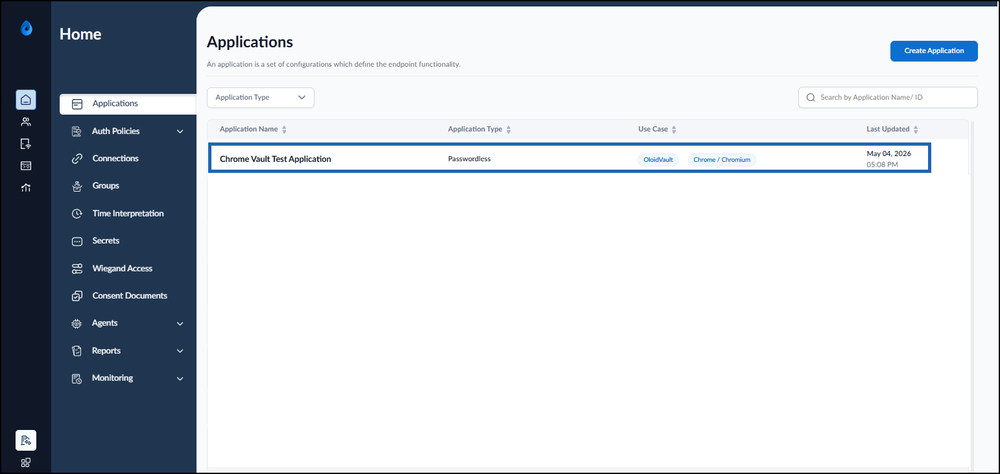
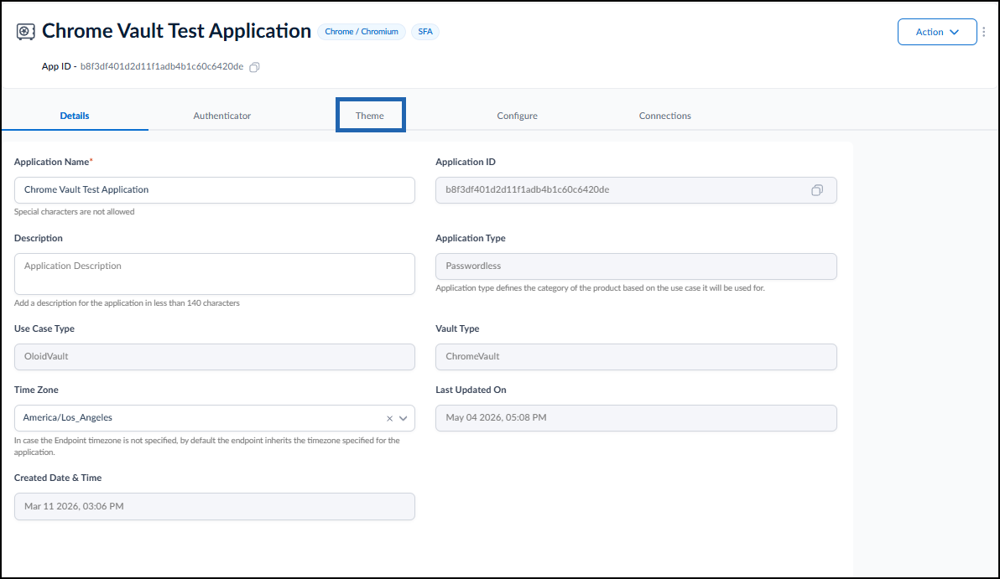
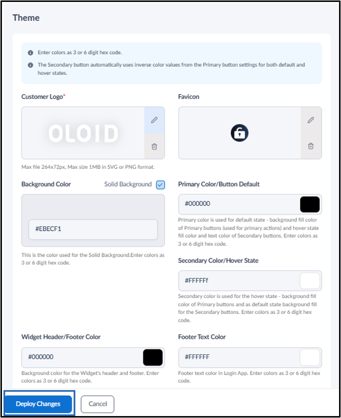
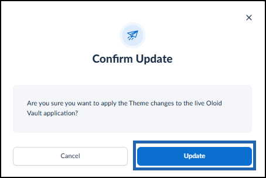
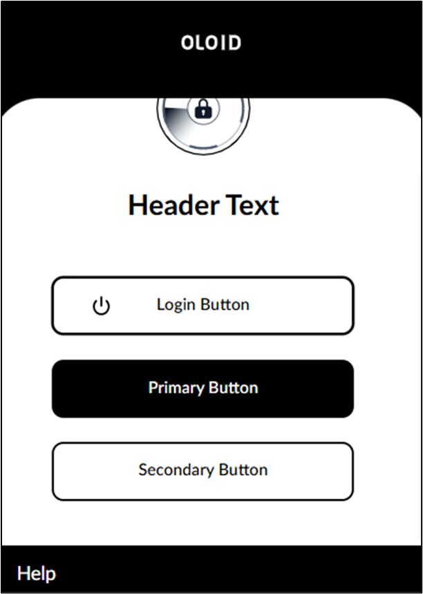

{/* Source: Intercom article 14887791 - https://oloid.help/en/articles/14887791-oloid-vault-chrome-chromium-how-to-configure-theme-tab-in-tenant-admin-portal */}
{/* Generated by intercom_to_mintlify.py - re-running overwrites this file. */}

## Introduction

The Theme tab in the Tenant Admin Portal for Oloid Vault application allows you to customize the appearance of your Oloid Vault Application. You can upload your organization’s logo, change the login icon, and update the button text to align with your company’s standards.

## Prerequisite

You must create an Oloid Vault Application in the Tenant Admin Portal. For more details, refer [How to Create and Configure Oloid Vault (Chrome / Chromium) Application in the Tenant Admin Portal](/platforms/web/vault/chrome/oloid-vault-chrome-chromium-how-to-create-and-configure-oloid-vault).

## ****Steps to Configure Theme Tab

1. Log in to the **Tenant Admin Portal**.
2. On the **Applications** page, click on the preferred Oloid Vault application to edit.

   

   The application page is displayed.
3. Click **Theme** tab.

   

   The **Theme** tab is displayed.
   Do the following.
   1. Upload **Customer Logo**.
   2. Upload **Background Color**. (optional)

      <Note>
        **Note:** You can set solid color in your background. Select **Solid Background** and enter the color code.
      </Note>

   3. Enter color code for **Primary Color**. (optional)
   4. Enter color code for **Secondary color**. (optional)
   5. Enter color code for **Widget Header/Footer Color**. (optional)
   6. Enter color code **Footer Text Color**. (optional)
4. Click **Deploy Changes**.

   

   The **Confirm Update** pop-up box is displayed.
5. Click **Update**.

   

   The theme customization is set for Oloid Vault Application successfully. You can see the changes in the preview screen.

   
