{/* Source: Intercom article 12606069 - https://oloid.help/en/articles/12606069-oloid-vault-chrome-chromium-how-to-create-and-configure-endpoint-template-in-the-tenant-admin-portal */}
{/* Generated by intercom_to_mintlify.py - re-running overwrites this file. */}

## Introduction

The Tenant Admin Portal allows admin to create endpoint templates for the Oloid Vault (Chrome / Chromium) application, enabling standardized configuration across devices.

## Prerequisites

You must have admin access to the Tenant Admin Portal.

## Steps to Create Endpoint Template

1. Log in to the **Tenant Admin Portal**.
2. On the homepage, select **Endpoint** from the left menu panel.

   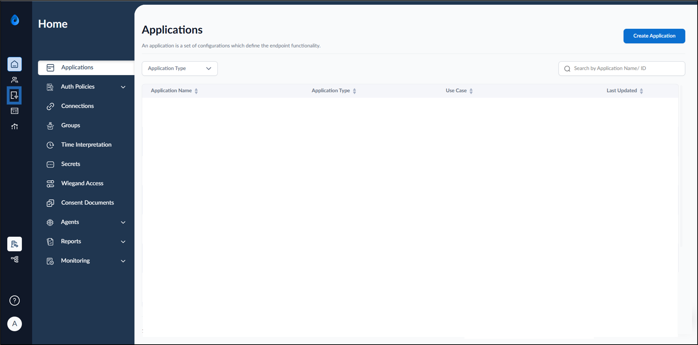

   The **Endpoints** page is displayed.
3. Click **Endpoint Templates** on the top right.

   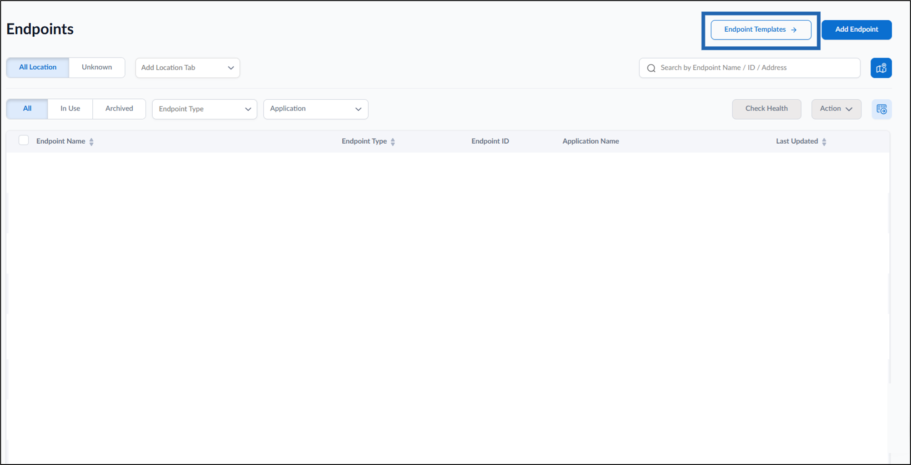

   The **Endpoint Templates** page is displayed.
4. Click **Create Template**.

   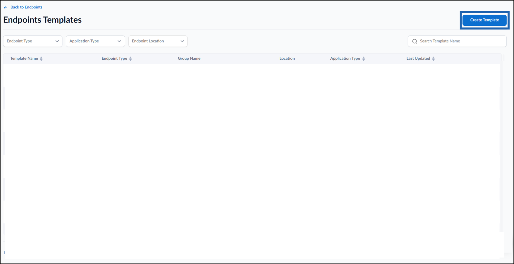

   The **Create New Template** pop-up box is displayed.
5. Do the following.
   1. Enter the **Template Name**.
   2. Select **Passwordless** from the **Application type** drop-down list.
   3. Select **OloidVault** from the **Endpoint Type** drop-down list.
   4. Select **Chromium Vault** from the Vault Type drop-down list.
   5. Click **Create**.

      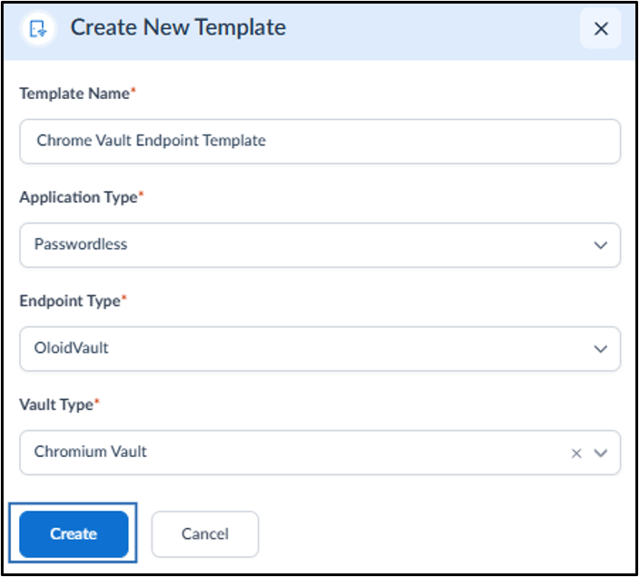

The Oloid Vault (Chromium) endpoint template is created successfully.

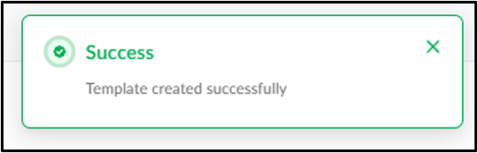

## Steps to Configure an Oloid Vault (Chromium) Endpoint Template

1. Click the preferred Endpoint template name to configure.

   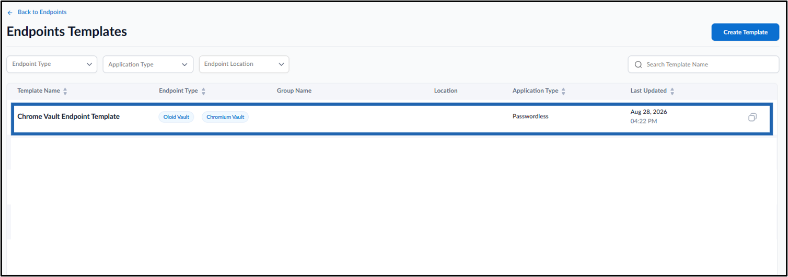

   The Endpoint template details page is displayed.

   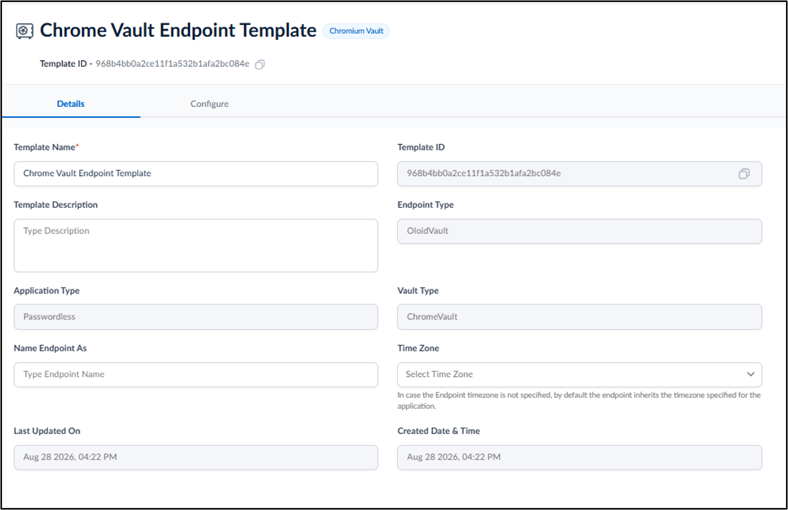

2. Do the following:
   1. [Configure Details tab](#configure-details-tab)
   2. [Edit Configure tab](#edit-configure-tab)

### Configure Details Tab

The **Details** tab allows you to view and update the basic information of the endpoint template, such as the template name, description, endpoint name, and time zone.

1. Edit **Template Name** if required.
2. Enter **Template Description**. (Optional)
3. Enter **Name Endpoint As**. (Optional)

   <Note>
     **Note:** Once the template is selected while pairing an endpoint on the device, the name provided in the **Name Endpoint As** field will be displayed for the endpoint.
   </Note>

4. Select **Time Zone** from the dropdown. (Optional)
5. Click **Save**.

   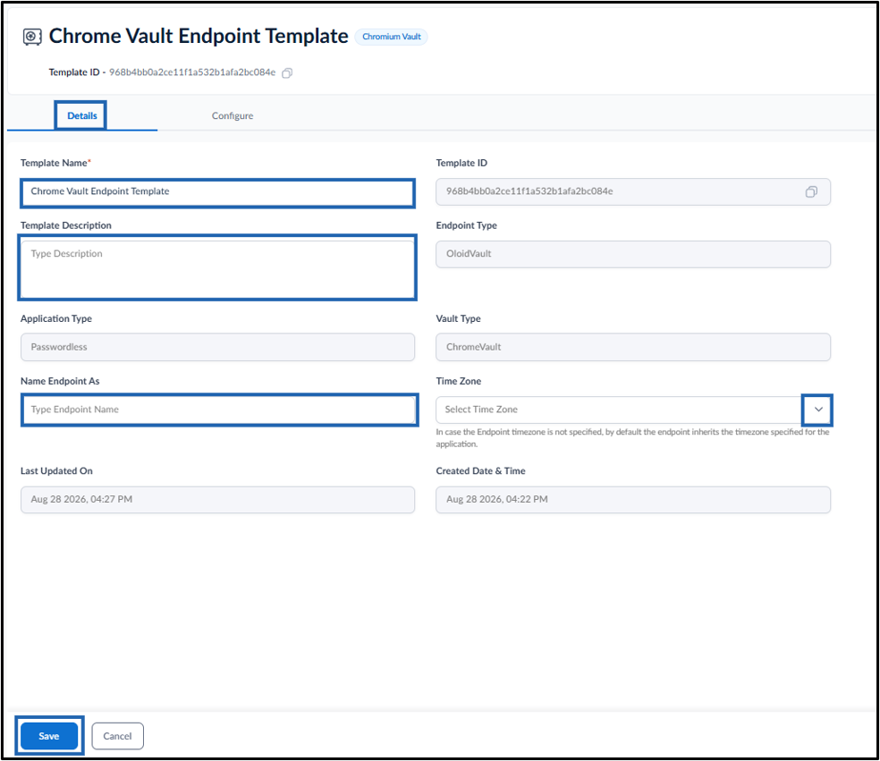

### Edit Configure Tab

The **Configure** tab allows you to configure the endpoint settings and assign groups to the endpoint template.

Do the following:

- [Configure Endpoint Settings](#configure-endpoint-setting)
- [Configure Groups](#configure-groups)

### Configure Endpoint Setting

1. Enable the **Generate Debug Logs** toggle to activate log generation for endpoint until disabled.
2. Click **Save**.

   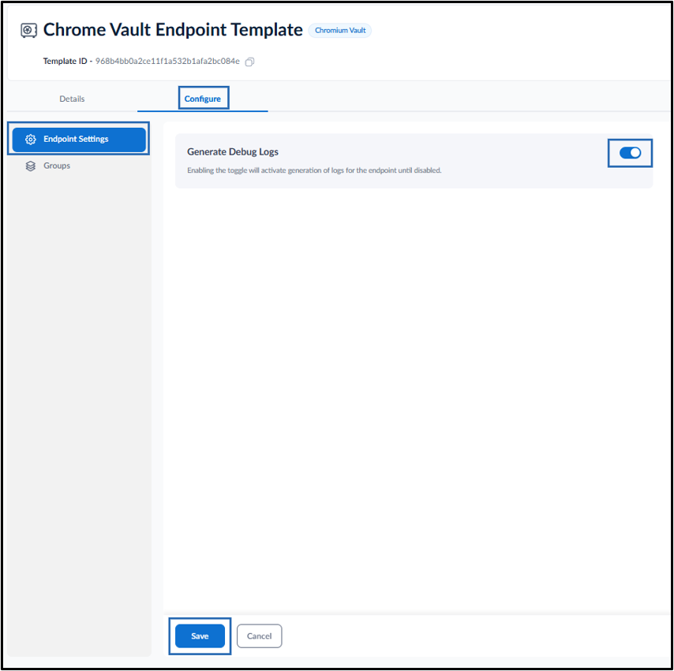

   The Endpoint settings section is configured successfully.

   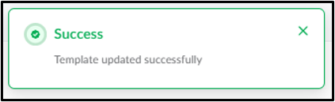

### Configure Groups

The **Groups** section allows you to add groups to the endpoint template. Users associated with the added groups can use the endpoints configured with this template.

1. Select **Groups** option from left menu panel > click **Add Group**.

   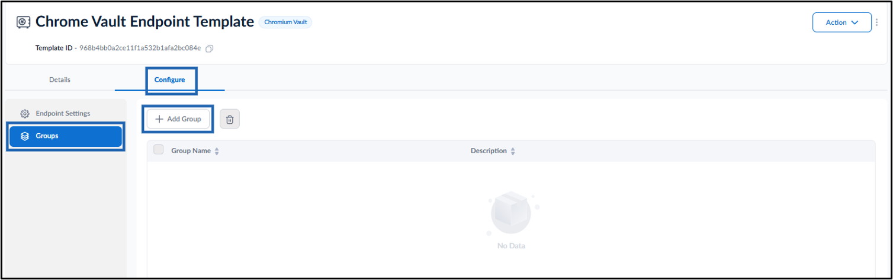

   The **Add Group** pop-up box is displayed.
2. Do the following:
   1. Select **Group(s)** from the dropdown list.
   2. Click **Add**.

      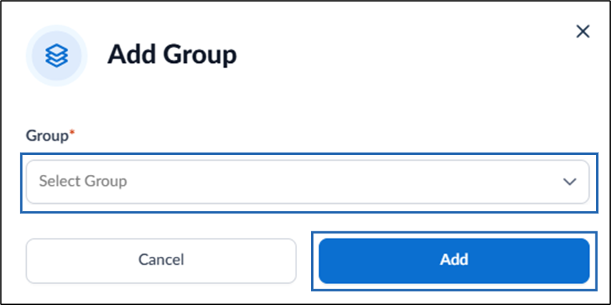

The group is added successfully.

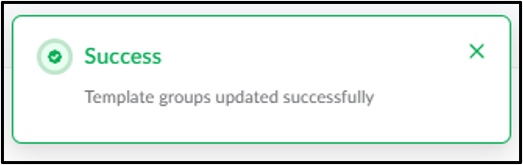
