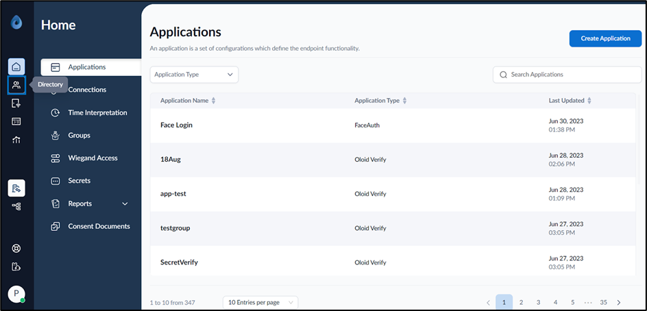
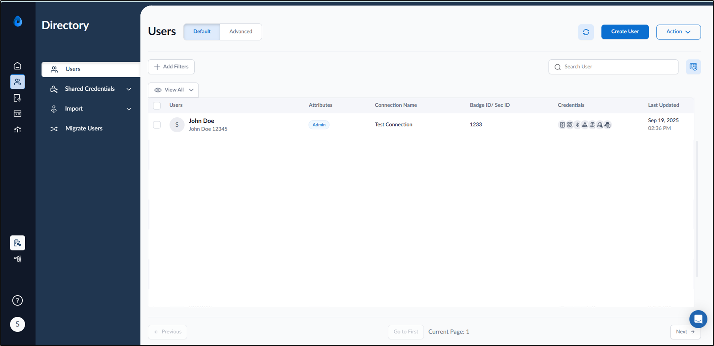
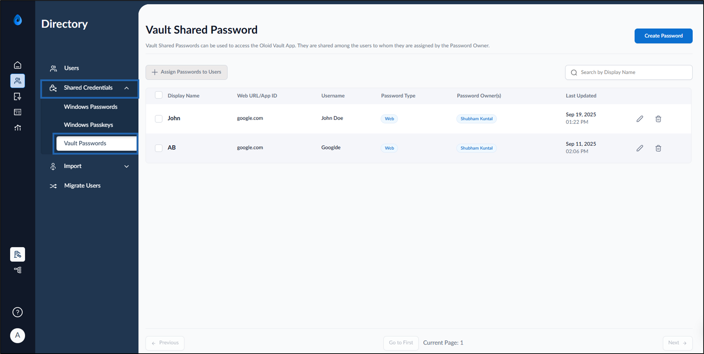
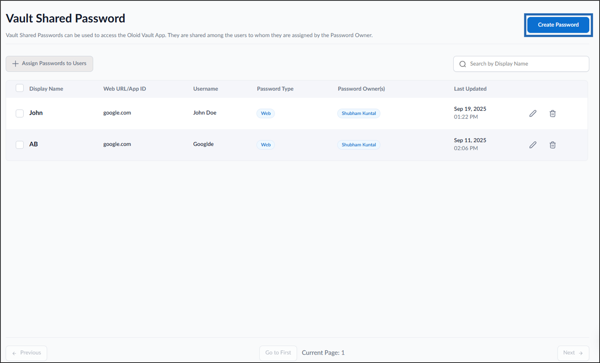
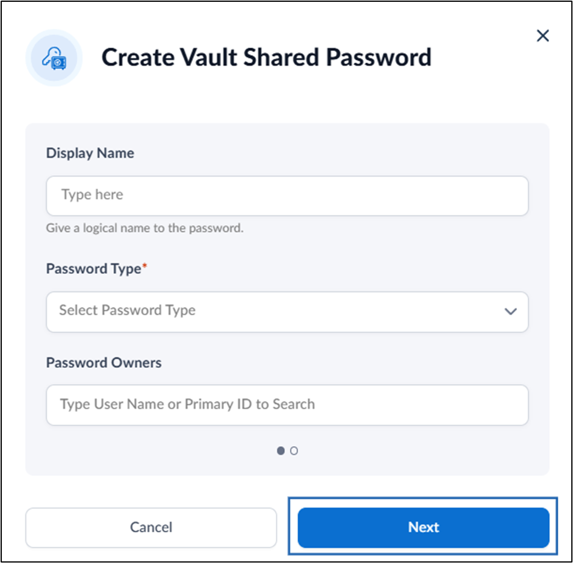
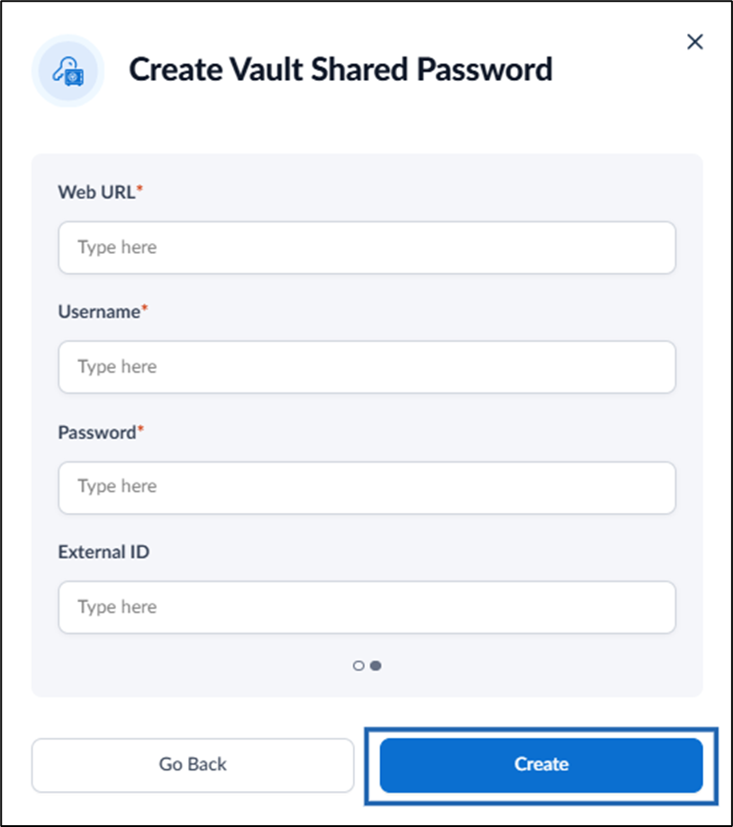
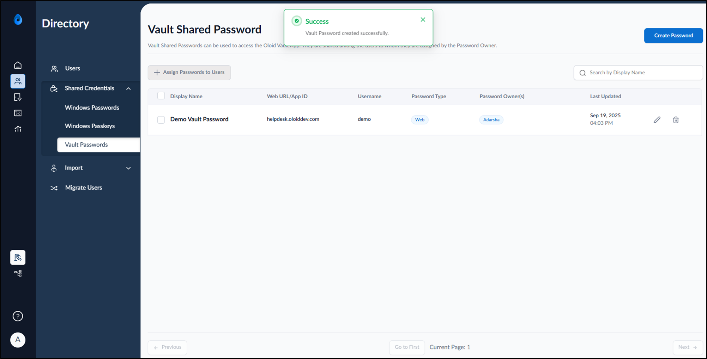
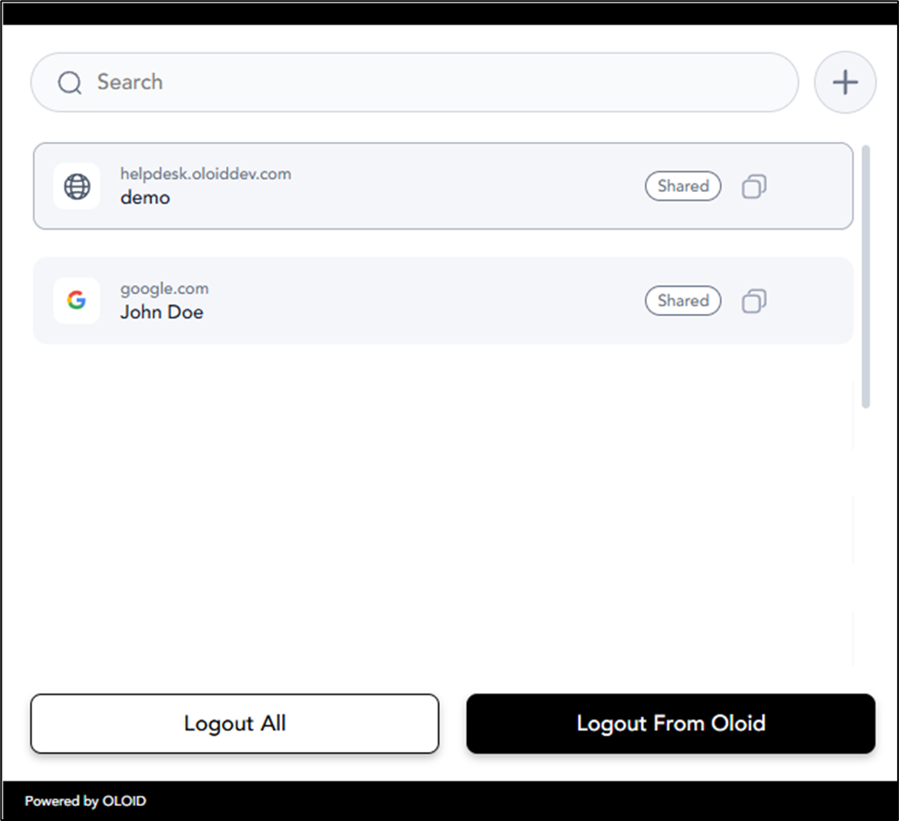

{/* Source: Intercom article 12275469 - https://oloid.help/en/articles/12275469-oloid-vault-chrome-chromium-how-to-create-shared-password-in-the-tenant-admin-portal */}
{/* Generated by intercom_to_mintlify.py - re-running overwrites this file. */}

## Introduction

The Tenant Admin Portal allows admin to create Oloid Vault (Chrome / Chromium) shared password(s) that can be securely managed and shared with multiple authorized users.

## Prerequisite

You must have access to the Tenant Admin Portal.

## Steps to create Vault Shared Password

1. Log in to the **Tenant Admin Portal**.
2. On the home page of the portal, click **Directory** on the left menu panel.

   

   The Users page is displayed.

   

3. Click **Shared Credentials** from the left menu panel **> Vault Passwords.**

   

   The **Vault Shared Password** page is displayed.
4. Click **Create Password**.

   

   The **Create Vault Shared Password** pop-up box is displayed.
5. On the pop-up box, do the following:
   1. Enter **Display Name**.
   2. Select **Password Type** as **Web** from the dropdown menu.
   3. Enter an existing Username or Primary ID in the **Password Owners** field > select the user from dropdown menu.

      <Note>
        **Note:** You can select multiple users in the password owner field.
      </Note>

   4. Click **Next**.

      

   5. Enter the **Web URL** in the text field.
   6. Enter the **Username** of your Chrome Vault account.
   7. Enter the **Password** of your Chrome Vault account.
   8. Enter **External ID** (optional)**.**
   9. Click **Create**.

      

      The Vault Password is created successfully and listed on the **Vault Shared Password** page.

      

---

##### Preview Screen

To Assign Vault Shared Password Please refer: [How to Assign Chrome Vault Shared Password to User in the Tenant Admin Portal](/platforms/web/vault/chrome/how-to-assign-chrome-vault-shared-password-to-user-in-the-tenant)

---

| Oloid Vault shared password | Create Vault shared password | Chrome Vault shared credentials | Chromium shared password setup |
