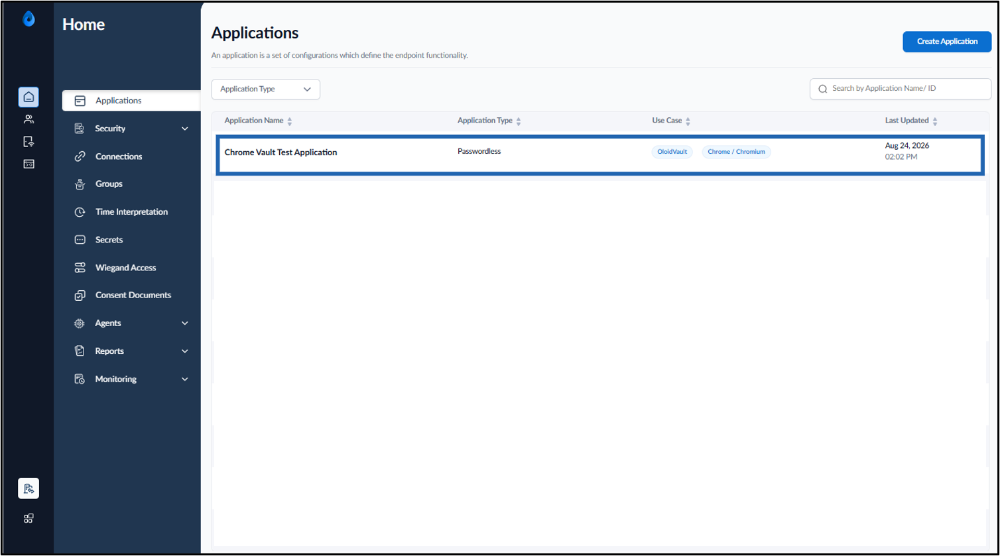
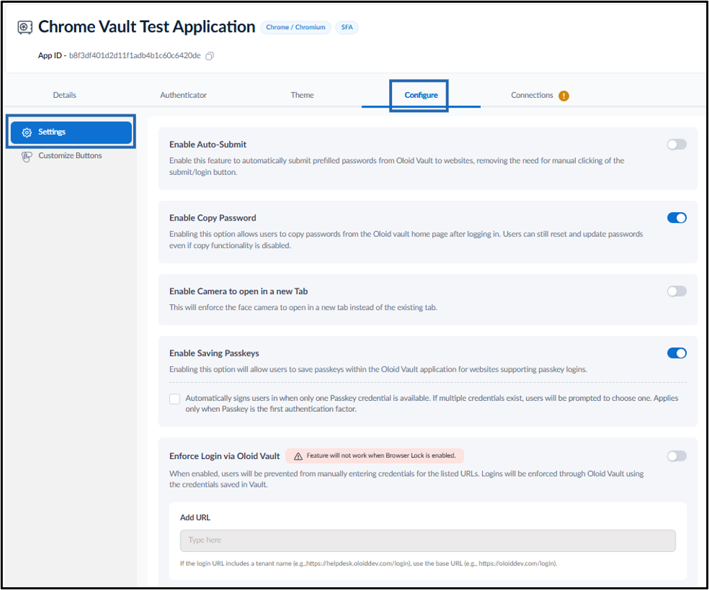
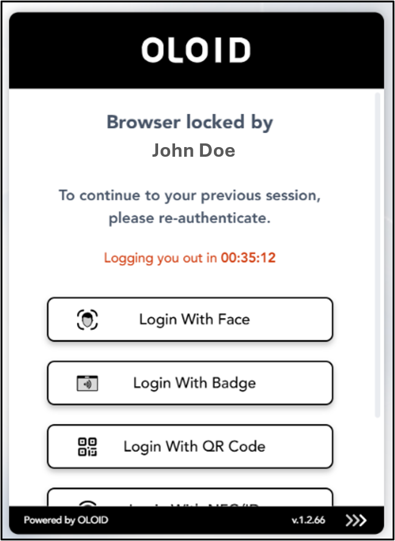
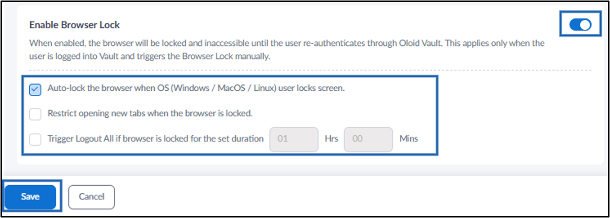

{/* Source: Intercom article 16592657 - https://oloid.help/en/articles/16592657-oloid-vault-chrome-chromium-how-to-enable-and-configure-enable-browser-lock-in-the-tenant-admin-portal */}
{/* Generated by intercom_to_mintlify.py - re-running overwrites this file. */}

## Introduction

This document provides instructions to configure **Browser Lock** for Oloid Vault (Chrome / Chromium) in the Tenant Admin Portal. Browser Lock prevents users from accessing the browser until they re-authenticate through Oloid Vault.

## Prerequisite

You must have admin access to the Tenant Admin Portal.

## Steps to Configure Browser Tracking

1. Log in to the **Tenant Admin Portal**.
2. On the Home page of the portal, click on the preferred Oloid Vault application.

   

   The application detail page is displayed.
3. Go to **Configure** > **Settings.**

   

   The Settings section is displayed.
4. Do the following:
   1. Turn on the **Enable Browser Lock** toggle.
   2. Select one or more of the following, as required:
      - **Auto-lock the browser when OS (Windows / MacOS / Linux) user locks screen:** Automatically locks the browser when the user locks the operating system.
      - **Restrict opening new tabs when the browser is locked:** Prevents users from opening new tabs while the browser is locked.
      - **Trigger Logout All if browser is locked for the set duration:** Select this option and specify the lock duration in **Hrs** and **Mins** to log out the user from all sessions when the browser remains locked for the specified duration.
        **Sample Screen:** If you select **Trigger Logout All if browser is locked for the set duration.**

        

   3. Click **Save**.

      

      The Enable Browser Lock is configured successfully.

      

---

#### Related Document

[Oloid Vault (Chrome / Chromium) - How to Create and Configure Oloid Vault Application in the Tenant Admin Portal](/platforms/web/vault/chrome/oloid-vault-chrome-chromium-how-to-create-and-configure-oloid-vault)
