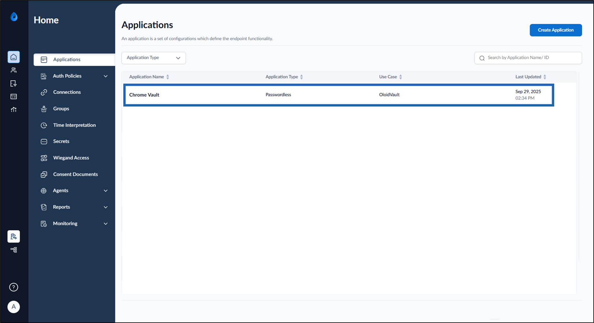
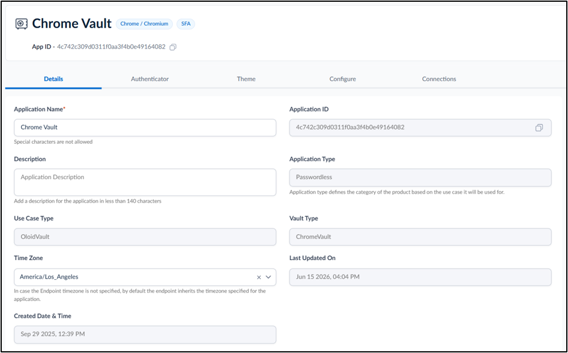
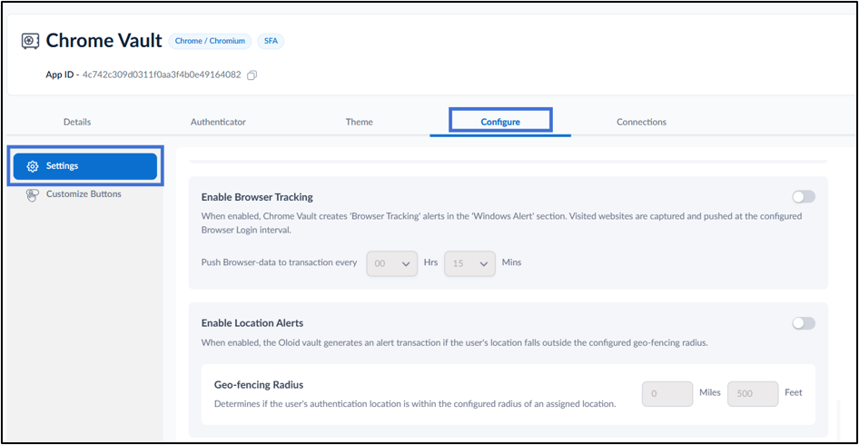
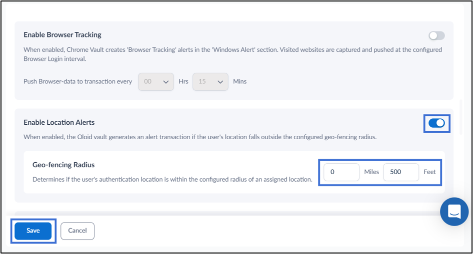
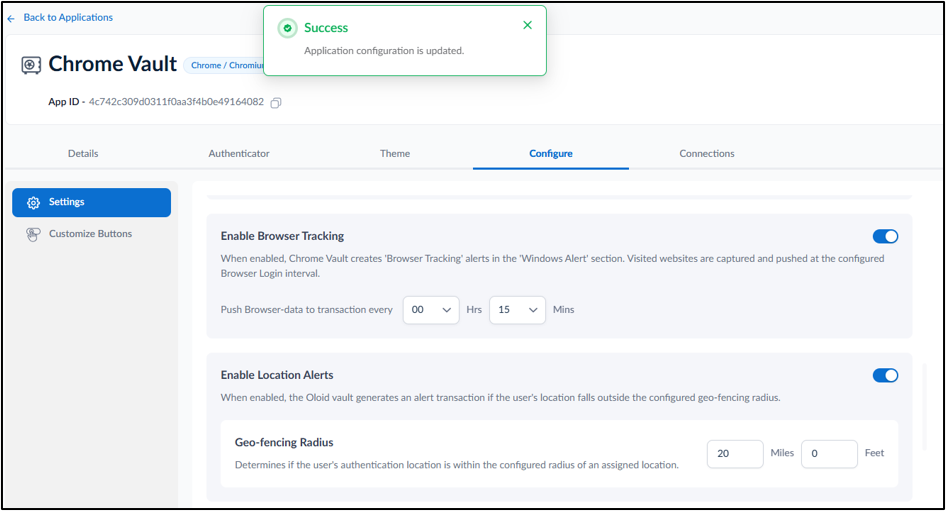

{/* Source: Intercom article 15699935 - https://oloid.help/en/articles/15699935-oloid-vault-chrome-chromium-how-to-enable-location-alerts-and-configure-geo-fencing-radius */}
{/* Generated by intercom_to_mintlify.py - re-running overwrites this file. */}

## Introduction

This document explains how to enable the **Location Alerts** feature and configure **Geo-Fencing Radius** for the Oloid Vault (Chrome / Chromium) application.

### Prerequisites

- You must have Admin access to the Tenant Admin Portal.
- You must create and configure Oloid Vault (Chrome / Chromium) application in the Tenant Admin Portal. For more, refer to [Oloid Vault (Chrome / Chromium) - How to Create and Configure Oloid Vault Application in the Tenant Admin Portal](/platforms/web/vault/chrome/oloid-vault-chrome-chromium-how-to-create-and-configure-oloid-vault)

## Steps to Enable Location Alerts

1. Log in to the **Tenant Admin Portal**.
2. On the **Applications** page, click on the Chrome Vault application.

   

   The application **details** page is displayed.

   

3. Go to **Configure** tab > **Settings.**

   

   The settings page is displayed.
4. **Enable Location Alerts** toggle to generate an alert transaction when a user's authentication occurs outside the configured geo-fencing radius.

   <Note>
     **Note:** When enabled, users must grant device location access before authentication.
   </Note>

5. In the **Geo-fencing Radius** section, configure the allowed authentication distance:
   - **Miles** – Enter the allowed radius in miles.
   - **Feet** – Enter the allowed radius in feet.

     <Note>
       **Note:** To receive a **Windows Alert** each time a location violation occurs, enable **Browser Tracking** and configure the **Push Browser-data to transaction every** interval. For more, refer to [How to Enable and Configure Browser Tracking.](/platforms/web/vault/chrome/oloid-vault-chrome-chromium-how-to-create-and-configure-oloid-vault)
     </Note>

Click **Save.**

The Location Alerts is configured successfully.

