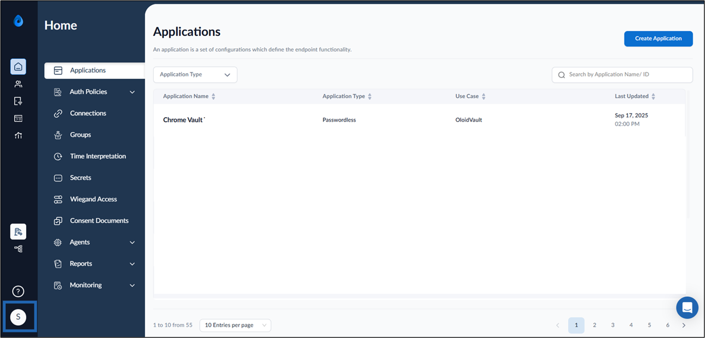
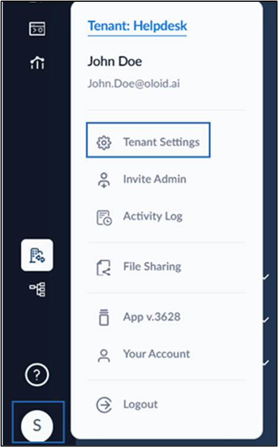
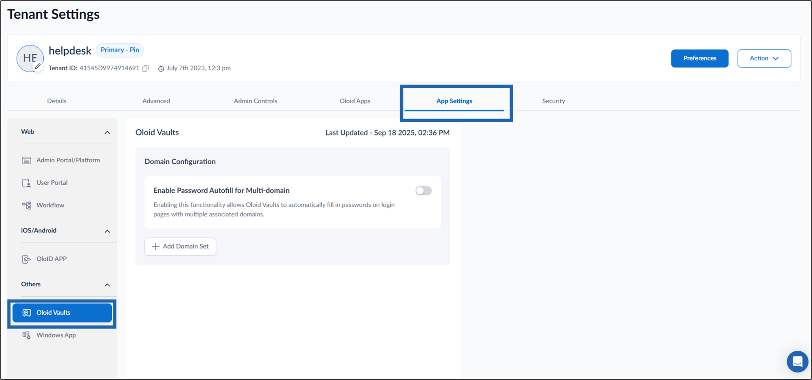
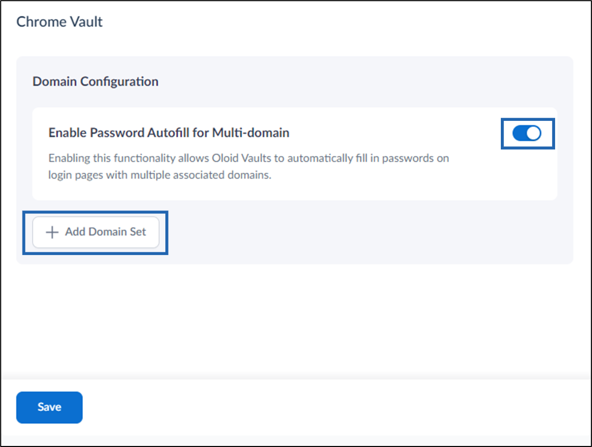
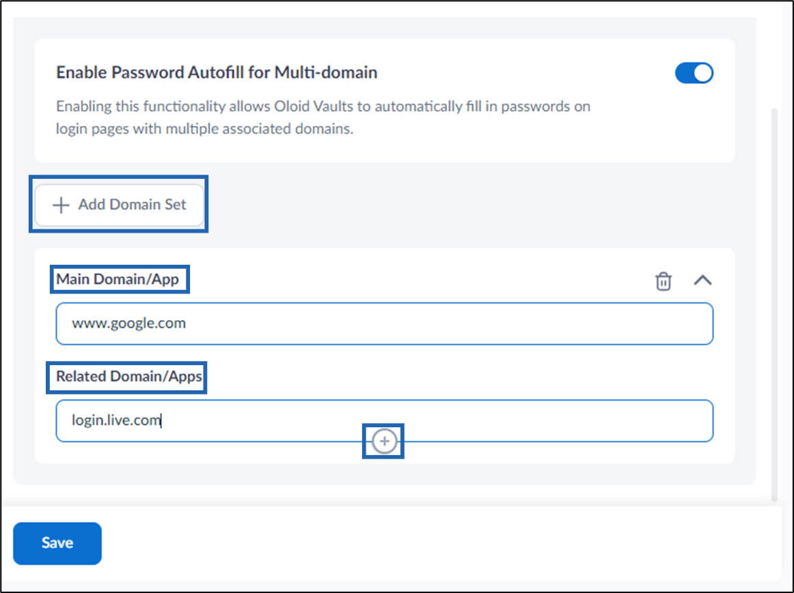
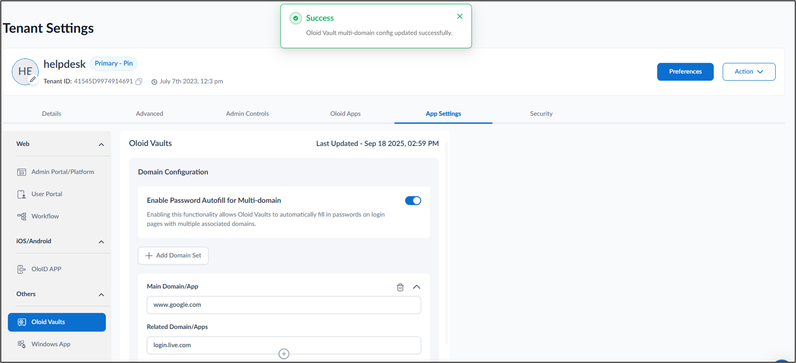

{/* Source: Intercom article 9814095 - https://oloid.help/en/articles/9814095-oloid-vault-chrome-chromium-how-to-enable-password-autofill-for-multi-domain-in-the-tenant-admin-portal */}
{/* Generated by intercom_to_mintlify.py - re-running overwrites this file. */}

## Introduction

This document describes how to set up multi-domain password autofill for Oloid Vault (Chrome / Chromium) in the Tenant Admin Portal. When the Password Autofill feature is enabled, Oloid Vault can automatically populate saved credentials on login pages for multiple domains or related applications.

## Prerequisite

You must have access to the Tenant Admin Portal.

## Steps to Enable Password Autofill for Multi Domain

1. Log in to the **Tenant Admin Portal**.
2. On the homepage, click **user profile icon**.

   

   The **user profile menu** is displayed.
3. Click **Tenant Settings**.

   

   The **Tenant settings** page is displayed.
4. Go to **App Settings** > **Oloid Vaults**.

   

   Domain Configuration section is displayed.
5. Select **Enable Password Autofill for Multi-domain** toggle, then click **+ Add Domain Set**.

   

   The **Main Domain/App** and **Related Domain/Apps** sections are displayed.
6. Do the following:
   1. Enter **Main Domain/App**.
   2. Enter **Related Domain/Apps**.

      <Note>
        **Note:** You can add as many related domains/apps as needed under each main domain, and you may also create multiple domain sets if required.
      </Note>

   3. Click **Save**.

      

      The Chrome Vault domain configuration is updated successfully.

      
