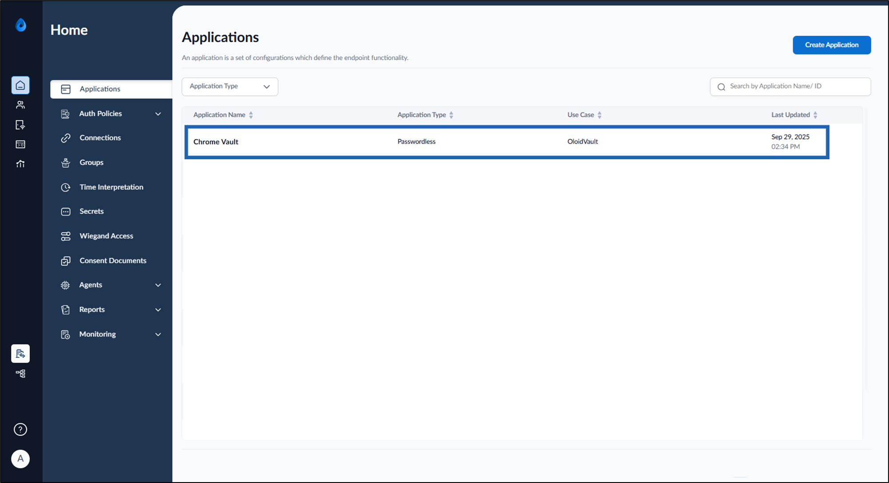
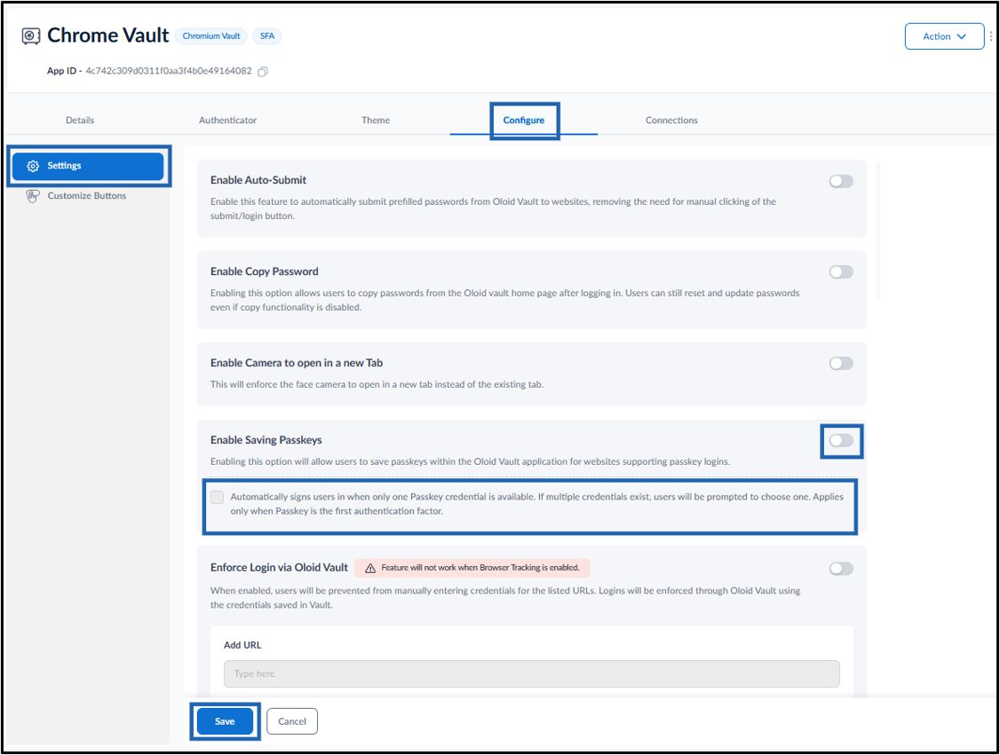
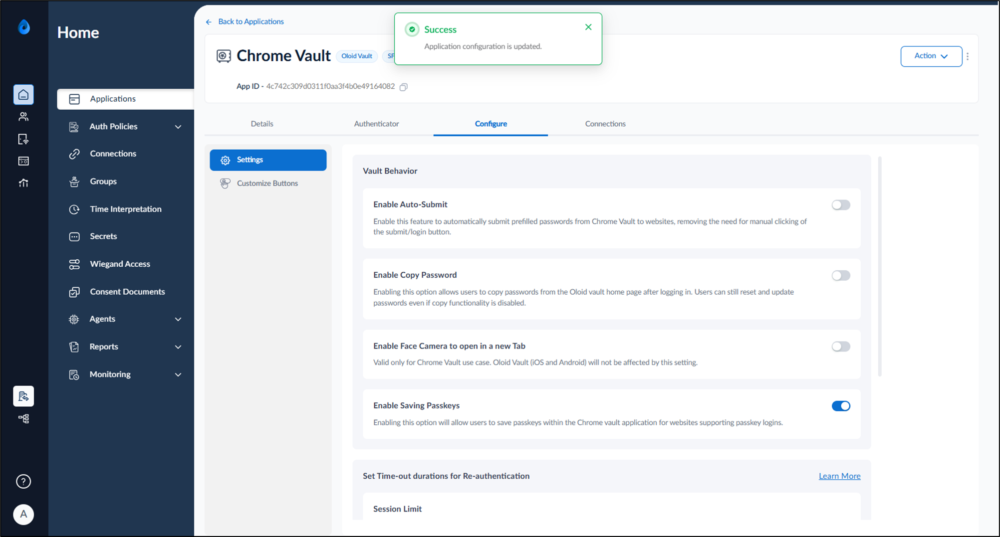
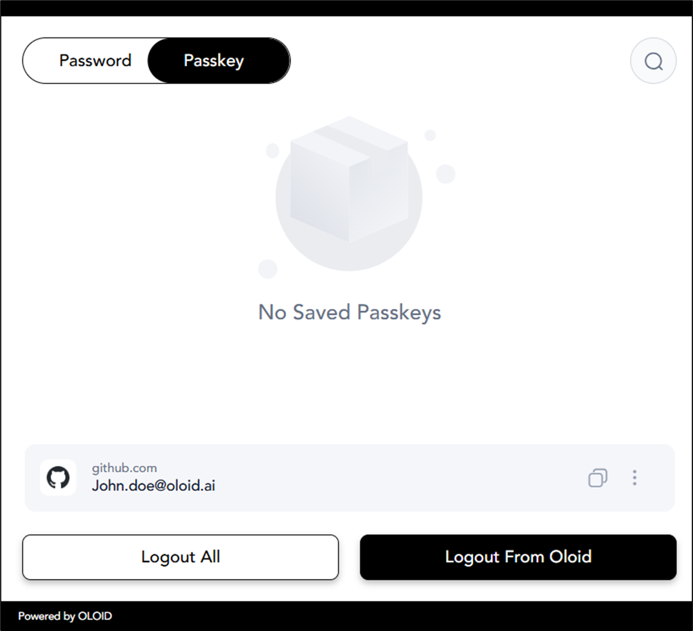

{/* Source: Intercom article 12441699 - https://oloid.help/en/articles/12441699-oloid-vault-chrome-chromium-how-to-enable-saving-passkeys */}
{/* Generated by intercom_to_mintlify.py - re-running overwrites this file. */}

## Introduction

The **Saving Passkeys** option in the Tenant Admin Portal allows the admin to enable saving of passkeys within the Oloid Vault (Chrome / Chromium) application. Once enabled, users can securely save and use passkeys for websites that support passkey logins, ensuring a faster and passwordless authentication experience.

## Prerequisites

- You must have admin access to the Tenant Admin Portal.
- You must create a Chrome Vault application in the Tenant Admin Portal. To create refer, [Oloid Vault (Chrome / Chromium) - How to Create and Configure Oloid Vault Application in the Tenant Admin Portal](/platforms/web/vault/chrome/oloid-vault-chrome-chromium-how-to-create-and-configure-oloid-vault).

## Steps to Enable Saving Passkeys

1. Log in to the **Tenant Admin Portal**.
2. On the Home page of the portal, click on the preferred Oloid Vault application.

   

   The application detail page is displayed.
3. Go to **Configure** tab **> Settings** and do the following:
   1. Turn on **Saving Passkeys** toggle to allow users to store passkeys in the Chrome Vault for websites that support passkey logins.
   2. Select **Automatically signs users in when only one Passkey credential is available** to skip passkey selection when only one passkey is available.
      **Note:**
      1. If multiple passkeys are available, the user is prompted to select the applicable passkey.
      2. This option applies only when **Passkey** is configured as the first authentication factor.
   3. Click **Save**.

      

      The **Saving Passkeys** for Chrome Vault Application is successfully enabled.

      

---

##### Preview Screen

   The below screenshot shows a preview of the Chrome Vault application after enabling the Saving Passkeys option.

   
