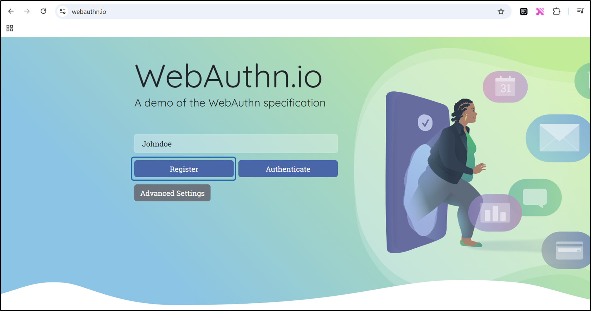
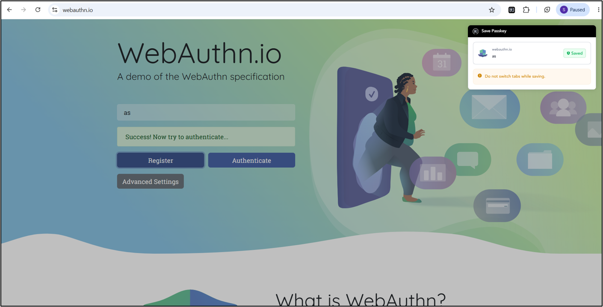
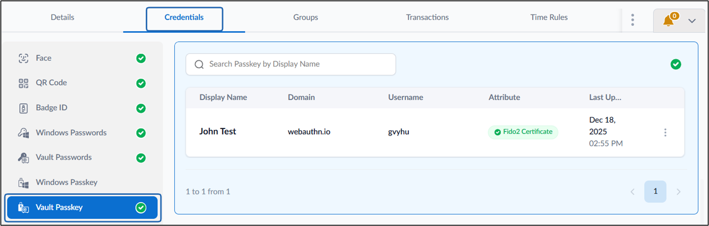
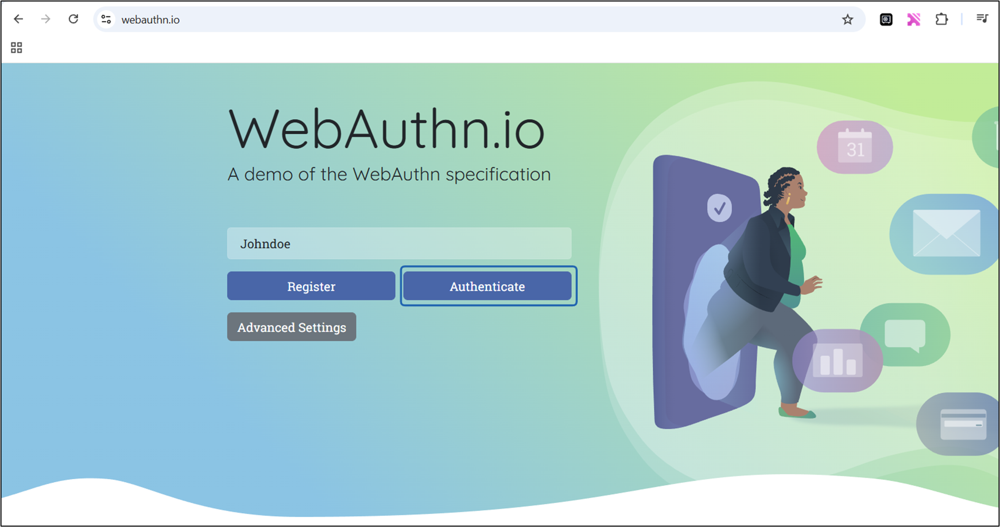
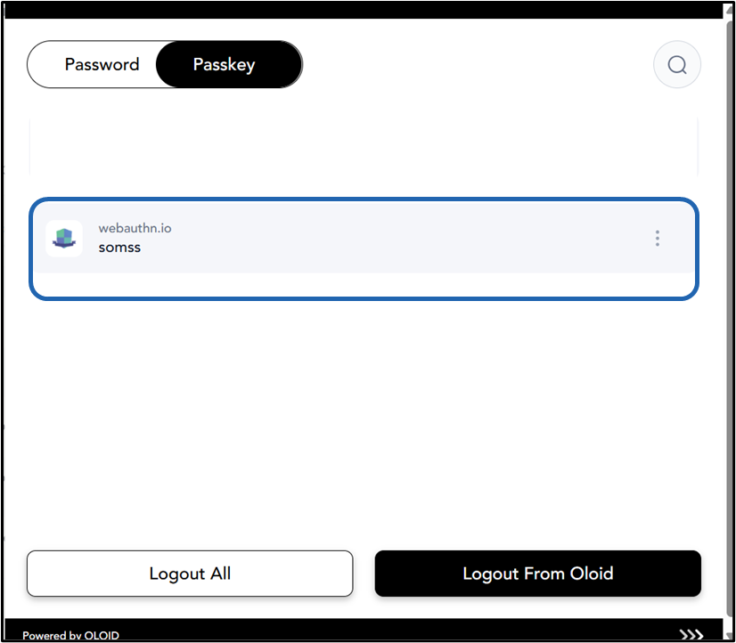

{/* Source: Intercom article 13396608 - https://oloid.help/en/articles/13396608-oloid-vault-chrome-chromium-how-to-generate-a-passkey-for-oloid-vault */}
{/* Generated by intercom_to_mintlify.py - re-running overwrites this file. */}

## Introduction

This document explains how to generate a passkey for authentication. As an example, the steps use WebAuthn.io, a public demo site, to demonstrate the passkey creation and authentication process.

Oloid Vault supports generating passkeys for multiple platforms and services, such as Microsoft, GitHub, Gmail, and WebAuthn.

### What is a Passkey

A passkey is a modern, passwordless method of signing in to applications and websites without the need to remember or enter a password. Instead, it uses a secure pair of cryptographic keys:

- One key is stored securely on your device.
- The other key is stored by the service or application you are accessing.

These two keys work together to verify your identity. The authentication process takes place locally on your device, and only a secure verification response is sent to the server.

## Prerequisites

- Use the latest version of Chrome, Edge, Safari, or Firefox for the best experience.
- Ensure you have access to Oloid Vault (Chrome/Chromium) and you are logged in.

## Steps to Generate Passkey

1. Login to Oloid Vault (Chrome / Chromium) using your configured Oloid Vault authentication method.
2. Open WebAuthn.io URL: Go to **[https://webauthn.io/](https://webauthn.io/)**

   <Note>
     **Note:** This site is a public demo environment for testing **WebAuthn / Passkeys**
   </Note>

3. Enter a Username in the **Username** field, enter any identifier.

   

4. Click **Register.**
   Passkey generated successfully.

   

Vault Passkey is saved to the users profile in credentials under the Vault Passkey section.

---

### Steps to Authenticate the Passkey

1. Enter the **Username** in the Username field
2. Click **Authenticate**.
   Authentication is completed using the created passkey.

### Sample screen Vault Passkey is saved in Oloid Vault

The Passkey is saved under the passkey tab in Oloid Vault.

