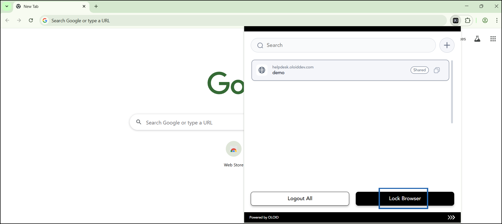
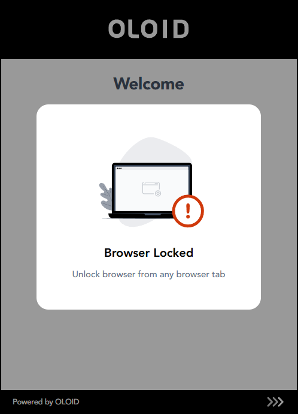

{/* Source: Intercom article 14075018 - https://oloid.help/en/articles/14075018-oloid-vault-chrome-chromium-how-to-lock-the-browser */}
{/* Generated by intercom_to_mintlify.py - re-running overwrites this file. */}

## Introduction

This document explains how to lock the browser using the Oloid Vault (Chrome / Chromium) app. The Browser Lock feature secures all active browser tabs and requires reauthentication to unlock them.

## Prerequisites

- Ensure that the **Browser Lock** feature is enabled in the Tenant Admin Portal. For more information, refer [Lock Browser](/platforms/web/vault/chrome/oloid-vault-chrome-chromium-how-to-create-and-configure-oloid-vault).
- You must login to the Chrome Vault. To log in refer [How to log in to Chrome Vault](/platforms/web/vault/chrome/how-to-log-in-to-chrome-vault).

## Steps to Lock the Browser

1. Open **Chrome Vault** application.
2. Click **Lock Browser**.

   

   The Browser is locked successfully.

   <Note>
     **Note:** All browser tabs are locked automatically. Reauthenticate from any tab to unlock the browser. Once authentication is completed, all tabs are unlocked.
   </Note>

   
