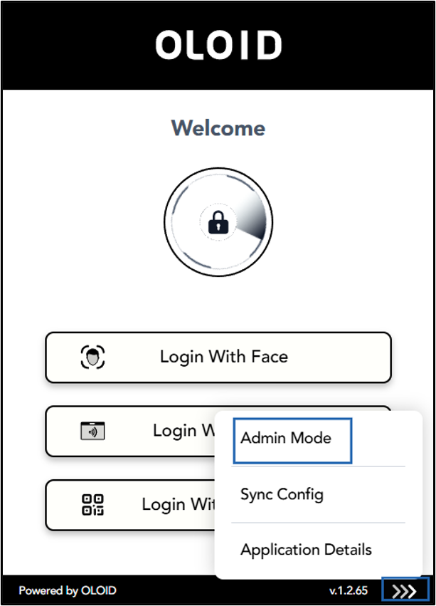
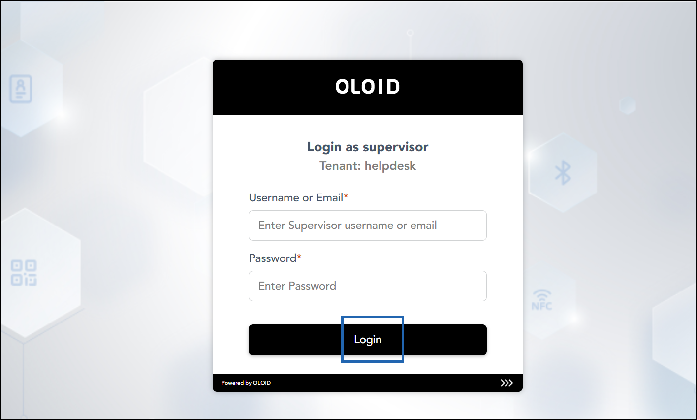
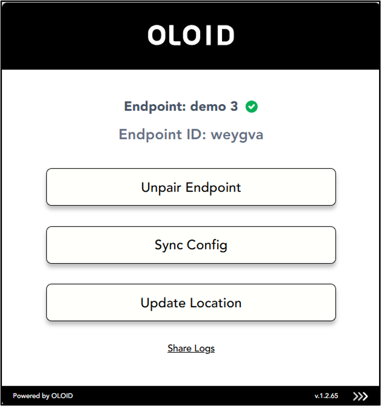

{/* Source: Intercom article 9651553 - https://oloid.help/en/articles/9651553-oloid-vault-chrome-chromium-how-to-log-in-to-admin-mode */}
{/* Generated by intercom_to_mintlify.py - re-running overwrites this file. */}

## Introduction

This document provides instructions for logging in to **Admin Mode** in Oloid Vault (Chrome/Chromium) to manage settings and configure features.

## Prerequisite

You must install and setup the Oloid Vault. For more details, refer [Oloid Vault - How to Set Up and Use](/platforms/web/vault/chrome/oloid-vault-chrome-chromium-how-to-set-up-and-use)

## Steps to Log in to Admin Mode

1. Open **Google Chrome** browser and click **Oloid Vault** icon.

   

   The welcome screen is displayed.
2. Click **More** option icon () > select **Admin Mode**.

   

   The **Login as supervisor** screen is displayed.
3. Do the following:
   1. Enter **Supervisor username** or **email ID**.
   2. Enter **Password**.
   3. Click **Login**.

      

      You are successfully logged in to the admin mode.

      

##### Related Video

**[How to log in to admin mode in Chrome Vault- Video Tutorial](/platforms/web/videos/how-to-log-in-to-admin-mode-in-chrome-vault-video-tutorial)**

---
