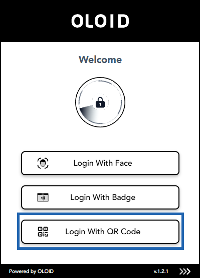
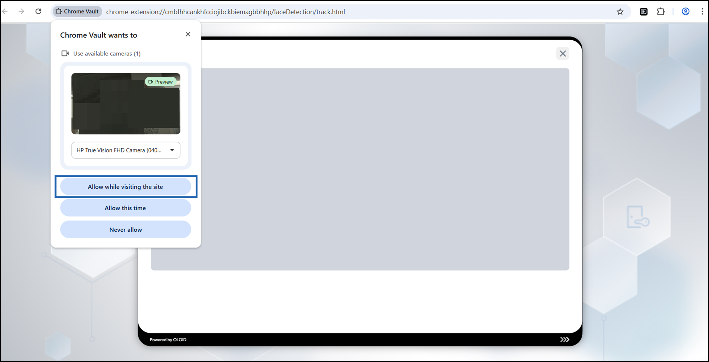
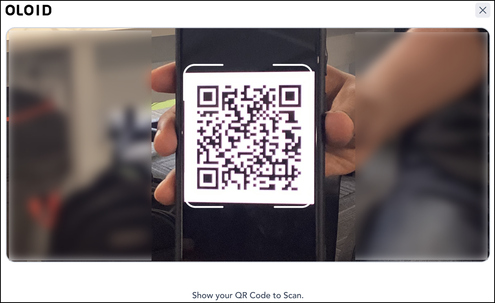

{/* Source: Intercom article 14778605 - https://oloid.help/en/articles/14778605-oloid-vault-chrome-chromium-how-to-log-in-with-qr-code */}
{/* Generated by intercom_to_mintlify.py - re-running overwrites this file. */}

## Introduction

This document explains how to sign in to Oloid Vault (Chrome / Chromium) using a QR Code credential. QR Code login provides a secure and passwordless way to access the browser through Oloid Vault (Chrome / Chromium).

## Prerequisite

User must have a QR Code assigned to the account.

## Steps to log in with QR Code

1. Open **Google Chrome** browser and click **Oloid Vault** icon located on the toolbar.

   

   The Welcome screen is displayed.
2. Select **Login with QR Code**.

   <Note>
     **Note:** You can see only the authentication ways enabled for you in the application. The button name may vary depending on the application configuration. Reach out to [support](mailto:support@oloid.ai)team if you do not see any authentication method.
   </Note>

   

   The **Camera Permission** pop-up box is displayed.
3. Select **Allow while visiting the site** to open the camera.

   

   The image capture pop-up box is displayed.
4. Show your QR Code in front of the camera for QR Code authentication.

   

   After successful QR Code authentication, you are signed in to Oloid Vault (Chrome / Chromium).
