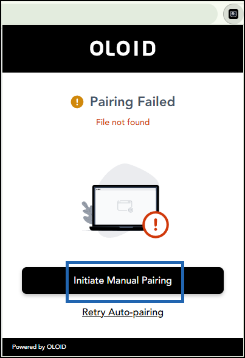
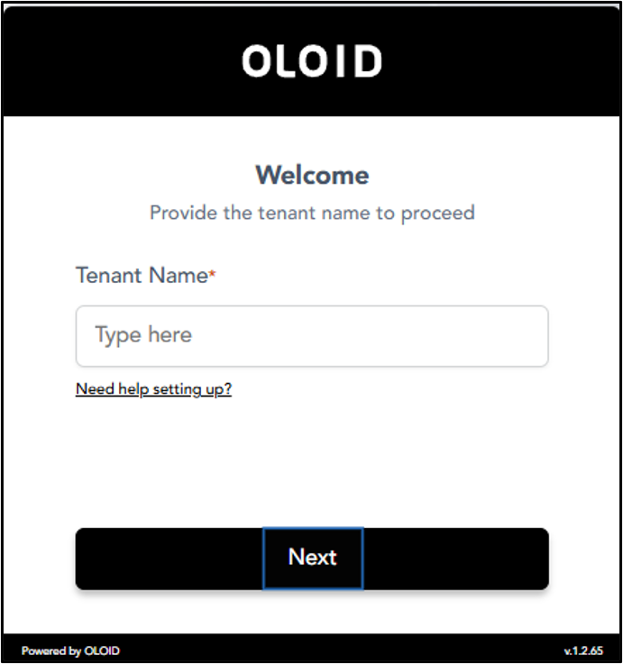
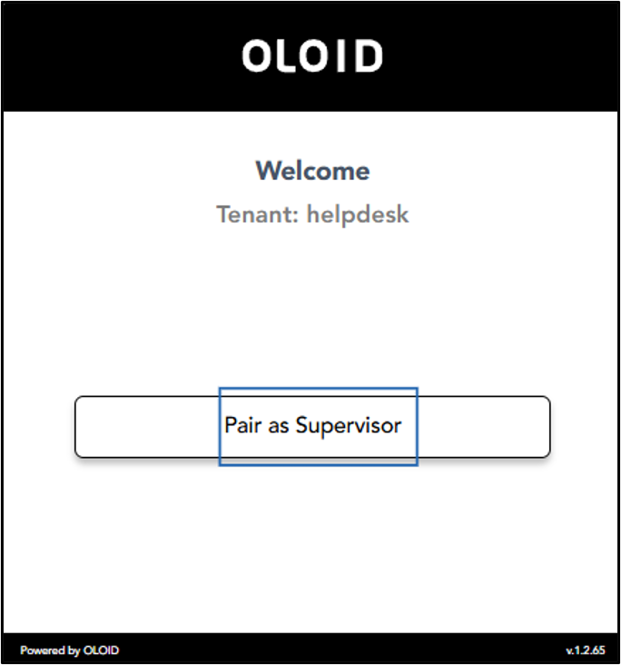
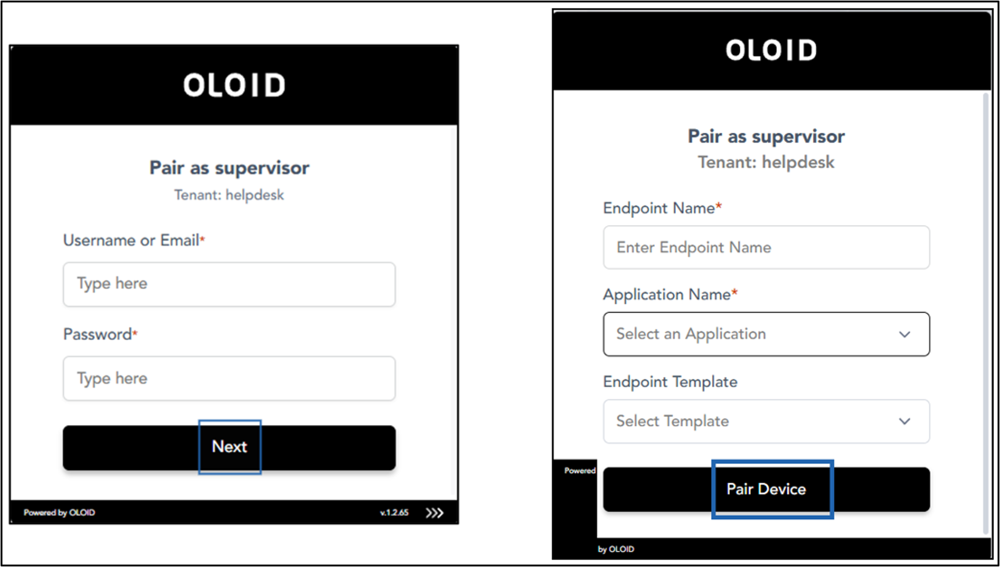
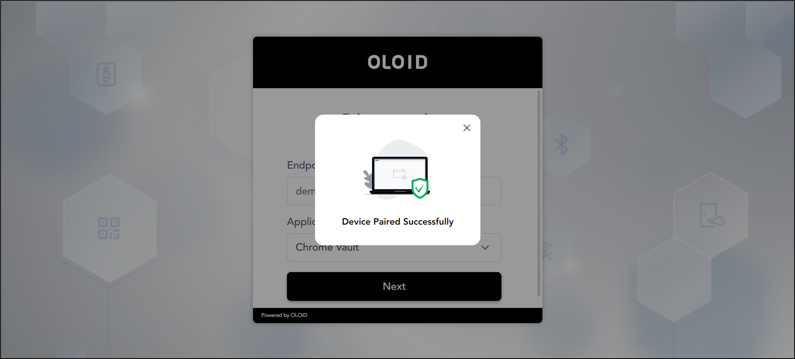
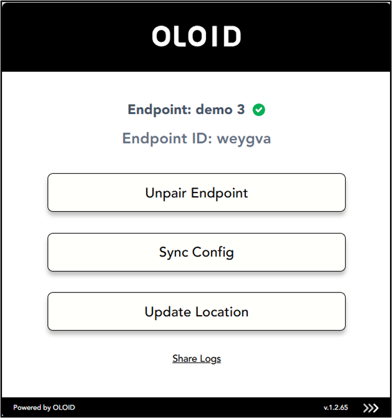

{/* Source: Intercom article 9739348 - https://oloid.help/en/articles/9739348-oloid-vault-chrome-chromium-how-to-manually-pair-an-endpoint */}
{/* Generated by intercom_to_mintlify.py - re-running overwrites this file. */}

## Introduction

This document provides instructions for manually pairing an endpoint in Oloid Vault (Chrome/Chromium) when automatic pairing fails or the endpoint needs to be manually configured by an Admin or Supervisor.

## Prerequisites

- You must have Admin or Supervisor credentials to perform endpoint pairing.
- The Chrome Vault extension must be installed and accessible from the browser toolbar.
- The application must be created and configured in the Tenant Admin Portal.

## Steps to Manually Pair Endpoint

1. Open **Google Chrome** browser and click **Oloid Vault** icon located on the toolbar.

   

   The **Pairing Failed** message is displayed.
2. Click **Initiate Manual Pairing**.

   

   The Welcome screen is displayed.
3. Enter **Tenant Name** and click **Next**.

   <Note>
     **Note:** If you do not have Tenant name, contact **[Oloid support](mailto:support@oloid.ai)**.
   </Note>

   

4. Click **Pair as Supervisor**.

   

   The **Pair as supervisor** screen is displayed.
5. Do the following:
   1. Enter your **Username** or **Email ID**.
   2. Enter **Password**.
   3. Click **Next**.
   4. Enter **Endpoint Name**.
   5. Select **Application Name**.
   6. Select **Endpoint Template** (Optional).
   7. Click **Pair Device**.

      

      The endpoint is successfully paired, and the home page is displayed.

      

      
