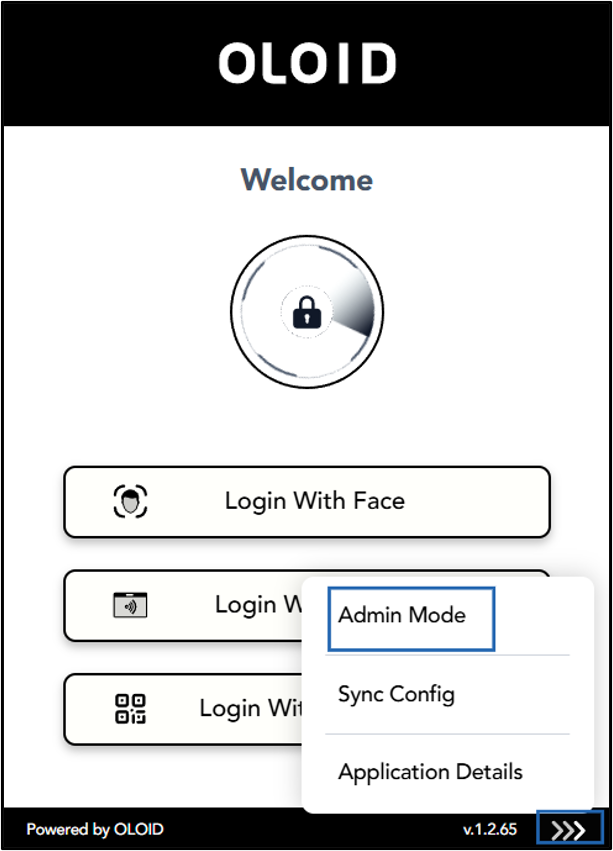
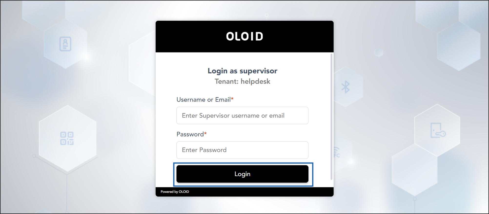
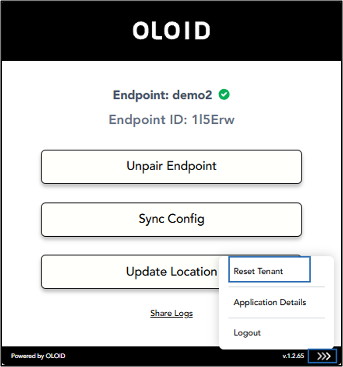
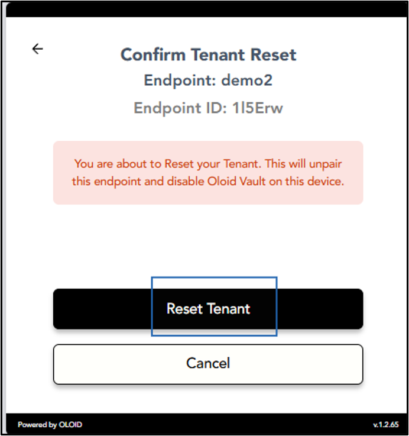
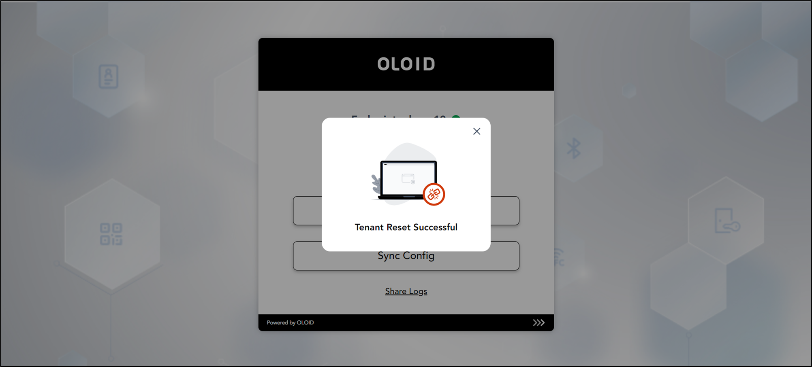

{/* Source: Intercom article 9667131 - https://oloid.help/en/articles/9667131-oloid-vault-chrome-chromium-how-to-reset-tenant */}
{/* Generated by intercom_to_mintlify.py - re-running overwrites this file. */}

## Introduction

This document provides instructions for resetting a tenant in Oloid Vault (Chrome/Chromium) to remove the existing tenant configuration and restore the application to its default state.

## Prerequisite

You must have valid Tenant Admin credentials to access **Admin Mode** in Oloid Vault.

## Steps to Reset Tenant

1. Open **Google Chrome** browser and click **Oloid Vault** icon located on the toolbar.

   

   The **Welcome** screen is displayed.
2. Go to **More** option () icon > **Admin Mode**.

   

   The **Login as supervisor** screen is displayed.
3. Do the following:
   1. Enter your **Username** or **Email ID**.
   2. Enter **Password**.
   3. Click **Login**.

      

      The Endpoint pair screen is displayed.
4. Select **More** () icon > **Reset Tenant**.

   

   The **Confirm Tenant Reset** page is displayed.
5. Select **Reset Tenant**.

   

   The tenant has been reset successfully.

   

#### Related Video

[How to reset tenant in Chrome Vault- Video Tutorial](/platforms/web/videos/how-to-reset-tenant-in-chrome-vault-video-tutorial)
