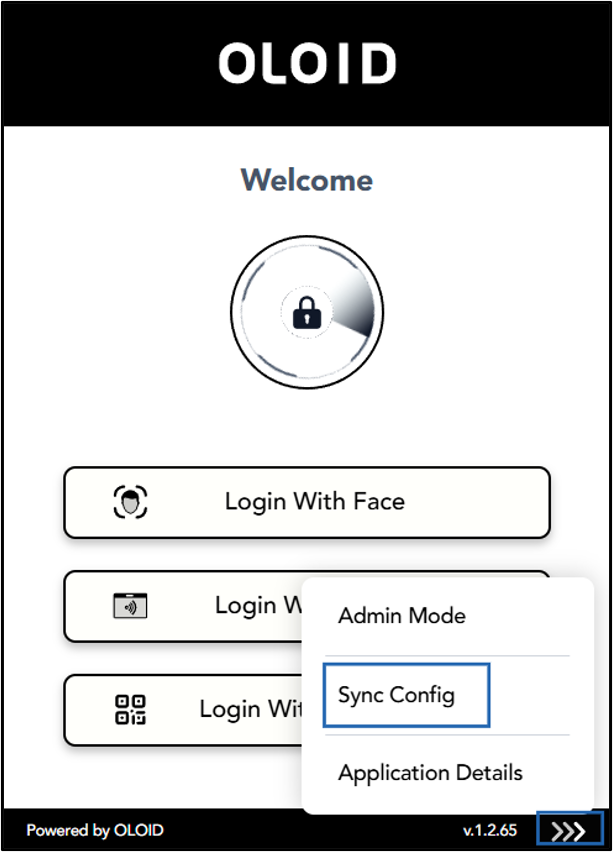
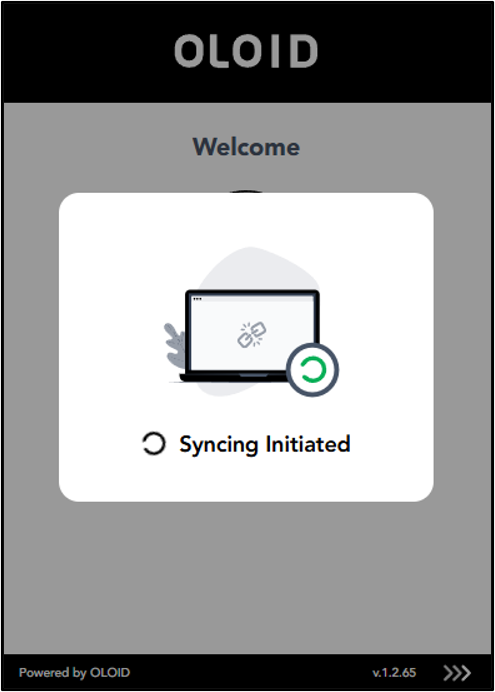
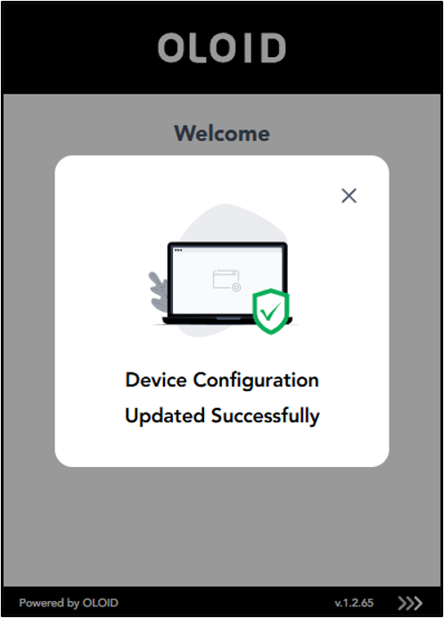
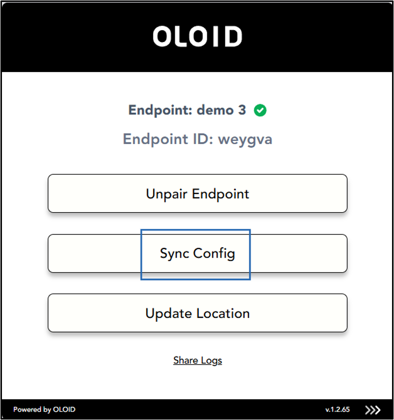
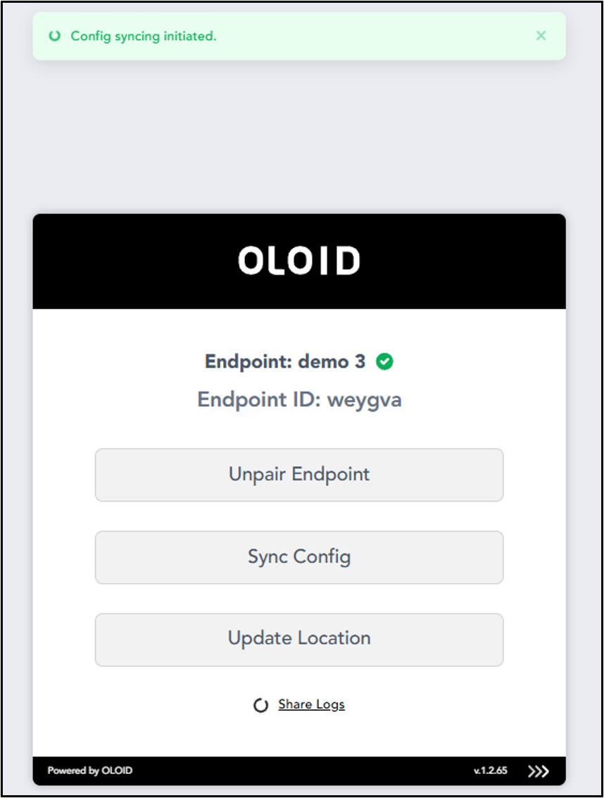
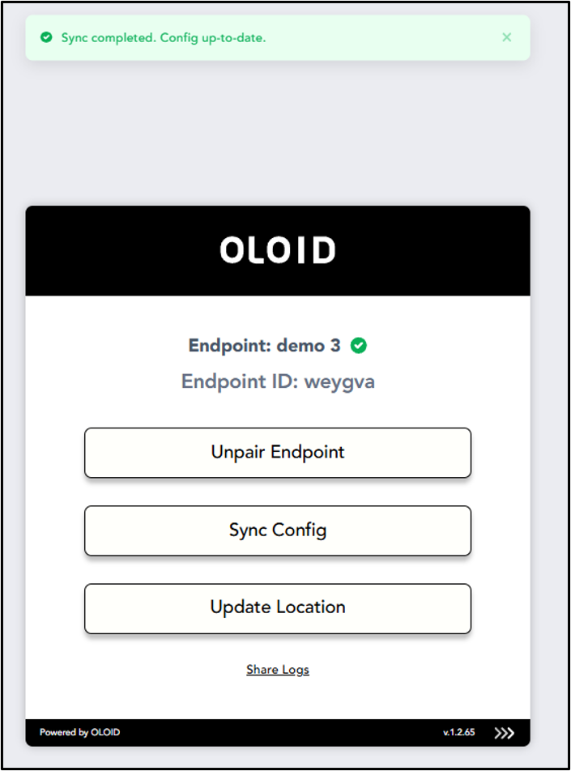

{/* Source: Intercom article 9842062 - https://oloid.help/en/articles/9842062-oloid-vault-chrome-chromium-how-to-sync-configuration */}
{/* Generated by intercom_to_mintlify.py - re-running overwrites this file. */}

## Introduction

This document provides instructions for syncing the configuration in Oloid Vault (Chrome/Chromium) to update the application with the latest settings and configuration.

## Prerequisites

- Oloid Vault (Chrome/Chromium) must be installed and set up on your device. For more information, refer to [Setting up and using Chrome Vault](/platforms/web/vault/chrome/oloid-vault-chrome-chromium-how-to-set-up-and-use).
- To sync the configuration from **Admin Mode**, you must have valid admin credentials.

## Steps to Sync Configuration

You can sync configuration in Chrome Vault using the following options:

- [Sync Config on Welcome Screen](#sync-config-on-welcome-screen)
- [Sync Config in Admin Mode](#sync-config-in-admin-mode)

### Sync Config on Welcome Screen

1. Open **Google Chrome** browser and click **Chrome Vault** icon located on the toolbar.

   

   The **Welcome** screen is displayed.
2. Go to **More** option () icon > **Sync Config**.

   

The Syncing Configuration is initiated.

The Oloid Vault configuration is updated successfully.

### Sync Config in Admin Mode

1. Log in to Admin Mode in Oloid Vault. For more details refer [Oloid Vault (Chrome / Chromium) - How to Log in to Admin Mode](/platforms/web/vault/chrome/oloid-vault-chrome-chromium-how-to-log-in-to-admin-mode)
2. On the configuration screen, click **Sync Config**.

   

3. The Syncing Configuration is initiated.

The Oloid Vault configuration is updated successfully.

