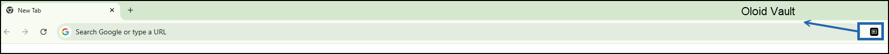
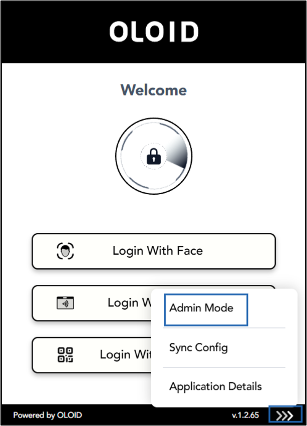
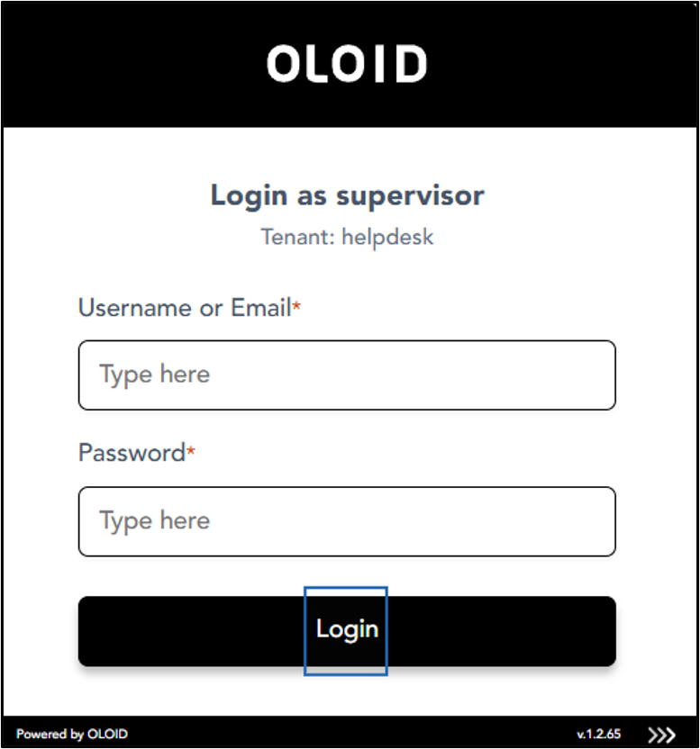
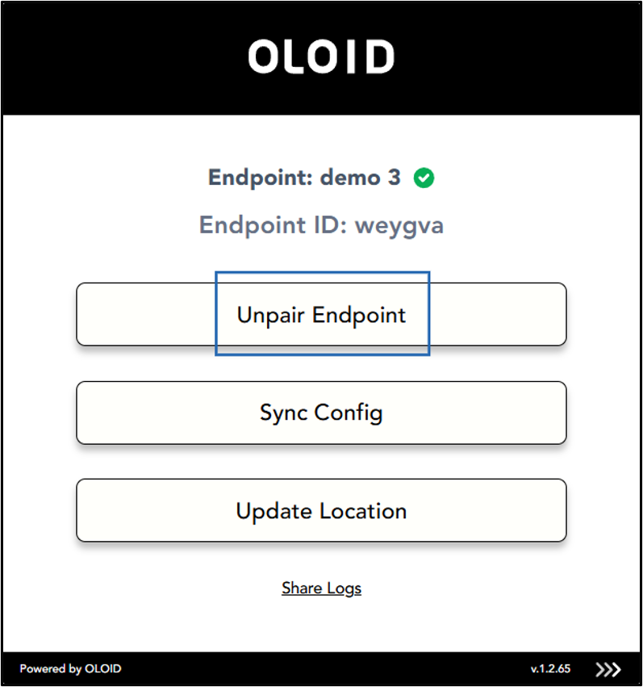
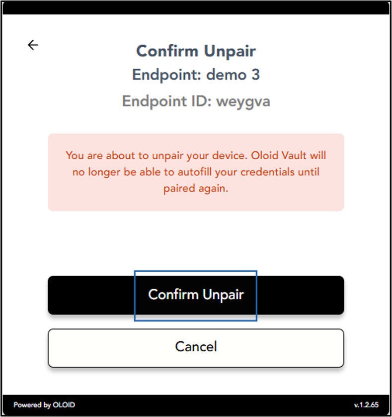
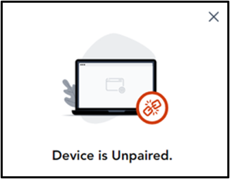

{/* Source: Intercom article 9651603 - https://oloid.help/en/articles/9651603-oloid-vault-chrome-chromium-how-to-unpair-an-endpoint */}
{/* Generated by intercom_to_mintlify.py - re-running overwrites this file. */}

## Introduction

This document provides instructions for unpairing an endpoint from Oloid Vault (Chrome/Chromium) when the endpoint is no longer in use or needs to be removed from the system.

## Prerequisites

- The endpoint you want to unpair must be paired with Oloid Vault (Chrome/Chromium).
- You must have valid Oloid Vault admin credentials to access Admin Mode.

## Steps to unpair an Endpoint

1. Open **Google Chrome** browser and click **Oloid Vault** icon located on the toolbar.

   

   The **Welcome** screen is displayed.
2. Go to **More** option () icon > **Admin Mode**.

   

   The **Login as supervisor** screen is displayed.
3. Do the following:
   1. Enter your **Username** or **Email ID**.
   2. Enter **Password**.
   3. Click **Login**.

      

      The Endpoint pair screen is displayed.
4. Select **Unpair Endpoint**.

   

   The **Confirm Unpair** screen is displayed.
5. Select **Confirm Unpair**.

   

   The device is unpaired successfully.

   

##### Related Video

[How to unpair endpoint in Chrome Vault- Video Tutorial](/platforms/web/videos/how-to-unpair-endpoint-in-chrome-vault-video-tutorial)
