{/* Source: Intercom article 12458180 - https://oloid.help/en/articles/12458180-oloid-vault-chrome-chromium-how-to-update-authenticator-tab-in-the-tenant-admin-portal */}
{/* Generated by intercom_to_mintlify.py - re-running overwrites this file. */}

## Introduction

The **Authenticator** tab in the Oloid Vault (Chrome / Chromium) application allows admin to enable and manage authentication methods such as Face, Badge ID, and NFC/ID. Each method has different configurable parameters to enhance security and optimize authentication performance.

## Prerequisite

Chrome Vault application is created. To create refer [How to Create and Configure Chrome Vault Application in the Tenant Admin Portal](/platforms/web/vault/chrome/oloid-vault-chrome-chromium-how-to-create-and-configure-oloid-vault).

## Steps to Update Authenticator Tab

1. Log in to the **Tenant Admin Portal**.
2. On the Home page of the portal, click on the preferred Oloid Vault application.

   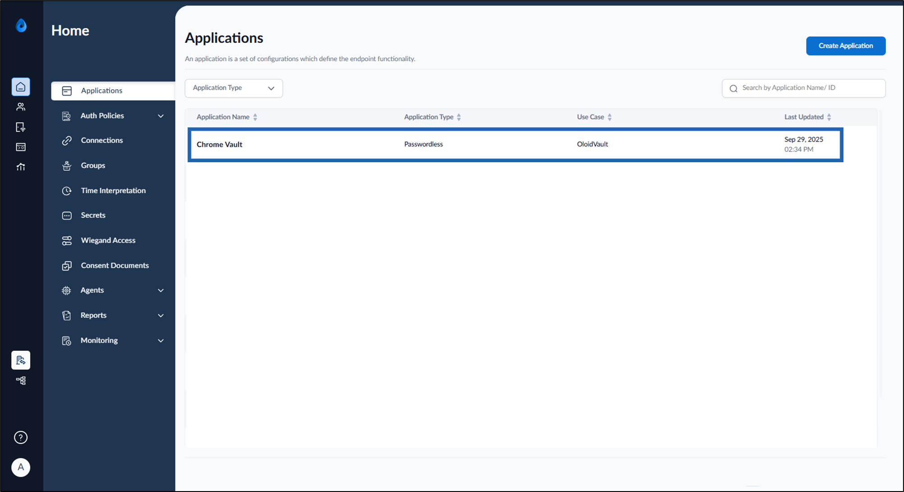

   The application detail page is displayed.
3. Go to Authenticator tab and configure the following:
   1. [Face](#face)
   2. [Badge ID](#badge-id)
   3. [NFC/ID](#nfc-id)

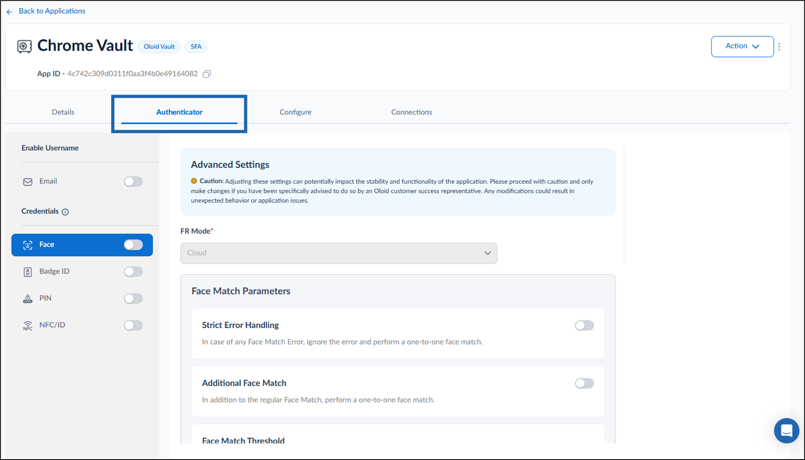

### Face

1. Select **Face** option from the left menu panel > turn on **Face** toggle.
2. Adjust the following setting for **Face Match Parameters**.

   <Note>
     **Note:** You must consult your Oloid representative before making any changes to the **Face Match Parameters** to ensure optimal authentication performance.
   </Note>

   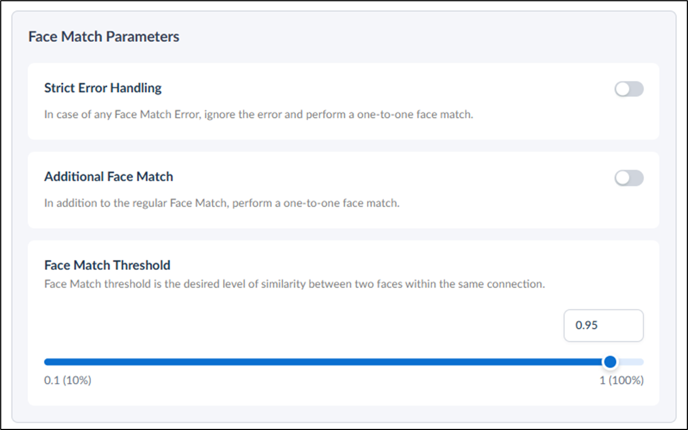

   1. Turn on **Strict Error Handing** toggle to skip the error and perform a direct one-to-one face match.

      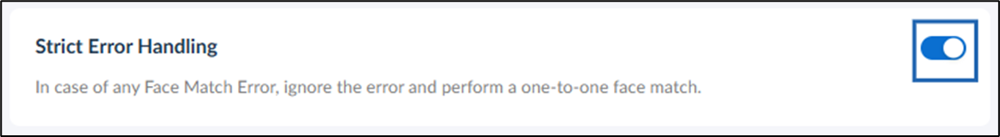

   2. Turn on **Additional Face Match** toggle to perform a one-to-one face match alongside the standard face matching process.

      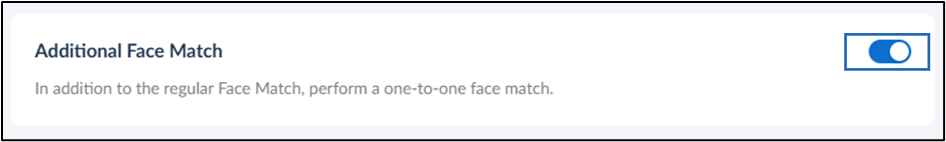

   3. Adjust the **Face Match Threshold** slider or enter a value directly into the input box to set the face match threshold value.

      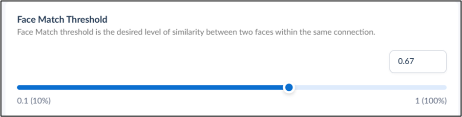

3. Adjust the following setting for **Liveness check parameters**.

   <Note>
     **Note:** You must consult your Oloid representative before making any changes to the **Liveness check parameters** value to ensure optimal authentication performance.
   </Note>

   1. **Min Liveness Probability**: Specifies the threshold used to determine whether an image is live or spoofed.
      - Default value: 0.5
      - Images with a liveness probability of **0.5 or higher** are classified as live.
   2. **Min Liveness Quality**: Specifies the minimum quality required for an image to be suitable for a liveness check.
      - Default: 0.1
      - Images with a quality score of **0.1 or higher** are considered suitable for liveness verification.

        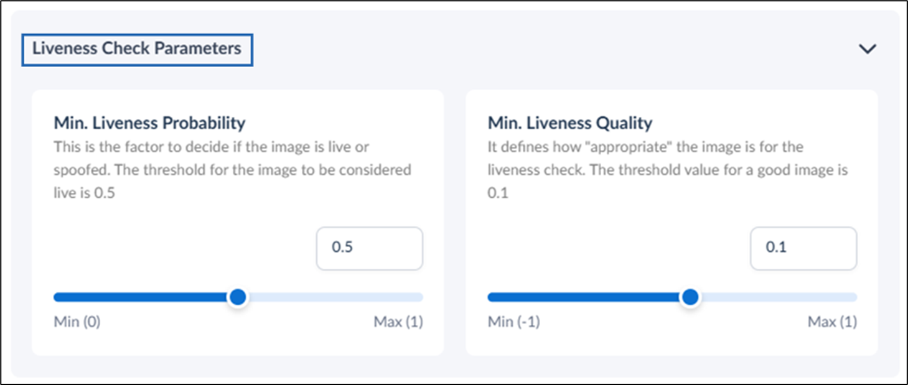

4. Click **Save**.

<Note>
  **Note:** The parameters are pre-configured. This is done by **Oloid admin**.
</Note>

#### Additional Settings

1. **Configure Image Capture Resolution:** Select the preferred resolution from the **Select Resolution** dropdown list for image capture during facial authentication.
2. Click **Save**.

   <Note>
     **Note:** If the selected resolution is not available, the browser will default to the closest supported resolution.
   </Note>

   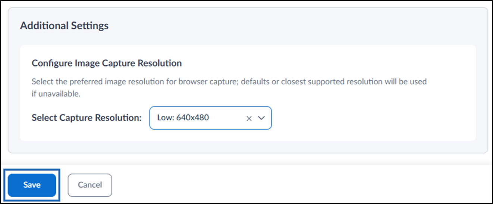

   The face credential is(are) updated successfully.

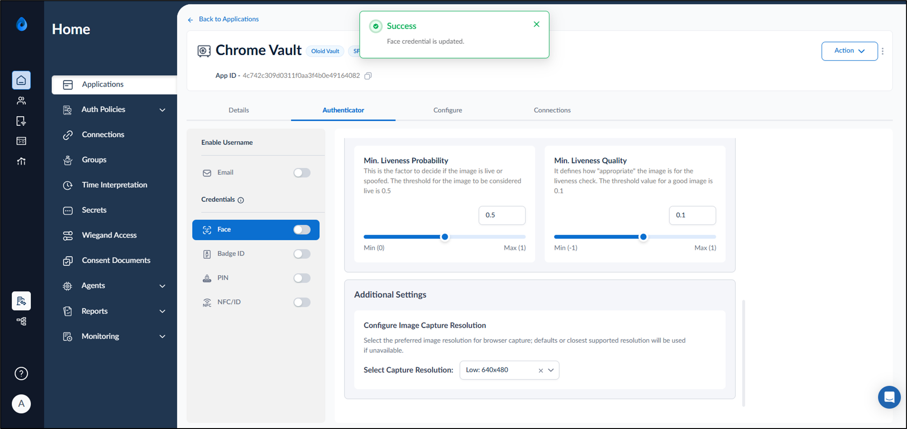

### Badge ID

1. Select **Badge ID** option from the left menu panel > turn on **Badge ID** toggle.
2. Select Badge input type from Badge type drop down list.
3. Click **Save**.

   <Note>
     **Note:** The Application will support the selected Badge input type at the linked endpoints.
   </Note>

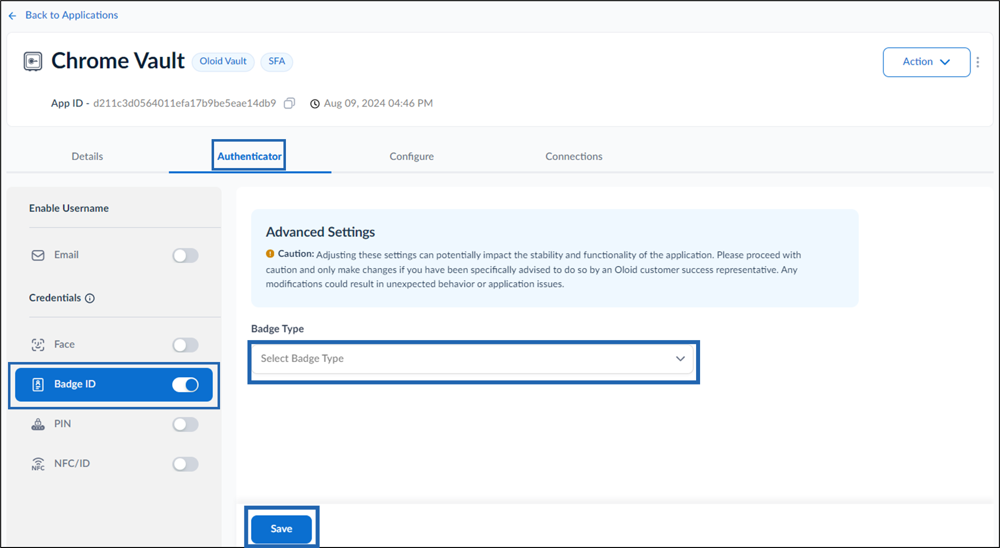

The Badge ID credential is updated successfully.

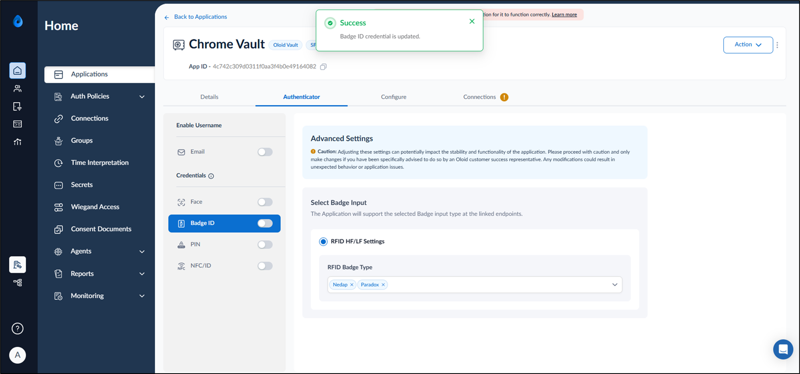

### NFC/ID

1. Select **NFC/ID** option from the left menu panel.
2. Turn on **NFC/ID** toggle.

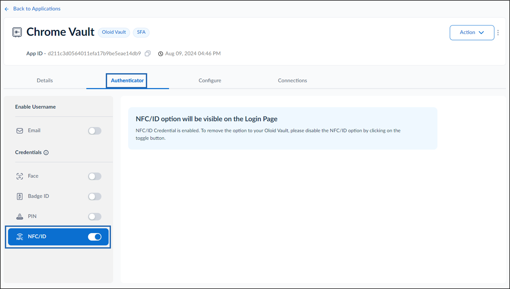

The NFC/ID is enabled successfully.

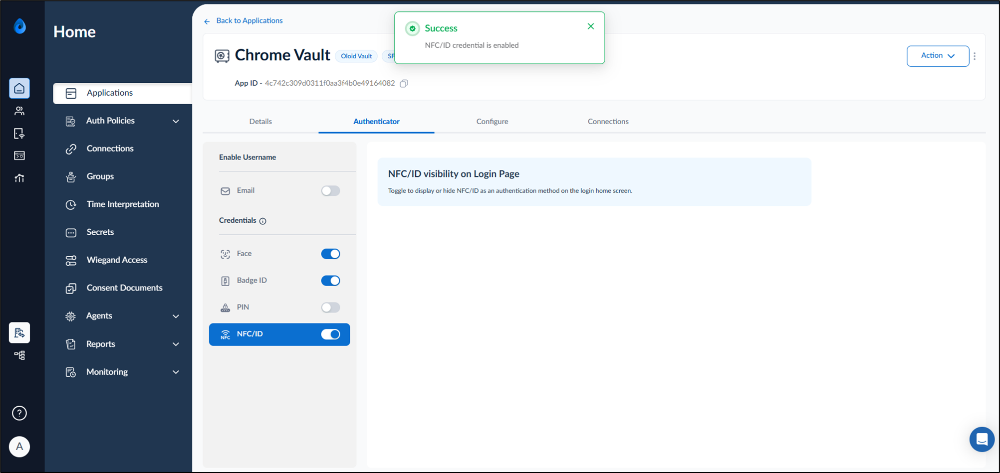
