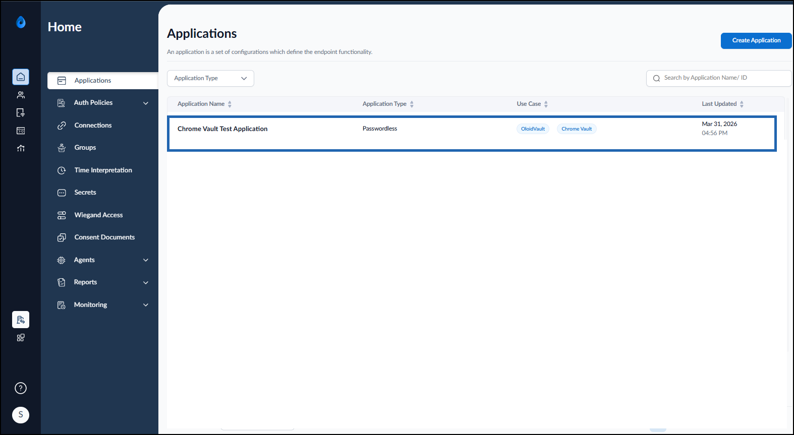
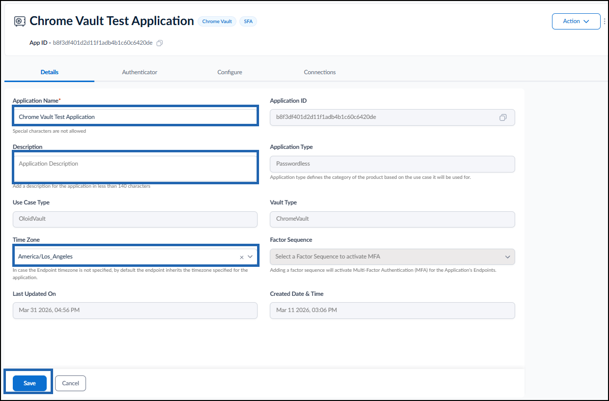
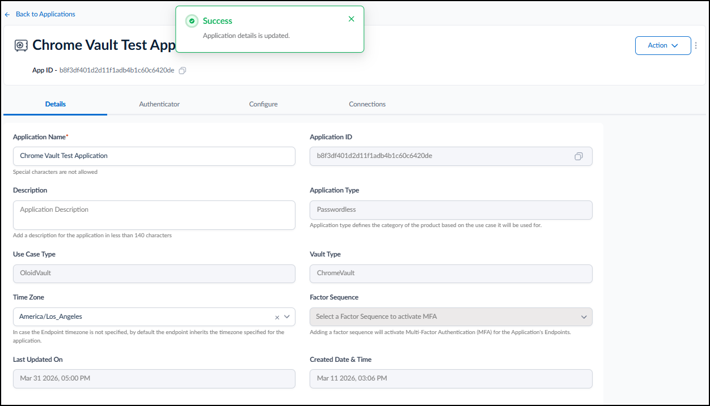

{/* Source: Intercom article 12457063 - https://oloid.help/en/articles/12457063-oloid-vault-chrome-chromium-how-to-update-details-tab-in-the-tenant-admin-portal */}
{/* Generated by intercom_to_mintlify.py - re-running overwrites this file. */}

## Introduction

The **Details** tab for Oloid Vault (Chrome / Chromium) application in the Tenant Admin Portal allows the admin to update the application name, description, set the time zone, etc.

## Prerequisites

- You must have access to the **Tenant Admin Portal**.
- Ensure that **Oloid Vault (Chrome / Chromium)** application is created. To create refer [Oloid Vault (Chrome / Chromium) - How to Create and Configure Oloid Vault Application in the Tenant Admin Portal](/platforms/web/vault/chrome/oloid-vault-chrome-chromium-how-to-create-and-configure-oloid-vault).

## Steps to Update Details Tab

1. Log in to the **Tenant Admin Portal**.
2. On the Home page of the portal, click on the preferred Oloid Vault application.

   

   The application detail page is displayed.
3. Do the following:
   1. Update the **Application Name** (If needed).
   2. Add the **Description** (Optional).

      <Note>
        **Note:** The description should be less than 140 characters.
      </Note>

   3. Select the **Time Zone** from the dropdown menu.

      <Note>
        **Note:** If the endpoint time zone is not set, it will automatically use the application’s time zone.
      </Note>

   4. Click **Save.**

      

      The details tab is updated successfully.

      
