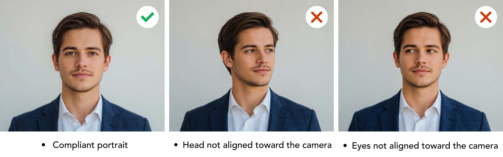
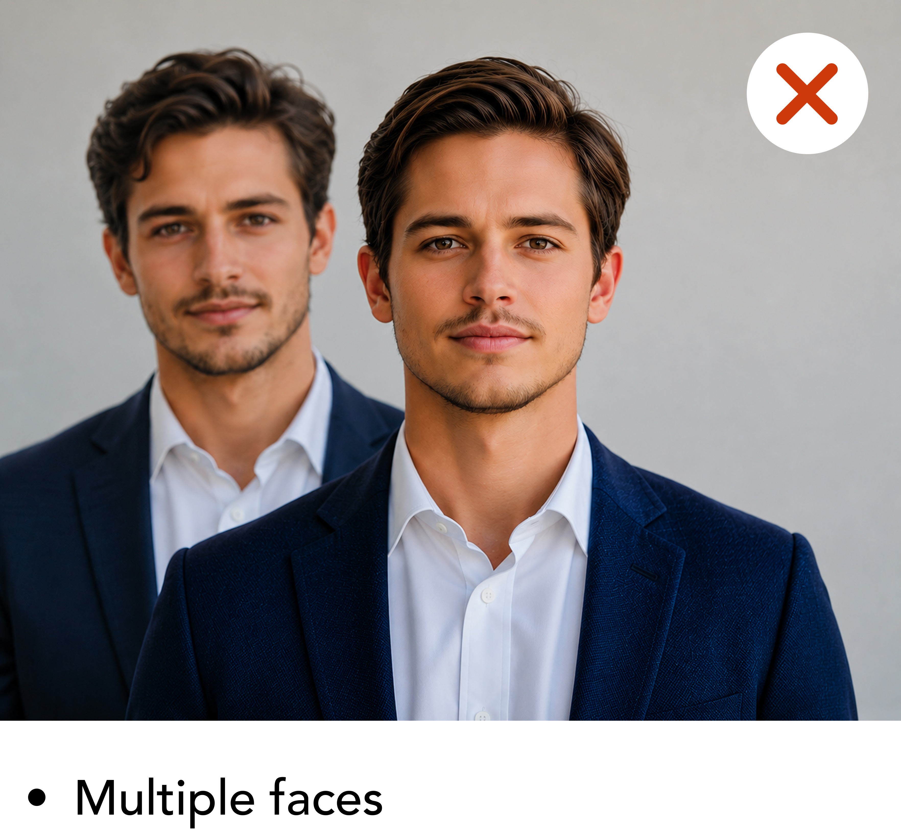
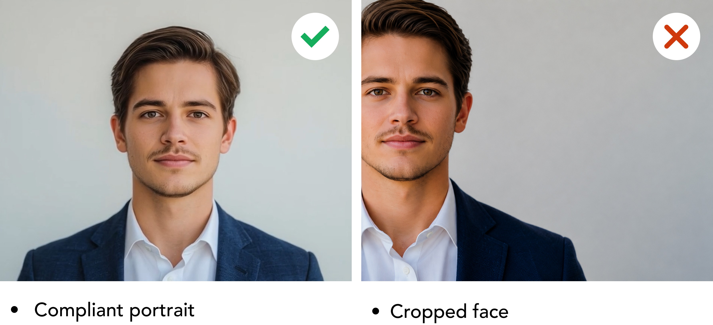
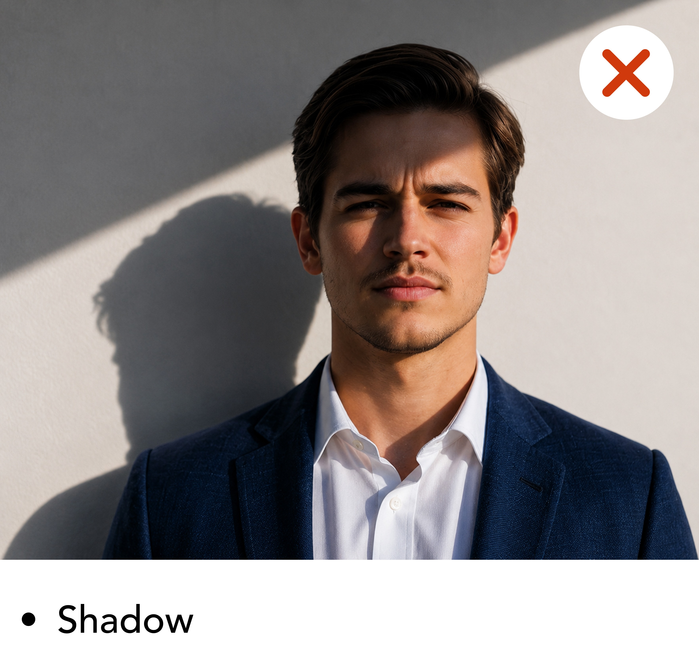
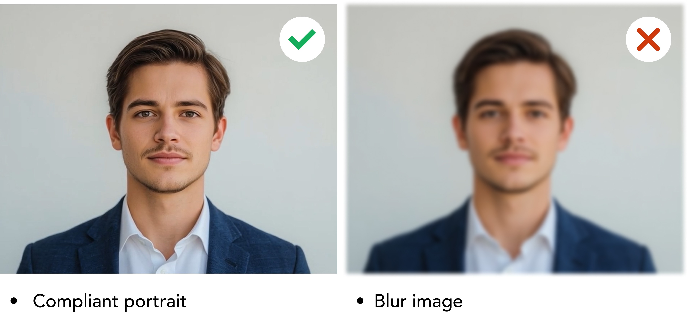
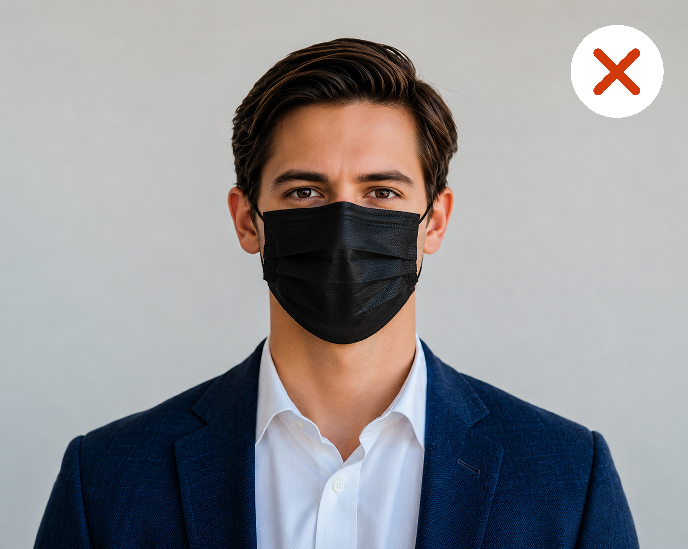

{/* Source: Intercom article 9886279 - https://oloid.help/en/articles/9886279-guidelines-for-face-enrollment-onboarding-images */}
{/* Generated by intercom_to_mintlify.py - re-running overwrites this file. */}

## Face Enrollment Guidelines

### Positioning

- **Face the Camera**: Look directly into the camera and ensure your face is centered in the frame.
- **Frame Your Face**: Position yourself so that there are 1-2 inch margins around your face, avoiding extreme angles and poses.
- Only one person should be present during face registration.

### Expressions

- **Neutral Expression**: Keep a neutral expression, avoiding exaggerated facial movements.
- **Remove Glasses**: If you are wearing dark glasses or tinted lenses, remove them to ensure both eyes are clearly visible.

### Lighting

- **Avoid Bright Backlighting**: To prevent shadows and glare, ensure the lighting is even. Avoid bright lights directly behind you.
- **Optimal Lighting Conditions**: Use soft, even lighting to enhance the clarity of your image.

### Focus & Movement

- **Image Clarity**: Ensure the captured image is sharp and not blurry, as image focus is crucial for accurate recognition.
- **Adjust Distance**: If the camera is having difficulty focusing, you might be too close or too far from the device.

These steps will help ensure a successful face enrollment process, resulting in accurate and reliable recognition.

## Guidelines for Face Onboarding

We recommend that you use the following guidelines when choosing reference images for facial onboarding.

1. Use an image of a face with both eyes open and visible. Make sure that the eyes of the user are open while taking the picture. Avoid pictures which show squinted eyes due to bright light.

   

2. Avoid images with multiple faces.

   

3. Avoid items, that can cover facial features, such as sunglasses, headbands and masks.

   

4. Use an image of a face that occupies a large proportion of the image. Images where the face occupies a larger portion of the image are matched with greater accuracy.
5. Use an image of a face that is not obscured or tightly cropped. The image should contain the full head and shoulders of the person. It should not be cropped to the face bounding box.

   

6. Use color images.
7. Use images with flat lighting on the face, as opposed to varied lighting such as shadows.

   

8. Use images that have sufficient contrast with the background. A high-contrast monochrome background works well.

   

9. Use images that are bright and sharp. Avoid using images that may be blurry due to subject and camera motion as much as possible.

   

### Images not recommended

|  **Image Description** | Examples |
| --- | --- |
| Images with multiple faces |  |
| Images with squinted eyes |  |
| Images with mask |  |
| Images with headband |  |
| Images with sunglasses |  |
| Images with shadow |  |
| Images with tilted face |  |
| Images with cropped face |  |
| Images with poor lighting |  |
| Images with cap/hat |  |
| Images with hat and dark sunglasses |  |
| Images with hairstyle covering face |  |
