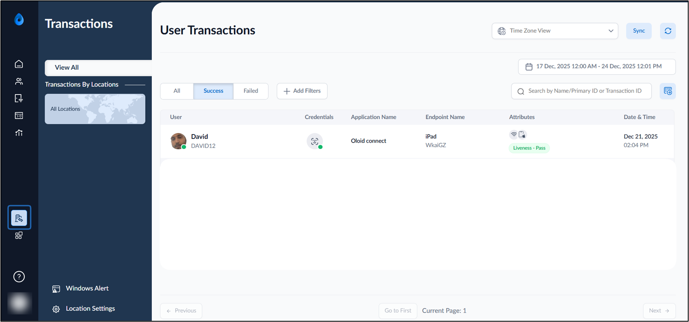
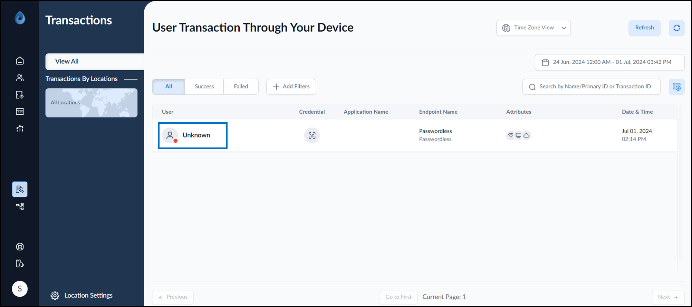
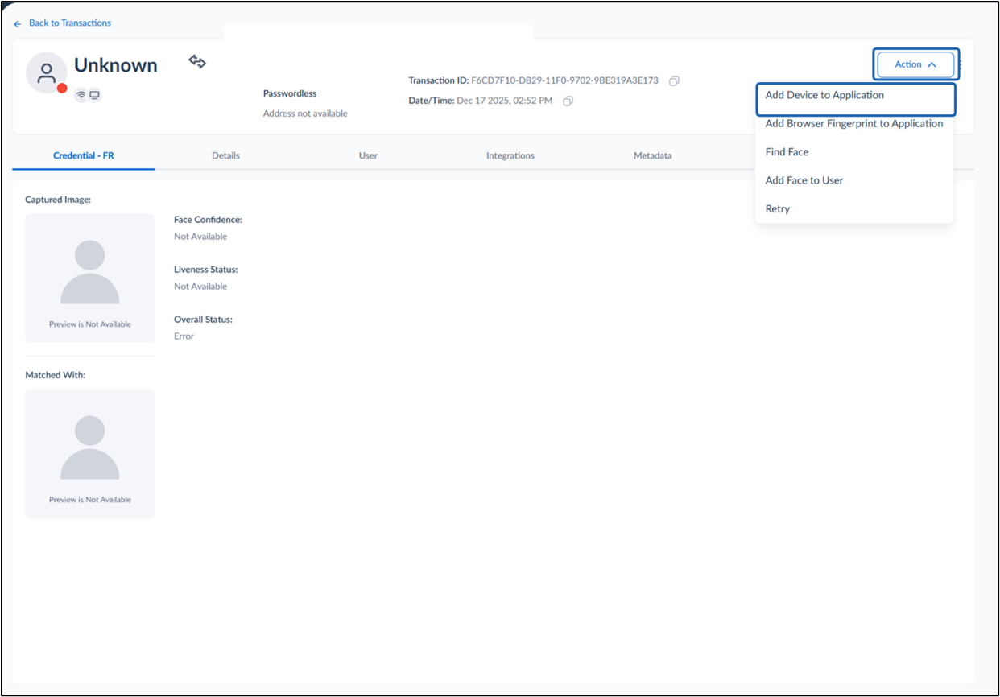
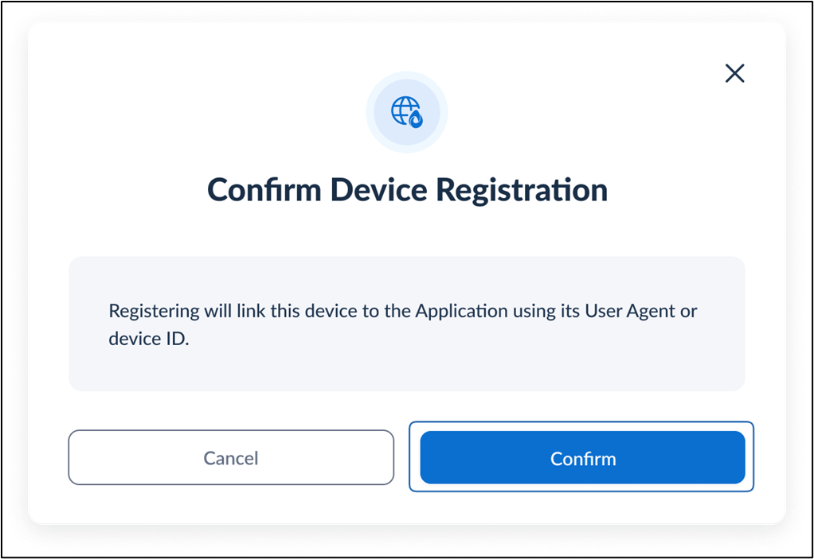
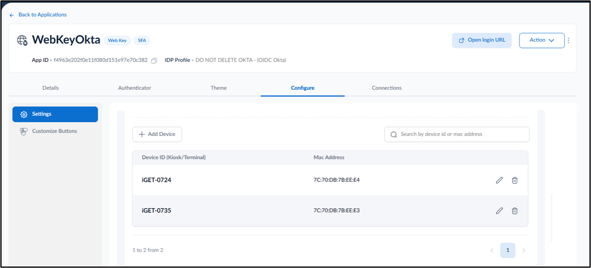

{/* Source: Intercom article 13175211 - https://oloid.help/en/articles/13175211-webkey-how-to-add-a-device-from-failed-transactions-in-the-tenant-admin-portal */}
{/* Generated by intercom_to_mintlify.py - re-running overwrites this file. */}

## Introduction

Enabling a Custom User Agent allows the tenant admin to register new devices directly from user transactions.

## Prerequisite

- You must have a tenant admin account.
- Custom User agent must be enabled.
  Devices can also be added to Webkey application from Oloid portal. For further information please refer: [How to configure Custom User Agent in WebKey Application](/platforms/web/webkey/webkey-how-to-configure-a-custom-user-agent-for-webkey)

## Steps to Add Device to Application

1. Log in to the **Tenant Admin Portal**.
2. Click **Transactions** from the left menu panel.

   

   The **User Transaction Through Your Device** page is displayed.
3. Selectthe latest transactionto edit.

   <Note>
     **Note:** Device can only be added from failed transaction.
   </Note>

   

4. On the top right, select **Action** > **Add Device to Application**.

   

5. On the Confirm Device Registration pop-up box, select **Confirm**.

   <Note>
     **Note:** Registering will link the device to the application using its User Agent or Device ID
   </Note>

   

The device is successfully added to the WebKey application.

