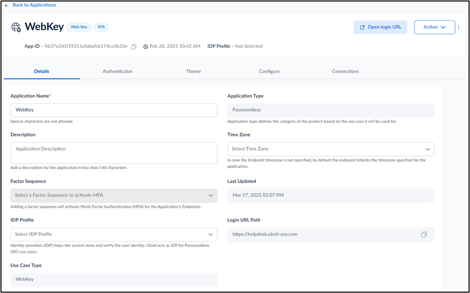
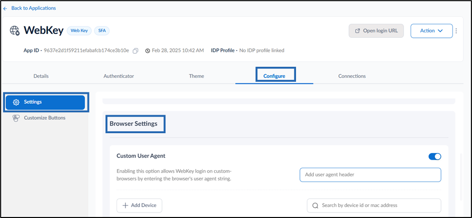
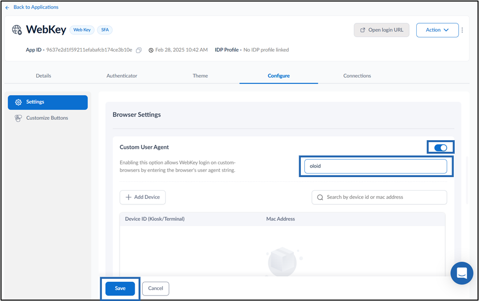
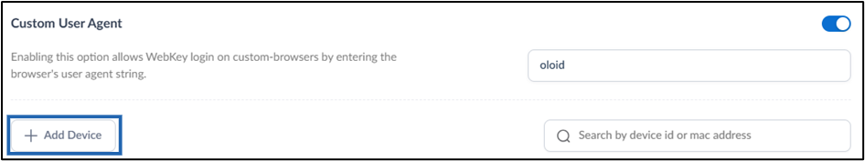
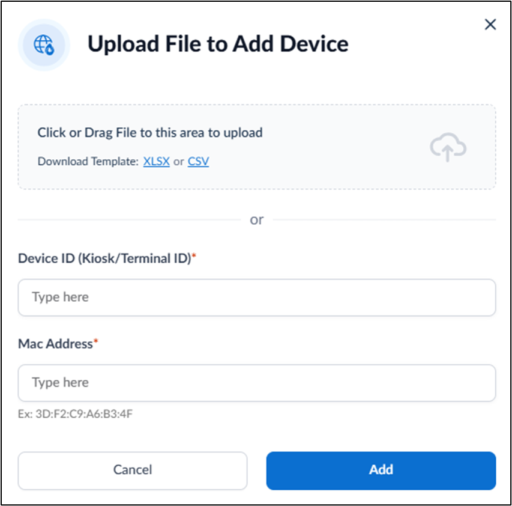
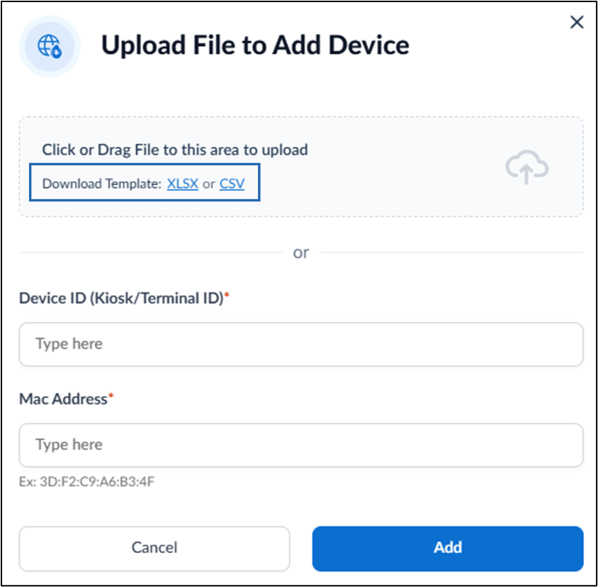
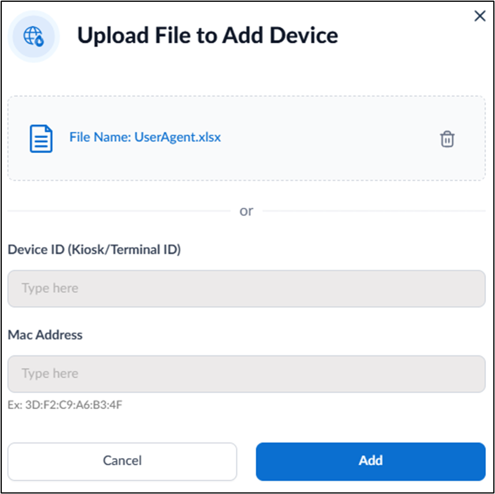
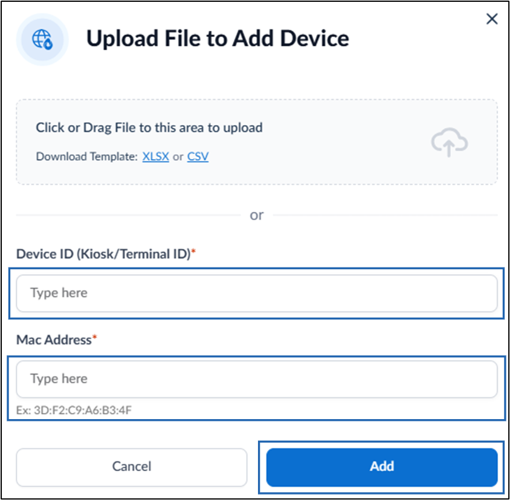
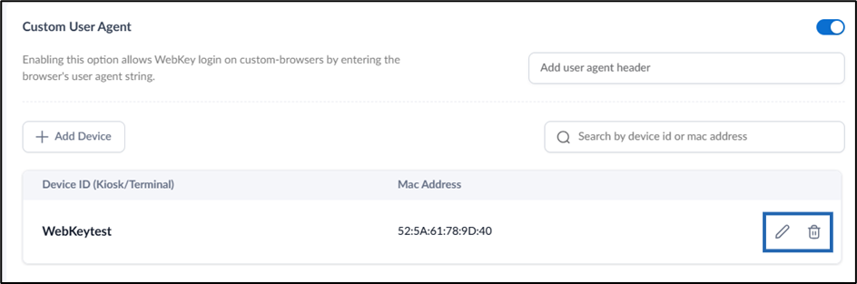

{/* Source: Intercom article 11659241 - https://oloid.help/en/articles/11659241-webkey-how-to-configure-a-custom-user-agent-for-webkey */}
{/* Generated by intercom_to_mintlify.py - re-running overwrites this file. */}

**Pre-requisite:**

You must create a Passwordless application of type WebKey. For further details, refer [How to create a WebKey application](/platforms/web/webkey/webkey-how-to-create-and-configure-a-webkey-application-in-tenant).

## Steps to configure Custom User Agent

1. Log in to the **Tenant Admin Portal**.
2. On the **Applications** page, click on the Webkey application to edit.

   

   The application page is displayed.

   

3. Go to **Configure tab** > **Settings** > **Browser Settings**.

   

4. Enable **Custom User Agent** to allow users to log in to WebKey app from custom browsers.
5. Enter the custom browser’s user agent name in **Type user agent header** field.
6. Click **Save**.

   <Note>
     **Note:** Agent browser should be configured for User agent. Reach out to [Oloid Support](mailto:support@oloid.ai) for details.
   </Note>

   

7. Click **Add Device**.

   

   The **Upload File to Add Device** Pop up box is displayed.

   

8. Do the following:
   1. [Bulk upload the devices](#bulk-upload-the-devices)
   2. [Add individual devices](#add-individual-devices)
      The Custom User Agent is configured for the added devices.

## Bulk upload the devices.

1. Drag and drop the **.XLSX** or **.CSV** file to bulk upload the devices.

   <Note>
     **Note:** You can download the templates by clicking on the respective download links.
   </Note>

   

   The XLSX or CSV template file is downloaded to your system.
2. Prepare the XLSX or CSV template file for upload.

   <Note>
     **Note:** To prepare the user upload template, refer [How to prepare User Upload Template](/platform/tenant-admin-portal/tenant-admin-portal-how-to-prepare-user-upload-template).
   </Note>

3. Drag and drop the file or click on the **Import .XLSX** or **.CSV file** area to upload your prepared XLSX or CSV file.

   

4. Select **Upload File**.

   

The file is uploaded in the **Upload** section.

## Add individual devices

1. Enter **Device ID (Kiosk/Terminal ID)**.
2. Enter **Mac Address**.
3. Click **Add**.

   

   The device is added successfully in the list with their Device ID and MAC Address. You can update deviceinformation or remove the device:
   - **Edit Device information** – Select the pencil icon to update the device information.
   - **Remove Device** – Select the trash icon to remove the device from the list.

     
