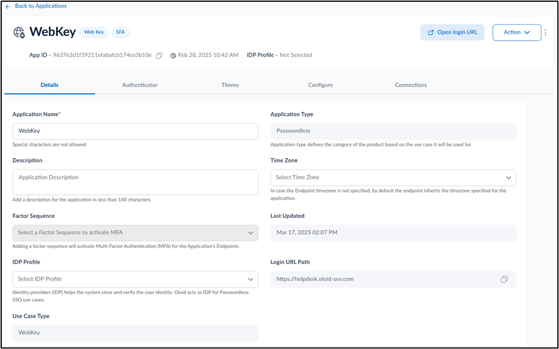
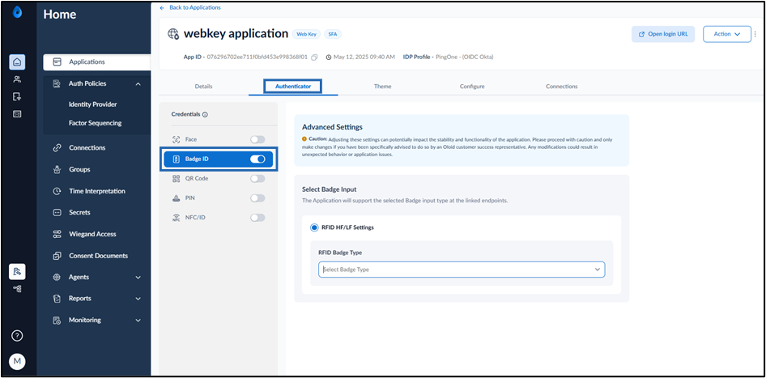
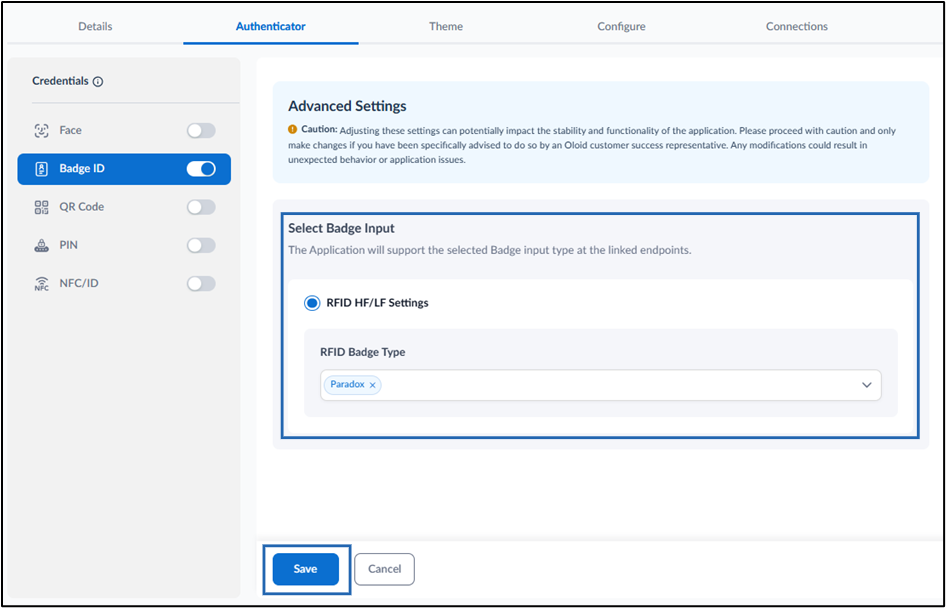
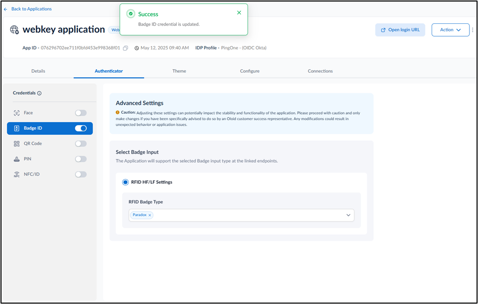

{/* Source: Intercom article 11494069 - https://oloid.help/en/articles/11494069-webkey-how-to-configure-badge-id-credential-for-webkey-in-the-tenant-admin-portal */}
{/* Generated by intercom_to_mintlify.py - re-running overwrites this file. */}

**Introduction**

The Badge credential feature in the Tenant Admin Portal allows admin to enable badge for the WebKey application. Once enabled, Users can authenticate to the Webkey application by scanning their badge.

**Steps to configure Badge ID credential:**

1. Log in to the **Tenant Admin Portal**. For more details, refer [How to log in to the Tenant Admin Portal](/platform/tenant-admin-portal/tenant-admin-portal-how-to-log-in-to-the-tenant-admin-portal).
2. On the **Applications** page, select the Webkey application to edit.

   

   The application page is displayed.

   

3. Go to **Authenticator** tab**.**
4. Turn on **Badge ID** toggle.

   

5. Select a **RFID Badge Type** from the dropdown list.
6. Click **Save**.

   

   Badge authenticator for WebKey application is configured successfully.

   
