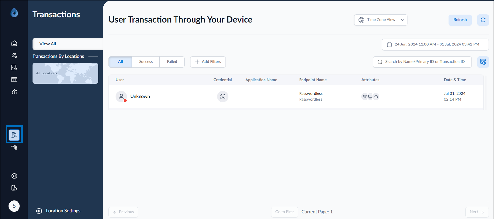
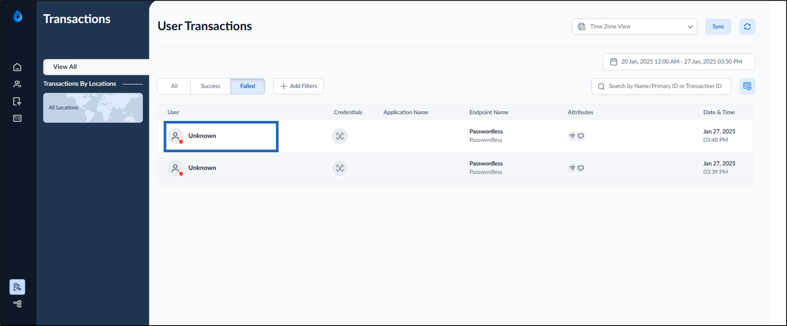
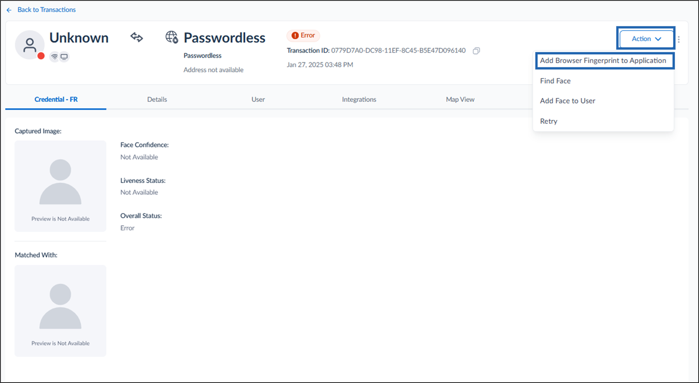
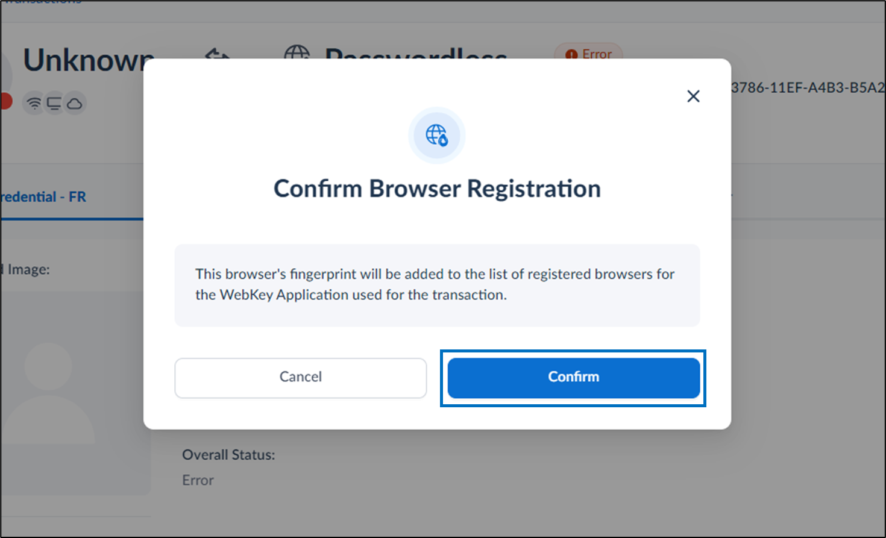
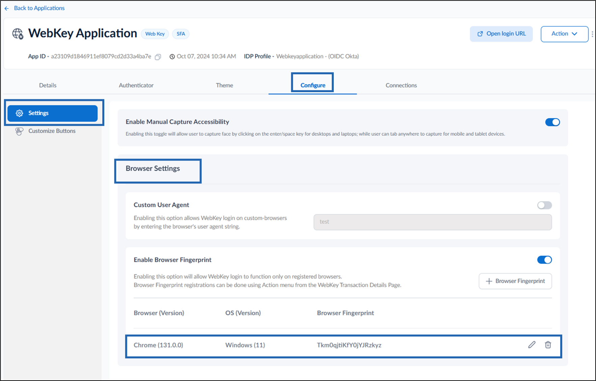

{/* Source: Intercom article 9545445 - https://oloid.help/en/articles/9545445-webkey-how-to-configure-browser-fingerprint-from-failed-transactions-in-the-tenant-admin-portal */}
{/* Generated by intercom_to_mintlify.py - re-running overwrites this file. */}

## Introduction

Browser fingerprint allows Webkey log in to function only on registered browsers.

## Prerequisites

- You must have a Tenant Admin account.
- **Enable Browser Fingerprint** toggle must be switched on.

Browser Fingerprint can also be added to Webkey application from Oloid portal. For further information please refer: [Oloid WebKey - How to edit Configure tab](/platforms/web/webkey/webkey-how-to-edit-configure-tab)

## Steps to configure Browser Fingerprint

1. Log in to the **Oloid Portal**.
2. Click **Transactions** from the left menu panel.

   

   The **User Transactions** page is displayed.
3. Selectthe latest transactionto edit.

   <Note>
     **Note:** Browser Fingerprint can only be added from failed transaction.
   </Note>

   

4. On the top right, select **Action** > **Add Browser Fingerprint to Application**.

   

5. On the **Confirm Browser Registration** pop-up box, select **Confirm**.

   

   The browser fingerprint is successfully added to the WebKey application.

To view the browser fingerprint details, go to **Applications** > edit **WebKey application** > **Configure** tab > **Settings** > **Browser Settings**.

<Note>
  **Note:** It is recommended to use Transactions menu to add browser fingerprint. In case the browser is not registered, manually add the browser details in **Application** detail page.
</Note>
