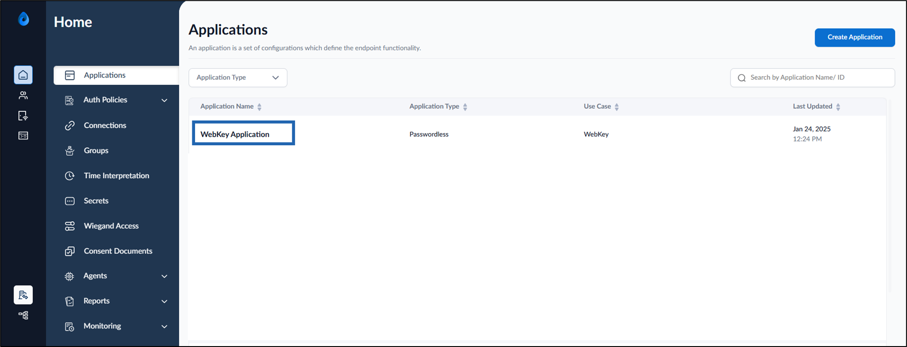
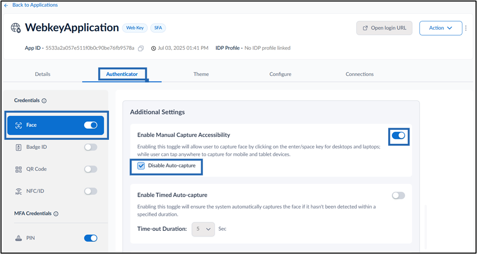
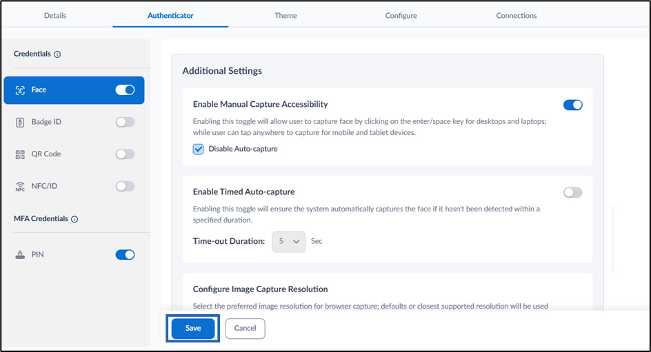
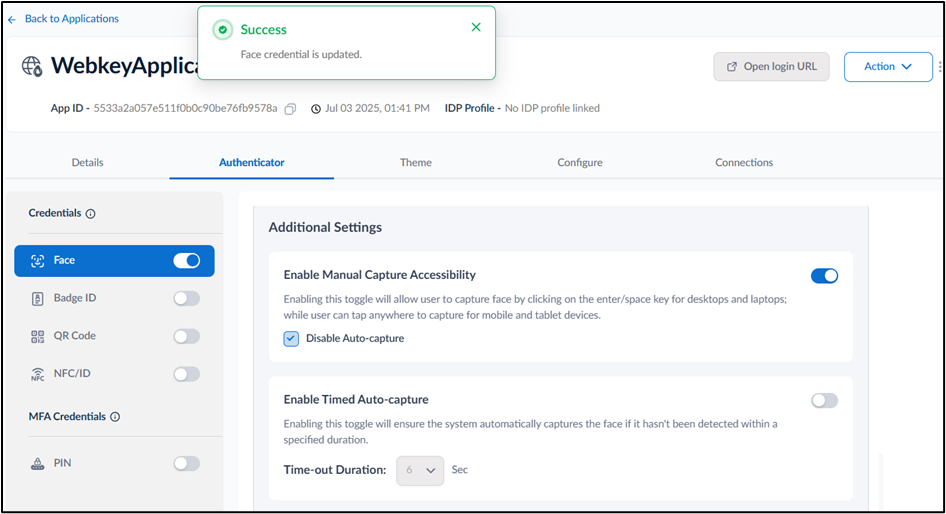

{/* Source: Intercom article 10454903 - https://oloid.help/en/articles/10454903-webkey-how-to-configure-manual-face-capture-for-webkey */}
{/* Generated by intercom_to_mintlify.py - re-running overwrites this file. */}

## Introduction

In Tenant Admin Portal, enabling manual face capture feature allows user to manually capture the face when using the Webkey application. User must click the shutter button or press Enter or Spacebar to capture the face.

## Prerequisite

The user must be a Tenant Admin to configure manual capture.

## Steps to configure manual capture

1. Log in to **Tenant Admin Portal**.
2. On the homepage, select **WebKey** application.

   

   The **WebKey details** page is displayed.
3. Go to **Authenticator** tab > **Face** Tab >**Additional Settings** > Turn on **Enable Manual Capture Accessibility** toggle button.
4. Select **Disable Auto-capture** to disable automatic face capture.(Optional)

   

5. Click **Save**.

   

   The manual capture is configured successfully.

   

Once manual capture is configured, users can manually capture their face using:

- **Enter** or **Space bar** on desktops and laptops.
- **Tap anywhere** on the screen for mobile and tablet devices.
