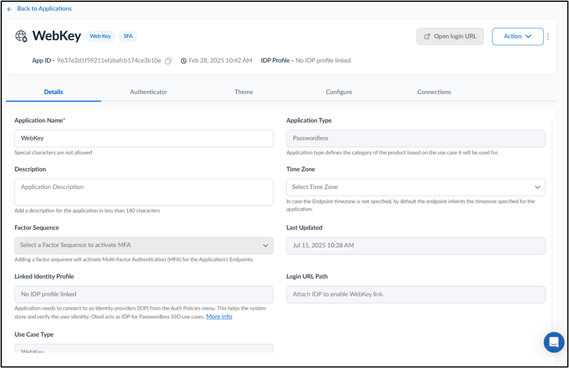
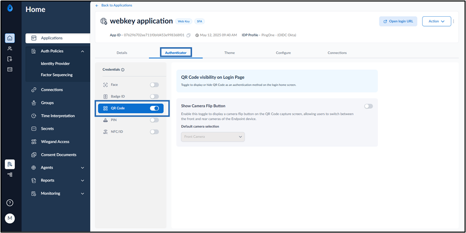
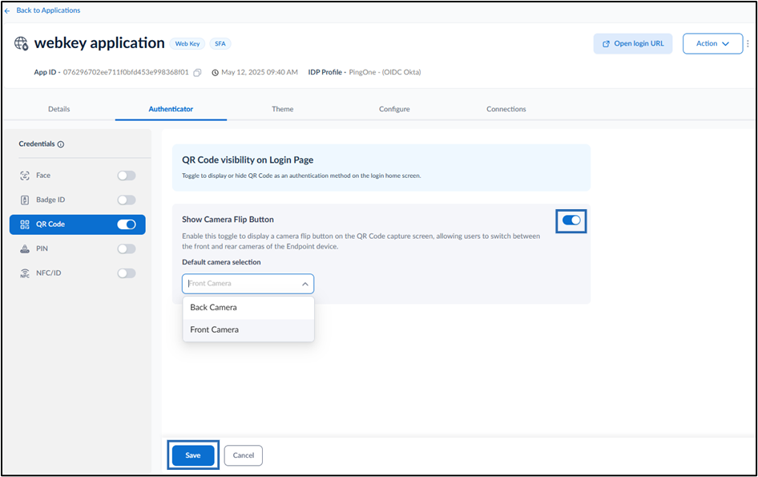
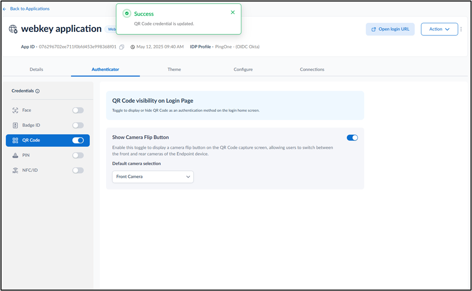

{/* Source: Intercom article 11494129 - https://oloid.help/en/articles/11494129-webkey-how-to-configure-qr-code-credential-for-webkey-in-the-tenant-admin-portal */}
{/* Generated by intercom_to_mintlify.py - re-running overwrites this file. */}

**Introduction**

The QR Code credential feature in the Tenant Admin Portal allows admin to enable QR code-based multi-factor authentication (MFA) for the WebKey application. Once enabled, Users can authenticate to the Webkey application by scanning a QR code.

## Steps to configure QR Code credential

1. Log in to the **Tenant Admin Portal**. For more details, refer [How to log in to the Tenant Admin Portal](/platform/tenant-admin-portal/tenant-admin-portal-how-to-log-in-to-the-tenant-admin-portal).
2. On the **Applications** page, select the Webkey application to edit.

   

   The application page is displayed.

   

3. Go to **Authenticator tab.**
4. Turn on **QR Code** toggle.

   

5. Enable **Show Camera Flip button** to allow users to switch between the front and rear cameras.
   This option displays a camera flip button on the preview screen during QR code scanning.
   Under **Default camera selection**, select a camera option:
   - **Back Camera**
   - **Front Camera**

     <Note>
       **Note:** This feature is available only for iOS devices and Android devices.
     </Note>

6. Click **Save.**

   

   QR Code authenticator for Webkey application is configured successfully.

   
